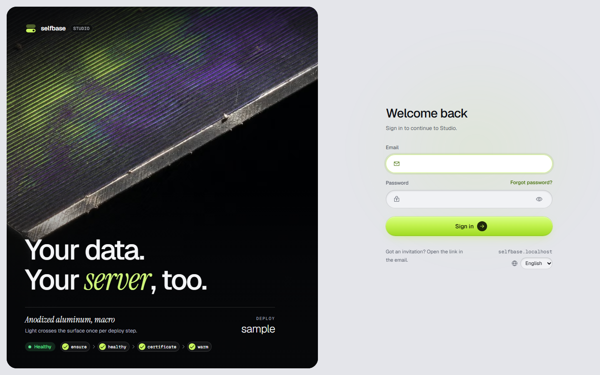
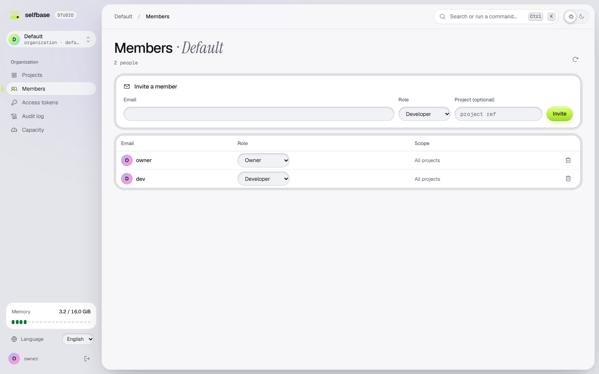
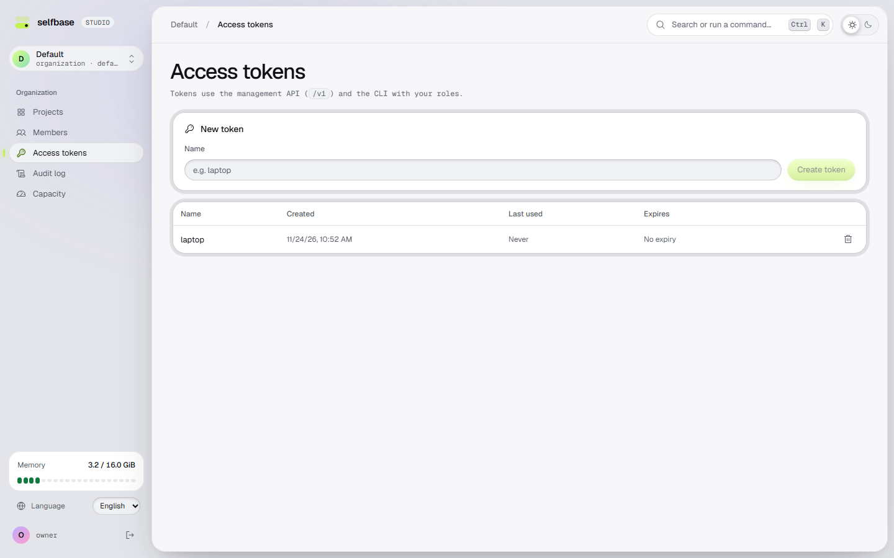
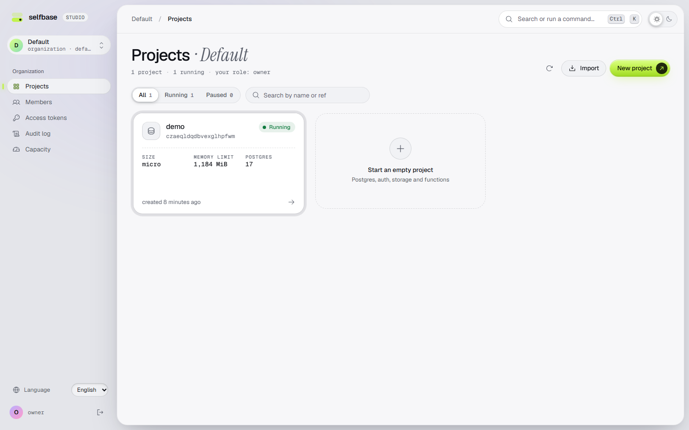
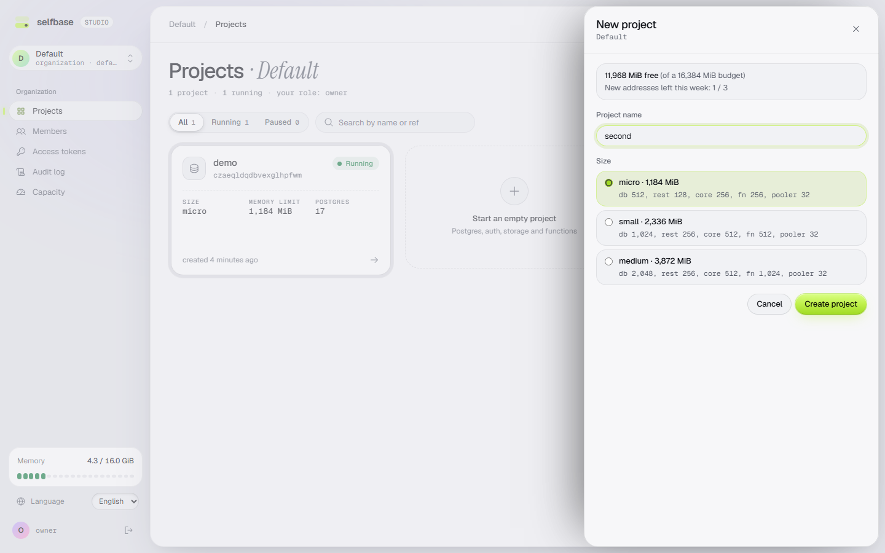
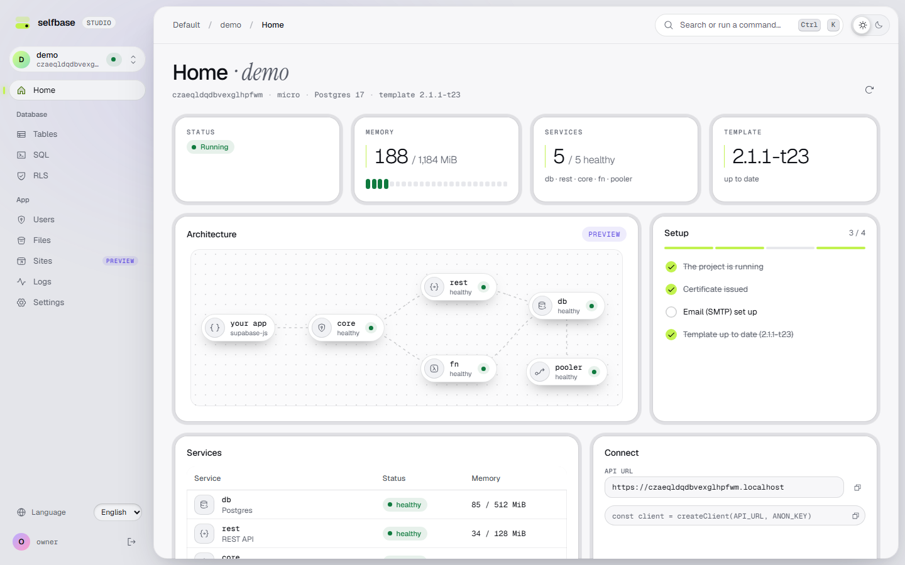
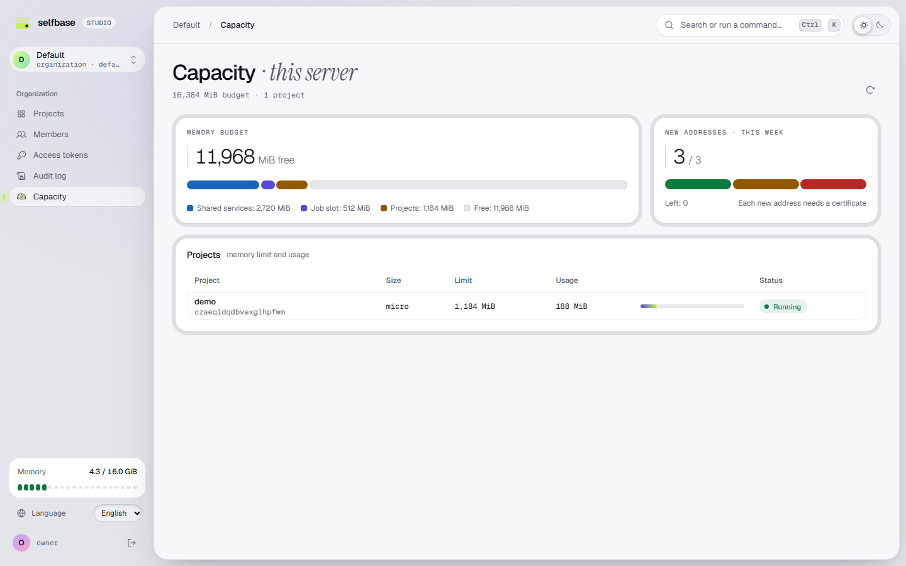
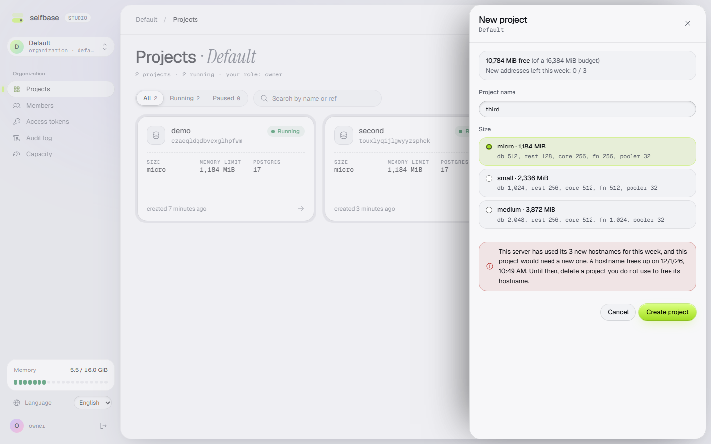
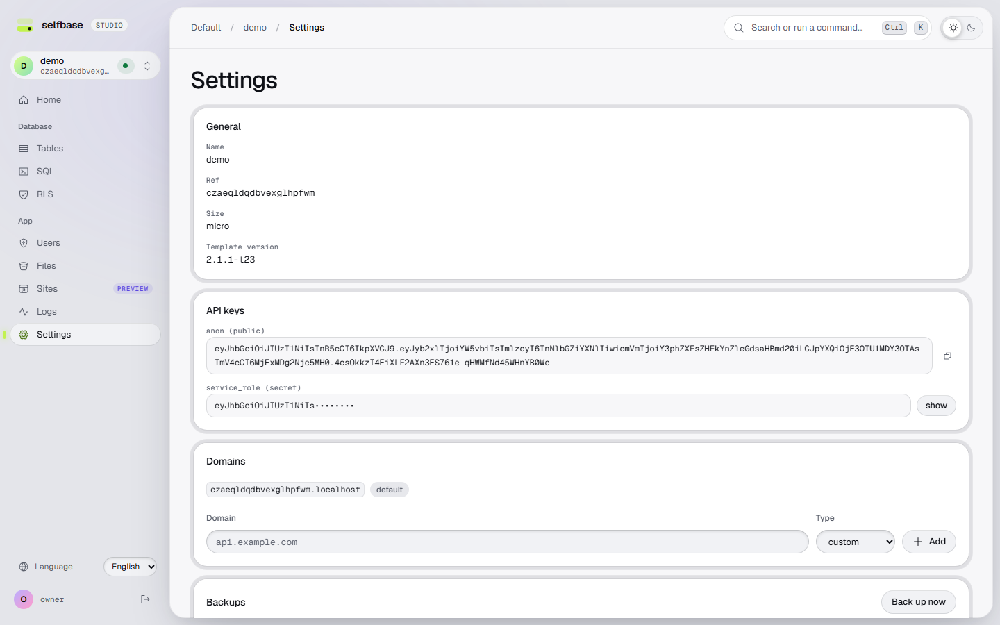
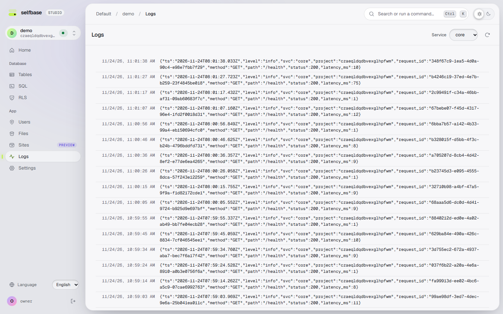

# selfbase rehberi

Bu rehber selfbase platformunu işletecek kişi için yazıldı: bugün paylaşımlı Coolify sunucusunda çalışan
kurulumu anlaman, günlük işleri yapman ve bir gün her şeyi kendi sunucuna taşıman için. Her adımda üç şey
var: **ne** yapıyorsun, **neden** yapıyorsun ve **ne görmen gerekiyor**. Gördüğün şey farklıysa ne
yapacağın da yazıyor.

Rehberde hiçbir gizli değer, sunucu adresi ya da gerçek proje adı yok. Yer tutucular:

| Yer tutucu | Anlamı |
|---|---|
| `<BASE>` | Temel alan adı. Paylaşımlı sunucuda `<ip>.sslip.io`, kendi alan adında ör. `ornek.com`. |
| `<ip>` | Sunucunun genel IP adresi |
| `<ref>` | Bir projenin 20 küçük harflik kimliği |
| `<sürüm>` | Bir selfbase sürümü, ör. `2.1.1` (etiketi `v2.1.1`) |
| `<REGISTRY>` | İmaj adlarının ön eki, ör. `ghcr.io/<owner>` |
| `<e-posta>` | Senin e-posta adresin |

> **Repo herkese açık.** Bu rehbere, commit'lere, ekran görüntülerine ve kanıt dosyalarına sunucunun IP'si,
> gerçek alan adları, e-posta adresleri, token'lar, sertifika seri numaraları ve gerçek proje ref'leri
> girmez. Bir şey yazmadan önce `<BASE>`, `<ip>`, `<ref>` ile değiştir.

Komutların başında hangi kabukta çalıştığı yazıyor:
- **root (sunucu)**: sunucuda `sudo -i` ile açılmış root kabuğu. `/opt/selfbase` altındaki her şey root'a
  ait ve sadece root okuyabiliyor. Bu yüzden sunucu komutlarının hepsi root olarak çalışır.
- **PowerShell**: kendi Windows bilgisayarın.
- **Git Bash**: Windows'ta, Git ile gelen bash. Taşıma script'leri (`scripts/migrate/*.sh`) bash ister.

> **Bilmen gerekenler (kısa liste, ayrıntısı ilgili bölümde)**
>
> 1. **Ana anahtarın (`master_key`) çevrimdışı bir kopyası olmalı.** Kaybolursa bütün projelerin sırları
>    kaybolur ve geri getirilemez (bölüm 3, adım 7).
> 2. **Registry yok. İmajlar sunucuda, sürüm etiketinden derleniyor.** Coolify'ın temizlik işi kullanılmayan
>    imajları silebilir. Ayarı "sadece disk eşiğinin üstünde" kalmalı (bölüm 12).
> 3. **sslip.io'da haftada en fazla 3 yeni adres.** Dalga 1 üçünü de kullandı. İlk hak
>    2026-11-30'da açılıyor (bölüm 7).
> 4. **Yedekler aynı sunucuda.** Sunucu giderse yedek de gider (bölüm 9).
> 5. **E-posta (SMTP) kapalı.** Davet bağlantısını Studio gösterir. Şifre sıfırlama bağlantısını sunucudan
>    sen okursun (bölüm 5).
> 6. **Kendi sunucuna geçişte dört adım hiç denenmedi** (bölüm 4'teki kutu).
> 7. **Paylaşımlı sunucu kuralı:** başka takımların container'larına, `coolify-proxy`'ye, `coolify` ağına
>    ve Docker'ın ayar dosyasına dokunma. selfbase sadece `selfbase-*` ve `sb-*` adlı nesnelerini yönetir.
> 8. **Çalışan bir kurulumda `BASE_DOMAIN`'i değiştirme.** Desteklenmiyor ve bütün projeleri bozar (bölüm 7).

## İçindekiler

1. [Büyük resim](#1-büyük-resim)
2. [Repo haritası](#2-repo-haritası)
3. [Kontrol yığınını Coolify sunucusuna kurma](#3-kontrol-yığınını-coolify-sunucusuna-kurma)
4. [Kendi sunucunda kurma](#4-kendi-sunucunda-kurma)
5. [Studio: hesaplar, roller, erişim token'ları](#5-studio-hesaplar-roller-erişim-tokenları)
6. [Projeler](#6-projeler)
7. [Alan adları ve sertifikalar](#7-alan-adları-ve-sertifikalar)
8. [Sırlar](#8-sırlar)
9. [Yedekler, dışa ve içe aktarma](#9-yedekler-dışa-ve-içe-aktarma)
10. [Günlükler](#10-günlükler)
11. [Yeni sürüme güncelleme](#11-yeni-sürüme-güncelleme)
12. [Coolify ile birlikte yaşamak](#12-coolify-ile-birlikte-yaşamak)
13. [Bu dalgada olmayanlar ve bilinen kısıtlar](#13-bu-dalgada-olmayanlar-ve-bilinen-kısıtlar)
14. [Sorun giderme](#14-sorun-giderme)
15. [Kaldırma ve sunucuda kalanlar](#15-kaldırma-ve-sunucuda-kalanlar)
16. [Yerelde tek proje çalıştırma](#16-yerelde-tek-proje-çalıştırma)
17. [Supabase'den veri taşıma](#17-supabaseden-veri-taşıma)
18. [Uygulamayı bağlama](#18-uygulamayı-bağlama)
19. [Ekibin yeni migration'larını alma (sync)](#19-ekibin-yeni-migrationlarını-alma-sync)

---

## 1. Büyük resim

### Ne bu?

selfbase, tek bir sunucuda birçok backend projesi çalıştıran küçük bir platform. Her proje kendi
veritabanını, kendi API'sini, kendi anahtarlarını ve kendi adresini (`https://<ref>.<BASE>`) alır. Projeleri
**Studio** adlı web panelinden oluşturur, duraklatır, yedekler ve silersin.

Uygulama tarafında kod neredeyse hiç değişmez: uygulama `@supabase/supabase-js` import etmeye devam eder,
derleme aracı bu import'u selfbase'in kendi istemcisine (`selfbase-js`) yönlendirir (bölüm 18). Aynı adresler
(`/rest/v1`, `/auth/v1`, `/storage/v1`, `/realtime/v1`, `/functions/v1`) ve aynı cevap biçimleri korunur.
Yani selfbase supabase-js ile çalışır ama hiçbir `@supabase/*` paketi ya da `supabase/*` Docker imajı
çalıştırmaz.

### İki yığın

Sunucuda iki tür yığın (stack) var:

- **Kontrol yığını**: bir tane. Studio, yönetim API'si, hesaplar ve Docker'la konuşan parça. Kurduğun tek
  şey bu (`control/compose.yml`).
- **Proje yığını**: her proje için bir tane. Kontrol yığını onları kendisi kurar, günceller, durdurur ve
  siler. Coolify'da görünmezler.

```
                       İnternet
                          │ 80/443
         ┌────────────────┴─────────────────┐
         │ Traefik: coolify-proxy, ya da     │  isteği Host adına göre yönlendirir,
         │ kendi sunucunda selfbase-traefik  │  kuralları container etiketlerinden okur
         └───┬──────────────────────────┬───┘
             │ selfbase.<BASE>          │ <ref>.<BASE>
┌────────────┴────────────┐   ┌─────────┴──────────────────────────┐
│ KONTROL YIĞINI (tek)    │   │ PROJE YIĞINI (her projeye bir)      │
│ selfbase-control        │──▶│ sb-<ref>-core   :8080 dışarı açık   │
│   Studio + API          │   │                 :8081 yönetim, kapalı│
│ selfbase-control-db     │   │ sb-<ref>-rest   PostgREST           │
│ selfbase-provisioner ─┐ │   │ sb-<ref>-fn     Deno fonksiyonlar   │
│ selfbase-socket-proxy ◀┘ │   │ sb-<ref>-db     Postgres 17         │
│   └─▶ Docker            │   │ sb-<ref>-pooler PgBouncer           │
│ selfbase-logs           │   │ ağ: sb-<ref> (kendi /27'si)          │
└─────────────────────────┘   └────────────────────────────────────┘
```

**Kontrol yığını**

| Container | Ne yapar | Neden |
|---|---|---|
| `selfbase-control` | Studio'yu sunar. `/platform` (Studio'nun API'si) ve `/v1` (yönetim API'si) burada. Hesapları, rolleri, işleri (job) ve her 30 saniyede bir çalışan uzlaştırma (reconcile) döngüsünü yürütür. Duraklatılmış projelerin adresine `540` cevabı da buradan gelir. | İnternete bakan tek kontrol parçası. Docker'a doğrudan erişimi yok. |
| `selfbase-control-db` | Postgres. Hesaplar, organizasyonlar, projeler, şifreli proje sırları, iş kayıtları, denetim kaydı. | "Ne olmalı" bilgisinin tek kaynağı. |
| `selfbase-provisioner` | Docker'la konuşan tek servis. Sadece tipli işlemler sunar: "şu projeyi şu sürümle kur", "durdur", "sil", "yedek işi çalıştır". Container tanımını kendisi şablondan kurar. | control ele geçirilse bile şablonun izin verdiğinden fazlasını yaptıramasın. `Privileged`, host bağlama (bind mount) ya da yetki ekleme hiç kullanılmaz. |
| `selfbase-socket-proxy` | Docker soketini bağlayan tek container. Provisioner'dan gelen ve sadece `sb-*` adlı nesnelere giden izinli çağrıları geçirir. `exec`, `build`, `prune` yok. | İkinci duvar: provisioner'da bir hata olsa bile zarar `sb-*` nesneleriyle sınırlı kalsın. |
| `selfbase-logs` | VictoriaLogs. Proje container'larının günlüklerini toplar (14 gün ya da 5 GiB). | Studio'nun Günlükler ekranı buradan okur. |
| `selfbase-traefik`, `selfbase-traefik-socket-proxy` | Sadece kendi sunucunda (`PROXY_MODE=own`): 80/443'ü dinleyen Traefik ve onun salt okunur soket vekili. | Coolify yokken HTTPS'i ve sertifikaları bunlar sağlar. |

**Proje yığını**

| Container | Ne | Neden böyle |
|---|---|---|
| `sb-<ref>-db` | Postgres 17 + PostGIS + pgvector + pg_cron | Supabase uyumlu şemalar (`auth`, `storage`, `vault`, `net`), roller ve `auth.uid()` gibi fonksiyonlar `db/platform/*.sql`'de. core her açılışta eksik olanları uygular, `selfbase.platform_migrations`'a yazar. Uygulamanın migration'ları ve RLS policy'leri değişmeden çalışır. |
| `sb-<ref>-rest` | PostgREST 14 | `.from()` ve `.rpc()` buradan geçer. JWT'deki `role` ile RLS uygulanır. |
| `sb-<ref>-core` | Node servisi (Hono) | auth, storage, realtime ve ağ geçidi. **8080** dışarı açık tek port. **8081** yönetim portu: süper kullanıcıyla SQL çalıştırır, hiçbir zaman proxy'ye bağlanmaz. control ona proje ağından, projenin yönetim token'ıyla ulaşır. |
| `sb-<ref>-fn` | Deno fonksiyon sunucusu | `/functions/v1/<ad>`. Fonksiyon dağıtımı dalga 2'de (bölüm 13). |
| `sb-<ref>-pooler` | PgBouncer (transaction modu) | Çok sayıda kısa bağlantıyı az sayıda veritabanı bağlantısına toplar. |

Her projenin kendi ağı (`sb-<ref>`) var ve bu ağ `PROJECT_SUBNET_POOL`'dan kesilmiş sabit bir /27 alır.
Projeler birbirinin veritabanına ve yönetim portuna ulaşamaz. Sadece `core` ayrıca proxy ağında
durur, çünkü Traefik ona oradan ulaşır. Volume'ler: `sb-<ref>-pgdata` (veritabanı), `sb-<ref>-storage`
(yüklenen dosyalar), `sb-<ref>-functions`, `sb-<ref>-denocache`.

### Neden Docker'a doğrudan konuşuyoruz?

Projeleri Coolify'ın API'siyle de kurabilirdik. Yapmadık, çünkü:

- **Taşınabilirlik.** Aynı kontrol yığını Coolify olmayan bir sunucuda da çalışır (bölüm 4). Coolify'a bağlı
  olsaydı kendi sunucuna geçmek her şeyi yeniden yazmak demekti.
- **Hız ve sınırlar.** Proje Studio'dan bir iki dakikada kurulur. Bellek sınırını, ağı ve etiketleri her
  container için biz koyarız.
- **Kontrol kapalıyken de çalışmak.** Projeler control'den ayar çekmez. Ayarları container'a kurulurken
  ortam değişkeni olarak verilir. control durursa projeler çalışmaya devam eder: dalga 1'de kontrol yığını
  60 saniye durdurulmuşken projeye yapılan 29 isteğin hepsi 200 döndü.
- **Güvenlik iki katmanlı.** Docker soketine sahip olmak sunucuda root olmak demek. Bu yüzden soketi sadece
  socket-proxy görür. Ona da sadece provisioner, sadece `sb-*` adları için ulaşır.

### Proje durumları

| Durum | Anlamı |
|---|---|
| `COMING_UP` | Kuruluyor ya da sertifikası henüz gelmedi. |
| `ACTIVE_HEALTHY` | Çalışıyor, sağlıklı, sertifikası var. |
| `ACTIVE_UNHEALTHY` | Çalışması gerekiyor ama bir servis sağlıksız. |
| `PAUSING`, `INACTIVE` | Duraklatılıyor / duraklatıldı. Container'lar durur, veri kalır. |
| `RESTORING` | Devam ettiriliyor ya da içe aktarılıyor. |
| `UPGRADING`, `RESTARTING` | Yeni sürüme geçiyor / yeniden başlatılıyor. |
| `GOING_DOWN`, `REMOVED` | Siliniyor / silindi. |
| `INIT_FAILED`, `PAUSE_FAILED`, `RESTORE_FAILED`, `REMOVE_FAILED` | O iş başarısız oldu (bölüm 14). |

Kavramlar (bir kez açıklıyorum, sonra İngilizce kullanıyorum):
- **container**: kendi dosya sistemi olan, izole çalışan süreç. **volume**: container silinse de duran veri
  klasörü. **network**: container'ların birbirini bulduğu sanal ağ.
- **job (iş)**: uzun süren bir işlem (kurma, yedek, içe aktarma). control-db'de bir satır. Adımları
  tekrarlanabilir, control yeniden başlarsa kaldığı yerden devam eder.
- **reconcile**: control'ün her 30 saniyede bir "olması gereken" ile "olan"ı karşılaştırıp farkı
  kapatması (eksik container'ı kurar, proxy ağından düşeni geri bağlar).
- **migration**: veritabanı şemasını değiştiren SQL dosyası. **RLS** ve **policy**: Postgres'in "bu
  kullanıcı bu satırı görebilir mi" kuralları.
- **health check**: Docker'ın bir container'a düzenli sorduğu "çalışıyor musun?" sorusu.

---

## 2. Repo haritası

Repo tek bir npm workspaces monoreposu. Bütün imajlar aynı sürüm numarasını taşır.

| Yol | İçerik |
|---|---|
| `package.json` | Workspace'ler: `core`, `control`, `provisioner`, `studio`, `client`, `acceptance`. Kökte tek lockfile. |
| `control/` | Kontrol düzlemi (Studio'nun API'si, işler, reconcile). `compose.yml` kontrol yığını, `.env.example` her ayarın açıklaması, `traefik-socket-proxy.env`. |
| `provisioner/` | Docker'la konuşan servis. `socket-proxy.env`: socket-proxy'nin izin listesi. |
| `studio/` | Studio (React). control imajının içinde derlenir. İngilizce ve Türkçe. |
| `template/` | Proje şablonu: `compose.yml` (beş servis), `sizes.json` (boyutlar), `compose.build.yml` ve `compose.local.yml` (sadece yerel), `.env.example` (yerel tek proje). |
| `db/` | Postgres imajı ve `platform/*.sql` (core'un uyguladığı platform migration'ları). |
| `core/` | auth, storage, realtime, yönetim API'si, ağ geçidi. |
| `fn/` | Deno fonksiyon sunucusu. |
| `rest/`, `pooler/` | PostgREST ve PgBouncer imajları. |
| `job/` | Yedek ve geri yükleme işlerinin imajı (`backup.sh`, `restore.sh`). |
| `client/` | `selfbase-js`, supabase-js yerine geçen istemci. `client/dist/` derlenmiş hâli, repoda. |
| `acceptance/` | Kurulmuş bir projeye karşı çalışan kabul testleri (`acceptance/README.md`). |
| `scripts/` | `gen-keys.mjs`, `install-check.mjs`, `import-project.mjs`, `sync.mjs`, `migrate/` (Supabase'den taşıma). |
| `docs/` | Bu rehber, `proofs/` (dalga kanıtları), `screens/v2/` (Studio ekranları), `auth-settings.md`, `functions-status.md`. |
| `.github/workflows/` | `ci.yml` ve `images.yml`: sekiz imajın listesi. GitHub Actions faturalandırma yüzünden şu an kapalı (bölüm 3, adım 4). |

---

## 3. Kontrol yığınını Coolify sunucusuna kurma

Bu bölüm dalga 1'de paylaşımlı sunucuda yapılan kurulumu adım adım anlatır (`PROXY_MODE=coolify`).
Yeniden kurman gerekirse ya da başka bir Coolify sunucusuna kuracaksan bunu izle. Kurulum sonunda dizin
şöyle olur:

```
/opt/selfbase/                 0700 root
├── .env                       0600 root   ayarlar (sır yok)
├── control/compose.yml                    kontrol yığını
├── control/traefik-socket-proxy.env
├── provisioner/socket-proxy.env           compose bunu ../provisioner/ altında arar
├── secrets/                   0700 root   dört sır dosyası, 0640 root:10001
├── backups/                   0711 root   yedekler, dışa aktarmalar, içe aktarma alanı
├── proofs/                    0700 root   kanıt listeleri ve yardımcı script'ler
└── src/                                   sürüm etiketinin kopyası (imajlar buradan derlenir)
```

**1. Sunucu bilgilerini oku.** (root, sunucu) Hiçbir şeyi değiştirmeyen okuma komutları:

```bash
docker inspect coolify-proxy --format '{{json .Config.Cmd}}' | tr ',' '\n' | grep -E 'entrypoints\.[a-z0-9]+\.address|certificatesresolvers\.[a-z0-9]+\.acme\.(httpchallenge|storage)'
docker inspect coolify-proxy --format '{{range $k,$v := .NetworkSettings.Networks}}{{$k}} {{end}}'
docker inspect coolify-proxy --format '{{index .Config.Labels "org.opencontainers.image.version"}}'
docker info -f '{{.CgroupDriver}} {{.CgroupVersion}}'
stat -c %g /var/run/docker.sock
docker network inspect $(docker network ls -q) --format '{{.Name}} {{range .IPAM.Config}}{{.Subnet}} {{end}}'
ss -lnuH | grep ':5514 ' || echo "5514/udp boş"
```

Ne arıyorsun:

| Çıktı | Örnek | Hangi ayar |
|---|---|---|
| `--entrypoints.http.address=:80`, `--entrypoints.https.address=:443` | `http`, `https` | `PROXY_ENTRYPOINT_HTTP`, `PROXY_ENTRYPOINT_HTTPS` |
| `--certificatesresolvers.letsencrypt.acme...` | `letsencrypt` | `PROXY_CERTRESOLVER` |
| Proxy'nin ağları | `coolify` (ve Coolify kaynaklarının ağları) | `PROXY_NETWORK=coolify` |
| İmaj sürümü | `3.6.22` | `PROXY_TRAEFIK_MAJOR=3` |
| cgroup | `systemd 2` | `selfbase.slice` kullanılabilir (adım 9) |
| Soketin grubu | bir sayı | `DOCKER_SOCKET_GID` |
| Alt ağlar | hiçbiri `10.207.` ile başlamıyor | `PROJECT_SUBNET_POOL=10.207.0.0/16` güvenli |
| 5514/udp | `5514/udp boş` | `LOG_SYSLOG_ADDR=udp://127.0.0.1:5514` |

Neden: Coolify'ın proxy'sinin adları ve ağı sunucudan sunucuya değişebilir. selfbase bunları tahmin etmez,
sen okuyup `.env`'e yazarsın.

**2. Dizinleri kur.**

```bash
install -d -m 0700 /opt/selfbase /opt/selfbase/secrets /opt/selfbase/control /opt/selfbase/provisioner /opt/selfbase/proofs
install -d -m 0711 /opt/selfbase/backups
```

Neden `backups` 0711: control (container'da `node` kullanıcısı, grubu 1000) bir dışa aktarmanın
`project.json`'unu okuyabilmeli. 0711 "içeri girilebilir" demek, "listelenebilir" demek değil. Planlı yedekler
0700/0600 kalır. Dışa aktarmalarda klasörler 0750 ve `project.json` 0640, grupları 1000 (bölüm 9).

**3. Sürüm etiketini al.** Repo herkese açık, giriş gerekmez:

```bash
git clone --branch v<sürüm> <REPO_URL> /opt/selfbase/src
git -C /opt/selfbase/src log -1 --oneline
```

Beklenen: etiketin commit'i. `detached HEAD` uyarısı normal.

**4. İmajları derle.** GitHub Actions faturalandırma yüzünden kapalı, bu yüzden GHCR'a imaj itilmiyor ve
**GHCR girişi de yok**. Sekiz imajı sunucuda, etiketten, `images.yml`'deki listeyle derlersin:

```bash
cd /opt/selfbase/src
V=<sürüm>; R=<REGISTRY>
for n in db core fn rest pooler job control provisioner; do
  docker build -q -f "$n/Dockerfile" -t "$R/selfbase-$n:$V" . || break
done
docker image ls --format '{{.Repository}}:{{.Tag}}' | grep -c "/selfbase-.*:$V\$"
```

Beklenen: son satır `8`. Bir imaj birkaç saniyeden yarım dakikaya kadar sürer.

Neden `<REGISTRY>` hâlâ `ghcr.io/<owner>` gibi bir ad: bu sadece imajın adı. Hiçbir şey indirilmez ya da
itilmez, provisioner yereldeki imajı kullanır. Actions bir gün açılırsa aynı adlar GHCR'dan gelir ve hiçbir
ayar değişmez. Herhangi bir ad olabilir, yeter ki `.env`'deki `REGISTRY` ile aynı olsun.

**Geri dönüş için eski imajlar kalır.** Yeni sürümü derlemek eskisini silmez. `2.1.0` ve `2.1.1` imajları
yan yana duruyor. Coolify'ın temizlik işi kullanılmayan etiketli imajları silebilir (bölüm 12). Silinirse
geri dönmek için o sürümü bu adımla yeniden derlersin.

**5. Compose dosyalarını kopyala.**

```bash
cd /opt/selfbase
cp src/control/compose.yml src/control/traefik-socket-proxy.env control/
cp src/provisioner/socket-proxy.env provisioner/
```

Neden üç dosya: `control/compose.yml`, socket-proxy'nin ayarını `../provisioner/socket-proxy.env`'den,
own modundaki Traefik'in vekilini `traefik-socket-proxy.env`'den okur.

**6. Sırları üret.** control imajındaki script, ağsız ve root olarak:

```bash
docker run --rm --user 0 --network none -v /opt/selfbase/secrets:/secrets \
  <REGISTRY>/selfbase-control:<sürüm> node /app/scripts/gen-keys.mjs --secrets /secrets 10001
ls -ln /opt/selfbase/secrets
```

Beklenen: dört dosya, her biri `-rw-r----- 1 0 10001`:

| Dosya | Ne |
|---|---|
| `master_key` | 32 rastgele bayt (base64). Projelerin bütün sırlarını şifreleyen ana anahtar (bölüm 8). |
| `control_db_password` | control-db'nin şifresi |
| `control_jwt_secret` | Studio oturumlarını imzalar |
| `provisioner_token` | control'ün provisioner'a kendini tanıttığı token |

Neden 0640 root:10001: control ve provisioner 10001 grubuyla çalışır ve dosyaları compose secret'ı olarak
okur. Başka hiçbir kullanıcı okuyamaz. `install-check` tam bu modu ister: 0600 ya da 0644 olursa durur.
Script çıktıya hiçbir değer yazmaz.

**7. Ana anahtarın çevrimdışı kopyası.** Şimdi yap, sonraya bırakma.

```bash
cat /opt/selfbase/secrets/master_key; echo
```

Çıkan tek satırı şifre yöneticine yeni bir kayıt olarak kaydet ("selfbase master_key, <tarih>").
Sonra hemen:
1. Panoya zararsız bir şey kopyala (ör. herhangi bir kelime). **Pano ana anahtarı hâlâ tutuyor.** Bir
   sonraki yapıştırma başka bir yere gitmesin. Dalga 1'de ana anahtar bir token dosyasına yanlışlıkla
   yapıştırıldı: control onu reddetti ve dosya silindi. Aynı yapıştırma bir sohbete ya da bir commit'e
   de gidebilirdi.
2. Terminali temizle: `clear`.

**Anahtar kaybolursa ne olur:** control-db'deki proje sırları (veritabanı şifreleri, JWT secret'ları,
`anon` ve `service_role` anahtarları, yönetim token'ları) bu anahtarla şifreli. Anahtar yoksa hiçbiri
açılmaz: control projelerin container'larını yeniden kuramaz, yeni sürüme geçiremez, API anahtarlarını
gösteremez. Çalışan container'lar çalışmaya devam eder (sırları ortam değişkenlerinde) ama bir container
silindiği an o proje geri gelmez. Anahtar control-db'ye ve control-db'nin yedeklerine hiç yazılmaz. Yani
yedekten de geri gelmez. Tek çare dışa aktarılmış yedekler: onları kendi seçtiğin şifre açar (bölüm 9).

**8. `.env`'i yaz.** Dosya sadece root'un okuyabileceği şekilde oluşur:

```bash
(umask 077; nano /opt/selfbase/.env)
```

Bu dosyada sır yok, sırlar adım 6'daki dosyalarda. Her satır `AD=değer`: tırnak yok, satır sonunda yorum
yok. Paylaşımlı sunucuda kullanılan değerler:

```
BASE_DOMAIN=<ip>.sslip.io
REGISTRY=<REGISTRY>
TEMPLATE_VERSION=<sürüm>
PROXY_MODE=coolify
PROXY_NETWORK=coolify
PROXY_ENTRYPOINT_HTTP=http
PROXY_ENTRYPOINT_HTTPS=https
PROXY_CERTRESOLVER=letsencrypt
PROXY_TRAEFIK_MAJOR=3
PROJECT_SUBNET_POOL=10.207.0.0/16
LOG_SYSLOG_ADDR=udp://127.0.0.1:5514
CGROUP_PARENT=selfbase.slice
BACKUP_HOST_DIR=/opt/selfbase/backups
MAX_NEW_HOSTS_PER_WEEK=3
TEST_HOST=sb-test.<ip>.sslip.io
NODE_NAME=main
DOCKER_SOCKET_GID=<adım 1'deki sayı>
SECRETS_DIR=/opt/selfbase/secrets
```

Satır satır (boş bırakılan isteğe bağlı satır sağdaki varsayılanı alır):

| Değişken | Ne | Değer |
|---|---|---|
| `SECRETS_DIR` | Sır dosyalarının klasörü. `/opt/selfbase/` altında olmalı. | `/opt/selfbase/secrets` |
| `SECRETS_GID` | Sır dosyalarının grubu | `10001` |
| `BASE_DOMAIN` | **Zorunlu.** Projeler `<ref>.<BASE_DOMAIN>`, Studio `selfbase.<BASE_DOMAIN>` olur. Projeler kurulduktan sonra değiştirilemez (bölüm 7). | `<ip>.sslip.io` |
| `PUBLIC_URL` | Studio'nun adresi. Host'u `selfbase.<BASE_DOMAIN>` olmalı. | `https://selfbase.<BASE>` |
| `REGISTRY` | **Zorunlu.** İmaj adlarının ön eki: `<REGISTRY>/selfbase-<ad>:<TEMPLATE_VERSION>` | adım 4'teki `R` |
| `TEMPLATE_VERSION` | **Zorunlu.** Bütün imajların sürümü. Yeni projeler bu sürümle kurulur. | `<sürüm>` |
| `PROXY_MODE` | **Zorunlu.** `coolify`: coolify-proxy'den geç. `own`: kendi Traefik'imiz (bölüm 4). | `coolify` |
| `PROXY_NETWORK` | **Zorunlu.** Proxy'nin Docker ağı. compose, provisioner ve socket-proxy aynı değeri okur. | `coolify` |
| `PROXY_ENTRYPOINT_HTTP`, `PROXY_ENTRYPOINT_HTTPS` | Traefik'in giriş noktalarının adları | `http`, `https` |
| `PROXY_CERTRESOLVER` | Sertifika çözücüsünün adı. Coolify modunda zorunlu. Boşsa ACME yok, Traefik'in kendi sertifikası (sadece yerel). | `letsencrypt` |
| `PROXY_CONTAINER` | control'ün `X-Forwarded-For`'una inandığı proxy container'ı, tam adıyla | `coolify-proxy` (own'da `selfbase-traefik`) |
| `TRUSTED_PROXY_HOSTS` | control'ün ayrıca inandığı proxy IP'leri, virgülle. Sadece adres, ad yok. | boş |
| `PROXY_TRAEFIK_MAJOR` | Proxy'nin Traefik ana sürümü. `2` ise `COMPOSE_FILE=compose.yml:compose.traefik-v2.yml` de gerekir. | `3` |
| `PROXY_HTTP_PORT`, `PROXY_HTTPS_PORT`, `ACME_EMAIL` | Sadece own modunda (bölüm 4) | boş |
| `COMPOSE_PROFILES` | own modunda `proxy`. Coolify modunda boş. | boş |
| `COMPOSE_FILE` | Sadece Traefik 2 için | boş |
| `MAX_NEW_HOSTS_PER_WEEK` | 7 günde en fazla kaç yeni adres (Studio'nunki dahil). Bölüm 7. | `3` |
| `BRANCH_HOST_SLOTS` | Dallar için sabit adres havuzu (dalga 2) | `2` |
| `TEST_HOST` | Deneme projelerinin tek sabit adresi | `sb-test.<BASE>` |
| `LEGACY_HOSTNAMES` | `BASE_DOMAIN` altında, sertifikası zaten olan eski adresler, virgülle (v1'in adresi). Bölüm 7. | boş |
| `CERT_PROBE` | `on`: proje kendi https adresi cevap verince sağlıklı sayılır. `off`: sadece yerelde. | `on` |
| `PROJECT_SUBNET_POOL` | Projelerin /27 ağlarının kesildiği özel aralık, /16 ya da daha geniş | `10.207.0.0/16` |
| `MEMORY_BUDGET_MB` | Bütün projeler ve paylaşılan servisler için MiB | `16384` |
| `OVERCOMMIT` | Kabul çarpanı. 1.0: aşırı taahhüt yok. | `1.0` |
| `SHARED_RESERVED_MB` | Paylaşılan yığına ayrılan MiB | `2720` |
| `JOB_SLOT_MB` | Tek iş yuvasına ayrılan MiB | `512` |
| `NODE_NAME` | Bu sunucunun control-db'deki adı | `main` |
| `BACKUP_HOST_DIR` | **Zorunlu.** Yedek klasörü, `/opt/selfbase/` altında, 0711 | `/opt/selfbase/backups` |
| `BACKUP_RETENTION_DAYS` | Planlı yedeklerin kaç gün tutulacağı | `7` |
| `LOG_SYSLOG_ADDR` | Proje günlüklerinin gideceği yer. Boşsa sadece Docker'ın kendi günlüğü. | `udp://127.0.0.1:5514` |
| `CGROUP_PARENT` | Bütün selfbase container'larının cgroup'u. Sadece systemd sürücüsünde. Boşsa yok. | `selfbase.slice` (adım 9) |
| `DOCKER_SOCKET_GID` | `/var/run/docker.sock`'un grubu | adım 1 |
| `SMTP_HOST`, `SMTP_PORT`, `SMTP_USER`, `SMTP_PASS`, `SMTP_FROM` | Studio'nun davet ve şifre sıfırlama postaları. Boşsa bağlantılar Studio'da görünür (bölüm 5). | boş |
| `AUTH_RATE_LIMIT_SIGN_IN` | IP başına 5 dakikada Studio giriş denemesi | `5` |

Compose'un sabitlediği ve burada yazılamayan değerler: `CONTROL_DB_HOST`, `PROVISIONER_URL`, `LOGS_URL`,
`BACKUP_DIR` (container içinde `/backups`), `DOCKER_HOST` ve dört `*_FILE` yolu.

**9. `selfbase.slice` (sahibin onayıyla).** Bütün selfbase container'ları bu cgroup'un altında çalışır.
Toplamlarına çekirdek düzeyinde bir tavan konur:

```bash
systemctl set-property selfbase.slice MemoryMax=16G
systemctl show selfbase.slice -p MemoryMax
```

Beklenen: `MemoryMax=17179869184`.

Neden: her container'ın kendi bellek sınırı zaten var ve control bütçeyi aşan projeyi reddeder (bölüm 6).
Slice ikinci duvar: kabul hesabında bir hata olsa bile selfbase'in tamamı 16 GiB'ı geçemez. Sunucuda swap
yok ve sunucu başka takımlarla paylaşımlı. Çekirdeğin rastgele bir süreci öldürmesi, bir projenin
reddedilmesinden çok daha kötü.

Neden sunucu sahibinin onayı gerekir: bu bir Docker ayarı değil, sunucunun systemd ayarı. Kalıcıdır
(`/etc/systemd/system.control/` altına yazılır), ve paylaşımlı sunucu kuralı sunucu düzeyindeki her
değişikliği sahibine bırakır. Dalga 1'de sahip onayladı ve uygulandı. Kendi sunucunda karar senin.

Adım 1'deki cgroup sürücüsü `systemd` değilse slice çalışmaz: `CGROUP_PARENT`'ı boş bırak.

**10. Kontrol et.** `install-check`, `.env`'i ve sır dosyalarını hiçbir şeyi başlatmadan denetler:

```bash
docker run --rm --user 0 --network none -e HOST_DOCKER_SOCKET_GID=$(stat -c %g /var/run/docker.sock) \
  -v /opt/selfbase/.env:/env:ro -v /opt/selfbase/secrets:/secrets:ro \
  <REGISTRY>/selfbase-control:<sürüm> node /app/scripts/install-check.mjs /env /secrets
```

Beklenen: `install-check: ok`. Değilse her sorun için bir satır yazar, anahtarın ya da dosyanın adıyla
(değerle asla). Neye bakar: zorunlu altı anahtar dolu mu, sır dosyaları 0640 root:`SECRETS_GID` mi, `.env`
0600 mü, `SECRETS_DIR` ve `BACKUP_HOST_DIR` `/opt/selfbase/` altında mı, `PUBLIC_URL`'nin host'u
`selfbase.<BASE_DOMAIN>` mi, own modunda `COMPOSE_PROFILES=proxy` var mı, coolify modunda
`PROXY_CERTRESOLVER` dolu mu, `DOCKER_SOCKET_GID` soketin grubuyla aynı mı.

Ayrıca elle:

```bash
docker network inspect coolify >/dev/null && echo "ağ var"
for n in db core fn rest pooler job control provisioner; do docker image inspect <REGISTRY>/selfbase-$n:<sürüm> >/dev/null || echo "eksik: $n"; done
```

**11. Başlat.**

```bash
cd /opt/selfbase
docker compose -p selfbase -f control/compose.yml --env-file .env up -d --wait
docker compose -p selfbase -f control/compose.yml --env-file .env ps
```

Beklenen: `selfbase-control`, `-control-db`, `-provisioner`, `-socket-proxy`, `-logs` `Up (healthy)`.
Dalga 1'de `up` 10 saniyede döndü.

**12. Dışarıdan kontrol.** (PowerShell, kendi bilgisayarın)

```powershell
curl.exe -s https://selfbase.<BASE>/health
```

Beklenen: `{"ok":true}`, sertifika hatası olmadan. Dalga 1'de `up`'tan 26 saniye sonra geldi. Bu adres
haftalık yeni adres hakkından birini kullanır (bölüm 7).

Sonraki adım: ilk sahip hesabı (bölüm 5).

---

## 4. Kendi sunucunda kurma

Coolify olmayan bir Linux sunucuda kontrol yığını kendi Traefik'ini getirir (`PROXY_MODE=own`, compose
profili `proxy`). Traefik 80 ve 443'ü dinler, sertifikaları Let's Encrypt'ten HTTP-01 ile alır ve Docker'ı
kendi salt okunur soket vekilinden okur. Bölüm 3'ün adımları aynı. Farklı olanlar:

**Önce gerekenler**

- Ubuntu 22.04/24.04 ya da benzeri. Docker Engine ve Compose eklentisi
  (`curl -fsSL https://get.docker.com | sh`, sonra `docker compose version`).
- Bir alan adı ve DNS'te iki A kaydı: `selfbase.<BASE>` ve `*.<BASE>` (joker, her proje `<ref>.<BASE>`
  aldığı için) → sunucunun IP'si.
- Dışarıdan açık portlar: 22, 80, 443.
- RAM: kontrol yığını boşta 190 MiB civarı, her proje boyutu kadar tavan (bölüm 6).

**`.env`'de farklı olanlar**

```
BASE_DOMAIN=ornek.com
PROXY_MODE=own
COMPOSE_PROFILES=proxy
PROXY_NETWORK=selfbase-proxy
PROXY_CERTRESOLVER=letsencrypt
ACME_EMAIL=<e-posta>
MAX_NEW_HOSTS_PER_WEEK=20
```

`PROXY_ENTRYPOINT_HTTP`/`HTTPS` boş kalır (own modunda `http` ve `https` olmak zorunda). `PROXY_CONTAINER`
boş kalır (`selfbase-traefik`). 80 ya da 443 doluysa `PROXY_HTTP_PORT`/`PROXY_HTTPS_PORT` ile başka port verilir. O zaman da HTTP-01 için 80'e gelen isteği o porta yönlendiren başka bir şey gerekir (aşağıdaki
kutu). `MAX_NEW_HOSTS_PER_WEEK`: kendi alan adında Let's Encrypt'in sınırı alan adı başına haftada 50.
Payı başkasıyla paylaşmadığın için 3'ten yükseltebilirsin.

**Proxy ağını bir kez oluştur.** Kontrol yığını bu ağı dışarıdan ister, kendisi kurmaz:

```bash
docker network create selfbase-proxy
```

Sonra bölüm 3'ün 2-11. adımları (dizinler, etiket, imajlar, compose dosyaları, sırlar, ana anahtar,
`.env`, slice, install-check, başlat). `docker compose ps`'te ayrıca `selfbase-traefik` ve
`selfbase-traefik-socket-proxy` görünür.

> **İlk kez gerçek sunucuda yapılacak, hiç denenmemiş adımlar**
>
> Own modu sadece Windows'ta Docker Desktop'ta denendi (`docs/proofs/wave1-own-traefik.md` ve bu
> rehberin doğrulaması). Şunlar orada denenemedi. Gerçek sunucuda ilk kez yaparken her birini ayrı ayrı
> kontrol et ve sonucu buraya yaz:
>
> 1. **Gerçek ACME sertifikası ve yenilenmesi.** Yerelde genel DNS olmadığı için Traefik kendi
>    sertifikasını sundu. Kontrol: `curl -sv https://selfbase.<BASE>/health 2>&1 | grep -i issuer`, Let's
>    Encrypt görmelisin. Yenileme 60 gün sonra kendiliğinden olmalı. `selfbase-acme` volume'ü silinirse
>    bütün sertifikalar yeniden istenir ve haftalık sınıra sayılır.
> 2. **Güvenlik duvarı olan bir Linux sunucuda 80/443.** Docker'ın yayınladığı portlar `ufw` kurallarını
>    atlar. Yani 80/443 ufw kapalı dese de açık olur. ufw'yi açarken SSH'ı unutma:
>    `ufw allow OpenSSH && ufw allow 80,443/tcp && ufw enable`. Bulut sağlayıcının güvenlik grubunda da
>    80/443 açık olmalı. Kontrol: başka bir makineden `curl -I http://selfbase.<BASE>/` → `301`.
> 3. **systemd slice.** Docker Desktop'ta systemd yok. Gerçek sunucuda `docker info -f '{{.CgroupDriver}}'`
>    `systemd` diyorsa bölüm 3, adım 9 aynen uygulanır. Kontrol:
>    `docker inspect selfbase-control --format '{{.HostConfig.CgroupParent}}'` → `selfbase.slice`.
> 4. **Başka bir proxy'nin yanında çalışmak.** Sunucuda 80/443'ü kullanan başka bir şey (nginx, Caddy)
>    varsa iki yol var, ikisi de denenmedi: (a) selfbase'in Traefik'ini başka portlara al ve öbür proxy'den
>    `selfbase.<BASE>` ile `*.<BASE>`'i, `/.well-known/acme-challenge/` dahil, o portlara yönlendir. (b) öbür
>    proxy'yi kaldır, her şeyi selfbase'in Traefik'ine bırak.

**Yerelde provası (doğrulandı).** Gerçek sunucudan önce aynı adımları Windows'ta Docker Desktop'ta
deneyebilirsin. Bu rehberin 4, 5 ve 6. bölümleri böyle doğrulandı:

- Docker Desktop'ta `/opt/selfbase` Linux sanal makinesinin içinde durur. Root adımlarını bir yardımcı
  container'la yaparsın (Git Bash):
  `MSYS_NO_PATHCONV=1 docker run --rm -v /opt/selfbase:/opt/selfbase alpine:3.22 sh -c '<komut>'`.
  `MSYS_NO_PATHCONV=1` olmadan Git Bash `/opt/...` yolunu Windows yoluna çevirir.
- `.env`'de: `BASE_DOMAIN=localhost` (tarayıcılar `*.localhost`'u kendi makinelerine çözer),
  `REGISTRY=selfbase.local`, `PROXY_CERTRESOLVER=` (boş), `CERT_PROBE=off`, `CGROUP_PARENT=` (boş),
  `DOCKER_SOCKET_GID=0`, `PROJECT_SUBNET_POOL` için sunucudakinden farklı bir aralık (ör. `10.219.0.0/16`).
- İmajları repodan derle (bölüm 3, adım 4, `R=selfbase.local`).
- Compose proje adı olarak `selfbase` yerine `selfbase-deneme` gibi bir ad ver (`-p`). Aynı makinede
  başka bir kontrol yığını varsa container adları çakışır: önce onu durdur.
- Sonuç: `up -d --wait` 19 saniyede sağlıklı, `https://selfbase.localhost/health` → `{"ok":true}`,
  `http://` → `301`. Tarayıcı Traefik'in kendi sertifikası için uyarır, bu yerelde normal.
- Kaldırırken önce projeleri Studio'dan sil, sonra kontrol yığınını indir (bölüm 15). Tersini yaparsan
  control kapanmadan önce silinen container'ları yeniden kurabilir: dalga 1'in provasında bu oldu.

**Bütün platformu yeni sunucuya taşımak.** Sıra: yeni sunucuya bu bölümle kontrol yığınını kur → eski
sunucuda her projeyi dışa aktar → her dışa aktarmayı yeni sunucunun içe aktarma alanına
(`backups/import/<org slug>/<ad>/`) kopyala ve control'ün okuyabileceği izinleri ver → yeni sunucuda şifresiyle
içe aktar → uygulamaları yeni adrese çevir → eski sunucudaki projeleri sil. Komutlar bölüm 9'da, "Başka
sunucuya taşıma". Kopyayı yeni sunucuda `backups/export-<ref>/` altına koyma: o ref yeni sunucunun
control-db'sinde yok, içe aktarma `404 backup not found` döner. Bu yol iki sunucu arasında henüz denenmedi.

---

## 5. Studio: hesaplar, roller, erişim token'ları

Studio `https://selfbase.<BASE>` adresinde. Varsayılan dili İngilizce. Türkçe için giriş ekranının ya da
sol alttaki **Language** seçicisinden **Türkçe**'yi seç. Seçim tarayıcıda saklanır.



### İlk sahip hesabı

Studio'da kayıt ol düğmesi yok. İlk hesabı sunucuda bir kez komutla açarsın. Komut, organizasyon
`default`'u ve seni onun sahibi (owner) olarak kurar. Herhangi bir hesap varken çalışmayı reddeder. Sonraki herkes davetle gelir.

**1. Tek kullanımlık şifre üret.** (root, sunucu) Şifre dosyada durur, ekrana ve komut satırına çıkmaz:

```bash
(umask 077; head -c 24 /dev/urandom | base64 | tr -d '/+=' > /opt/selfbase/secrets/owner-initial-password)
```

**2. Hesabı aç.**

```bash
docker exec -i selfbase-control node src/cli.ts create-owner <e-posta> < /opt/selfbase/secrets/owner-initial-password
```

Beklenen: e-posta adresin tek satır olarak. Şifre en az 12 karakter olmalı (üretilen 30 civarı).

**3. Giriş yap.** Şifreyi oku, Studio'da e-posta adresin ve bu şifreyle gir:

```bash
cat /opt/selfbase/secrets/owner-initial-password; echo
```

**4. Şifreyi değiştir.** Studio'da ayrı bir "şifre değiştir" ekranı yok. Şifreyi "şifremi unuttum" yoluyla
değiştirirsin (aşağıda). Yeni şifren şifre yöneticinde dursun.

**5. Dosyayı sil.**

```bash
rm /opt/selfbase/secrets/owner-initial-password
```

Neden: dosyadaki şifre artık geçersiz ama orada kalırsa bir gün yanlışlıkla bir yere kopyalanır.

### Şifremi unuttum (SMTP kapalıyken)

Giriş ekranında **Forgot password?** (Türkçe: **Şifremi unuttum**) → e-posta adresin. SMTP ayarlı
olmadığı için posta gönderilmez. Sıfırlama postası control-db'deki `selfbase.mail_log` tablosuna yazılır.
Bağlantıyı sunucuda okursun (root, sunucu):

```bash
docker exec selfbase-control-db psql -U postgres -At -c "select html from selfbase.mail_log order by id desc limit 1" | sed -n 's/.*href="\([^"]*\)".*/\1/p' | head -1 | sed 's/&amp;/\&/g'
```

Çıkan adresi tarayıcında aç, yeni şifreni iki kez yaz. Eski şifre artık çalışmaz.

> **Bu bağlantıyı hiçbir yere yapıştırma:** sohbet, ticket, not, commit. Bağlantıyı açan herkes şifreni
> değiştirir ve hesabına girer. Sadece kendi tarayıcının adres çubuğuna.

### Davet

Studio → organizasyon → **Members** (Üyeler) → **Invite a member**: e-posta, rol, isteğe bağlı bir proje
ref'i (davet sadece o projeye geçerli olur) → **Invite**. SMTP kapalı olduğu için Studio daveti göndermez,
bağlantıyı ve son geçerlilik tarihini gösterir. Bağlantıyı davet ettiğin kişiye kendin, güvenli bir yoldan
ilet. Kişi bağlantıyı açar, şifresini belirler (en az 12 karakter) ve girer. Doğrulandı: yeni bir
tarayıcıda davet kabul edildi ve geliştirici olarak giriş yapıldı.



### Roller

Her rol, solundaki rollerin yapabildiği her şeyi de yapar.

| İşlem | Salt okunur | Geliştirici | Yönetici | Sahip |
|---|---|---|---|---|
| Projeleri ve verileri görmek | ✓ | ✓ | ✓ | ✓ |
| Kendi erişim token'larını yönetmek | ✓ | ✓ | ✓ | ✓ |
| Tabloya yazmak, SQL çalıştırmak, API anahtarlarını görmek | | ✓ | ✓ | ✓ |
| Proje oluşturmak, duraklatmak, silmek, yedeklemek, içe aktarmak, güncellemek, alan adı eklemek | | | ✓ | ✓ |
| Üye davet etmek, rol değiştirmek, üye çıkarmak | | | ✓ | ✓ |
| Sahip atamak, organizasyon oluşturmak | | | | ✓ |

Bir üyelik bir projeyle sınırlanabilir (davetteki proje ref'i). O zaman rol sadece o projede geçerli,
organizasyon işlerinde değil. Organizasyonda en az bir sahip kalmak zorunda.

### Erişim token'ları

Studio → organizasyon → **Access tokens** (Erişim belirteçleri), adres `/org/<slug>/tokens` → ad yaz
(ör. `dizüstü`) → **Create token**.



- Token `sbp_` ile başlar ve 44 karakterdir (`sbp_` + 40 onaltılık rakam).
- **Sadece bir kez gösterilir.** Kaybedersen sil, yenisini oluştur.
- **Süresi yok.** İşin bitince Studio'dan sil. Silinen token'la yapılan her istek reddedilir.
- Token seninle aynı rollerle çalışır: yönetim API'si (`/v1`), Studio'nun API'si (`/platform`) ve
  `import-project.mjs` gibi script'ler. Token sadece Studio oturumundan oluşturulur, başka bir token'la
  oluşturulamaz.

**Token'ı sunucuda güvenle tutmak.** Token'ı bir dosyaya ya da komut satırına yazma: komut satırı `ps` ile
herkese görünür. Bir kabuk değişkenine, ekrana basmadan oku (root, sunucu):

```bash
read -rs T; echo
case "$T" in
  sbp_*) if [ ${#T} -eq 44 ]; then export SELFBASE_ACCESS_TOKEN="$T"; echo "token hazır"; else echo "44 karakter değil: reddedildi"; fi ;;
  *) echo "sbp_ ile başlamıyor: reddedildi" ;;
esac
unset T
```

`case` koruması tam dalga 1'deki hatayı önler: panoda kalmış ana anahtar (ya da başka bir şey) yapıştırılırsa
reddedilir. Token'ı bir isteğe başlık olarak, standart girdiden verirsin. Böylece komut satırına hiç çıkmaz:

```bash
printf 'Authorization: Bearer %s\n' "$SELFBASE_ACCESS_TOKEN" | curl -fsS -H @- https://selfbase.<BASE>/v1/projects
```

Beklenen: projelerin JSON listesi (hiç proje yoksa `[]`). Yanlış token → `401`. İşin bitince
`unset SELFBASE_ACCESS_TOKEN; exit` ve Studio'dan token'ı sil.

---

## 6. Projeler



### Oluşturma

Studio → **Projects** → **New project** → ad, boyut → **Create project**. Yönetici ya da sahip rolü gerekir.
Form iki şeyi baştan gösterir: sunucuda kaç MiB boş ve bu hafta kaç yeni adres hakkı kaldı.



Ne oluyor (iş adımları): `allocate` (ref, ağ, adres), `secrets` (şifreler ve anahtarlar üretilir,
şifrelenip saklanır), `ensure` (container'lar kurulur), `healthy` (beş servis sağlıklı), `warm`,
`coming_up`, `certificate` (adresin sertifikası), `activate`. Hazır olunca Studio projenin ana sayfasını
açar: API adresi ve anahtarlar burada.



Süreler: yerelde 27 saniye. Sunucuda yeni bir adresle 83 saniye: bunun 60 saniyesi sertifika denetiminin
önbelleği, sertifikanın kendisi yaklaşık 25 saniyede geliyor. Boşalmış bir adresle 22 saniye.

### Boyutlar

| Boyut | db | rest | core | fn | pooler | Toplam (MiB) | Postgres |
|---|---|---|---|---|---|---|---|
| micro (varsayılan) | 512 | 128 | 256 | 256 | 32 | **1184** | shared_buffers 128 MB, max_connections 60 |
| small (CorteQS) | 1024 | 256 | 512 | 512 | 32 | **2336** | 256 MB, 100 |
| medium | 2048 | 256 | 512 | 1024 | 32 | **3872** | 512 MB, 150 |

Sayılar container'ların sert bellek sınırı (`mem_limit`), gerçek kullanım değil. Dalga 1'de CorteQS (small)
boştayken toplam 170 MiB kullanıyordu.

### Bellek bütçesi ve ret mesajı

control bir projeyi kurmadan, devam ettirmeden önce hesap yapar:

```
boş = MEMORY_BUDGET_MB × OVERCOMMIT − SHARED_RESERVED_MB − JOB_SLOT_MB − (çalışan projelerin toplamı)
    = 16384 × 1.0 − 2720 − 512 − ...   → hiç proje yokken 13152 MiB
```

Bu, 11 micro, 5 small ya da 3 medium proje eder. Duraklatılmış projeler bütçeden düşmez, sadece disk
tutar. Yer yoksa Studio şu mesajı gösterir ve proje kurulmaz:

> This server has 864 MiB of memory free and a micro project needs 1184 MiB. Pause or delete a project you
> do not use, or choose a smaller size.

Ne yap: kullanmadığın bir projeyi duraklat ya da sil, ya da daha küçük boyut seç. `OVERCOMMIT`'i 1'in
üstüne çıkarma: sunucuda swap yok, çekirdek bellek bitince başka takımların süreçlerini de öldürebilir.

**Kapasite** sayfası (organizasyon → **Capacity**) bütçeyi, paylaşılan servislerin payını, iş yuvasını,
projeleri ve bu haftanın adres hakkını gösterir.



Adres hakkı bittiyse ret mesajı başka (bölüm 7):



### Duraklatma ve devam ettirme

Proje → **Settings** (Ayarlar) → **Pause / resume** → **Pause** → onay. Container'lar durur, volume'ler ve
veri kalır, bellek bütçeye geri döner. Duraklatılmış projenin adresi **540** döner (`project paused`). Yani
uygulama ağ hatası değil, "proje duraklatıldı" görür. **Resume** ile geri gelir. Devam ettirme de bütçeye
bakar: yer yoksa reddedilir.

Doğrulandı: duraklatınca `https://<ref>.<BASE>/health` → `540`, devam ettirince → `200`.

### Silme

Proje → **Settings** → **Delete project** kutusu → proje adını yaz → **Delete project**. Container'lar, ağ
ve volume'ler silinir. Veritabanı, dosyalar ve anahtarlar **kalıcı olarak gider**. Projenin adresi boşa
çıkar, sıradaki proje onu yeni sertifika almadan kullanır. Silmeden önce gerekirse dışa aktar (bölüm 9).

Doğrulandı: silmeden sonra `sb-<ref>` adlı container, ağ ya da volume kalmadı. Projenin
`/opt/selfbase/backups/<ref>/` altındaki yedekleri **kalır**. İstemiyorsan elle silersin (bölüm 15).

### Güncelleme (yeni şablon sürümü)

Kontrol yığını yeni bir sürüme geçince (bölüm 11) mevcut projeler eski sürümde kalır. Studio, proje →
**Settings** → **General** → **Template version** yanında `new version: <sürüm>` rozeti ve **Upgrade**
düğmesi gösterir. Düğme projenin container'larını yeni etiketle yeniden kurar. Veri volume'lerde kalır.
core açılışta yeni platform migration'larını uygular. Birkaç saniye kesinti olur.

Doğrulandı: yerelde imajlar yeni bir etiketle işaretlendi, kontrol yığını o sürüme geçirildi, **Upgrade**
tıklandı. Beş container yeni etiketle 15 saniye içinde sağlıklıydı, `/health` → `200`.



### Deneme projeleri (test adresi)

Kabul testleri ve denemeler için tek bir sabit adres var: `sb-test.<BASE>` (`TEST_HOST`). Bu adres bir kez
sertifika aldı. Sonraki deneme projeleri onu yeniden kullanır ve haftalık hakkı harcamaz. Aynı anda
sadece bir deneme projesi olabilir. Studio'nun formunda yok, sadece API'yle (token'ın hazır olmalı,
bölüm 5):

```bash
printf 'Authorization: Bearer %s\n' "$SELFBASE_ACCESS_TOKEN" | curl -fsS -H @- -H 'content-type: application/json' \
  -d '{"name":"deneme","size":"micro","pool":"test","organization_slug":"default"}' https://selfbase.<BASE>/platform/projects
```

İşin bitince projeyi Studio'dan sil ki adres boşalsın. Doluysa ikinci deneme projesi şu mesajla reddedilir:
`The test host ... is in use by another project`.

---

## 7. Alan adları ve sertifikalar

### sslip.io neden kıt bir kaynak

Paylaşımlı sunucuda `<BASE>` = `<ip>.sslip.io`: DNS kaydı gerektirmeyen, IP'yi adın içinde taşıyan bir
servis. Her proje adresi (`<ref>.<BASE>`) için Traefik Let's Encrypt'ten ayrı bir sertifika ister (HTTP-01).
Sorun şu: `sslip.io` Public Suffix List'te değil. Let's Encrypt'in "alan adı başına haftada 50 yeni
sertifika" sınırı bütün dünyadaki sslip.io kullanıcıları için **tek bir havuz**. Aynı sunucudaki diğer
takımların Coolify uygulamaları da aynı havuzdan ve aynı ACME hesabından çekiyor. İsteğin başkası yüzünden
reddedilebilir, ve aldığın her sertifika o hafta başkasının alamayacağı bir sertifika.

Bu yüzden selfbase adresleri kıt kaynak gibi kullanır:

1. **Bir adres bir kez alınır, tekrar kullanılır.** Silinen projenin adresi boş havuza döner. Sıradaki proje
   yeni adres açmadan önce boştakini alır. Traefik sertifikayı saklar ve yeniler. Değişmeyen bir adresin
   yenilenmesi haftalık sınıra sayılmaz.
2. **Haftalık tavan:** `MAX_NEW_HOSTS_PER_WEEK` (sslip.io'da 3). Studio'nun kendi adresi de sayılır.
   Yeni adres gerektiren proje tavanın üstündeyse reddedilir:
   > This server has used its 3 new hostnames for this week, and this project would need a new one. A new
   > hostname becomes available on 2026-11-30 22:51 UTC; until then, delete a project you do not use to free
   > its hostname.
3. **Sertifikası gelmemiş proje sağlıklı sayılmaz.** control projenin kendi https adresini dener
   (`CERT_PROBE=on`). Cevap 60 saniye önbellekte tutulur. Sertifika gelene kadar proje `COMING_UP` kalır.
   Studio bunu proje listesinde **certificate pending** (Türkçe **sertifika bekleniyor**) rozetiyle, işin
   adımlarında **Waiting for the certificate** (Türkçe **Sertifika bekleniyor**) satırıyla gösterir.

**Dalga 1'in durumu:** üç hakkın üçü de kullanıldı: `selfbase.<BASE>` (Studio), `sb-test.<BASE>` (test
adresi) ve CorteQS'in proje adresi. İlk hak **2026-11-30 22:51 UTC**'de açılıyor, sonrakiler ilk
kullanımlarından 7 gün sonra. O zamana kadar yeni proje ancak bir projeyi silip adresini boşaltarak kurulur.
Kapasite sayfasındaki **New addresses · this week** sayacı bunu gösterir.

### Eski adres (legacy)

v1'in adresinin (`<v1 adresi>.<BASE>`) sertifikası v1 zamanından beri var. `.env`'de
`LEGACY_HOSTNAMES` listesindeki bir adres projeye **legacy** türüyle (Studio'da "old address", Türkçesi "eski adres") eklenince
yeni sertifika istenmez. Traefik var olan sertifikayı kullanır ve haftalık sayaç artmaz. Dalga 1'de v1'in
adresi bu yolla proje #1'e taşındı. Sertifika seri numarası öncesi ve sonrası aynıydı, sayaç 3'te kaldı.

Adım adım: `.env`'e `LEGACY_HOSTNAMES=<adres>` ekle → `docker compose -p selfbase -f control/compose.yml
--env-file .env up -d` → Studio → proje → **Settings** → **Domains** → adres, tür **old address** (eski adres) → **Add**.
Proje core'u bir saniyede yeniden kurulur. Adres listede yoksa reddedilir:
`... has no certificate yet, so it would count as a new hostname`.

Aynı adresi önce eski sahibinden (ör. v1'in Coolify kaynağı) çekmeden ekleme: iki router aynı adresi
ister. Dalga 1'de önce v1 durduruldu, sonra adres eklendi.

### Özel alan adı (custom)

Studio → **Settings** → **Domains** → ör. `api.ornek.com`, tür **custom** (özel) → **Add**. Önce DNS'te bu ad
sunucunun IP'sine gitmeli. Özel bir ad ilk eklendiğinde yeni sertifika ister ve **haftalık haktan birini
kullanır**. Studio bunu onay kutusunda söyler. Yazım hatası o hakkı boşa harcar. `<BASE>` altındaki bir
ad özel olarak eklenemez. `*.sslip.io`, `*.nip.io` gibi joker IP adları da reddedilir (havuzu tüketirler).

Bir alan adını kaldırmak: aynı listede **Remove**. Proje artık o adrese cevap vermez.

### Gerçek alan adına geçiş (henüz yok)

> **Çalışan bir kurulumda `BASE_DOMAIN`'i değiştirme.** Bu desteklenmiyor ve bütün projeleri bozar. Projelerin
> varsayılan adresleri (`<ref>.<ip>.sslip.io`) control-db'de eski adla kalır. Yeni `BASE_DOMAIN` ile control bu
> adların hepsini "`BASE_DOMAIN` dışında joker IP adı" sayar ve her projenin kurulum adımında (`ensure`) durur:
> devam ettirme, güncelleme ve alan adı ekleme bütün projelerde başarısız olur (`control/src/hosts.ts`,
> `assertRoutable`). Ayar bütün sunucuya ait, bir projede deneyemezsin.

Alan adı değişikliği planlı bir iş ama henüz yapılmadı: her projeye yeni varsayılan adresini vermek ve eski
sslip.io adresini legacy olarak korumak. Bu iş alan adı satın alınmadan önce yapılmalı.

O zamana kadar gerçek bir alan adına geçmenin tek yolu yeni bir kurulum: gerçek alan adıyla yeni bir kontrol
yığını kur (bölüm 3 ya da 4), sonra her projeyi dışa aktarıp yeni kuruluma içe aktar (bölüm 9, "Başka
sunucuya taşıma"). Kontrol yığınının container adları sabit, aynı Docker'da ikincisi çalışmaz. Bu yüzden yeni
kurulum pratikte yeni bir sunucu demek. İçe aktarılan proje yeni bir ref ve adres alır, anahtarları korunur.

Taşımadan sonra elle yapılacaklar (otomatik değil): Google gibi OAuth sağlayıcılarının konsolunda geri dönüş adresi
(`https://<ref>.<yeni>/auth/v1/callback`), Stripe gibi webhook gönderenlerde adres, uygulamaların
`VITE_SUPABASE_URL`'si ve CSP'si (bölüm 18). Uygulamaları uygun bir zamanda yeni adresle yeniden derle.

---

## 8. Sırlar

| Sır | Nerede | Kim görür |
|---|---|---|
| `master_key`, `control_db_password`, `control_jwt_secret`, `provisioner_token` | `/opt/selfbase/secrets/`, 0640 root:10001. control ve provisioner'a compose secret'ı olarak verilir (`/run/secrets/`), ortam değişkeni olarak değil. | root ve 10001 grubuyla çalışan iki container. Sunucuda Docker'a erişen herkes. |
| Projelerin sırları: Postgres ve `authenticator` şifreleri, JWT secret, `anon` / `service_role` anahtarları, yönetim token'ı, varsa SMTP şifresi ve Google client secret'ı | control-db `project_secrets` tablosunda AES-256-GCM ile şifreli: her değere rastgele nonce, ek doğrulama verisi `<ref>:<ad>` (bir satır başka projeye taşınamaz). Anahtar `master_key`. | control (çözer). Projenin container'larına kurulurken ortam değişkeni olarak gider: sunucuda Docker'a erişen herkes `docker inspect` ile görür. v1 ve Coolify ile aynı güven sınırı. |
| API anahtarları Studio'da | Projenin ana sayfası (**Home**) → **API keys**. `anon` açık. `service_role` gizli, **show** ile açılır ve her açılış denetim kaydına yazılır. | Geliştirici ve üstü. |
| Dışa aktarılan yedeğin sırları | Yedeğin yanındaki `project.json`. Senin seçtiğin şifreyle (scrypt + AES-256-GCM) şifreli. Şifre hiçbir yerde saklanmaz. | Şifreyi bilen. |
| Studio şifreleri | control-db `auth.users`'ta bcrypt hash | Kimse (hash). |
| Erişim token'ları | control-db'de sadece hash | Kimse. Token bir kez gösterilir. |

Kurallar:
- Sırlar günlüklere, iş kayıtlarına, denetim kaydına ve hata mesajlarına hiç yazılmaz. Script'ler de
  (`install-check`, `import-project`, `gen-keys`) sadece anahtar adlarını yazar.
- `master_key` control-db'ye ve control-db'nin yedeklerine yazılmaz. Bu yüzden control-db yedeği tek
  başına projeleri geri getirmez: anahtar da gerekir (bölüm 3, adım 7).
- Ekran görüntüsünde `anon` anahtarı görünebilir, o zaten herkese açık. `service_role` asla.

---

## 9. Yedekler, dışa ve içe aktarma

> **Yedekler aynı sunucuda.** Hepsi `/opt/selfbase/backups` altında. Sunucu bozulursa yedek de gider.
> Sunucu dışına kopyalayan bir iş henüz yok. Önemli bir projeyi dışa aktarıp kendi bilgisayarına ya da
> başka bir yere düzenli kopyalamak senin işin (aşağıda).

### Planlı yedek

Her gün **03:15 UTC**'de control iki tür iş başlatır: kontrol yığınının yedeği (`control.backup`) ve
çalışan her proje için bir yedek. Yedekler tek bir iş yuvasında **sırayla** çalışır, böylece bellek
bütçesini aşmazlar. `BACKUP_RETENTION_DAYS` günden (varsayılan 7) eski planlı yedekler silinir.

```
/opt/selfbase/backups/
├── control/<YYYYMMDD-HHMMSS>/    control-db: db.dump, globals.sql, MANIFEST
├── <ref>/<YYYYMMDD-HHMMSS>/      proje: db.dump, globals.sql, storage.tar.gz, MANIFEST
├── export-<ref>/<...>/           dışa aktarma: aynısı + project.json (hiç silinmez)
└── import/<org>/<ad>/            içe aktarma alanı (v1 ya da dışarıdan gelen yedekler)
```

- `db.dump`: bütün veritabanı (`pg_dump -Fc`). `globals.sql`: roller, şifresiz. `storage.tar.gz`: yüklenen
  dosyalar. `MANIFEST`: her dosyanın boyutu ve sha256'sı.
- Dosyalar 0600, klasörler 0700, sahibi root. Dışa aktarmada tek fark: klasörler 0750 ve `project.json` 0640,
  grupları 1000 (control okuyabilsin diye, `job/backup.sh`). `db.dump` bütün veriyi ve kullanıcıların şifre hash'lerini
  içerir. Yedek klasörünü `.env` kadar koru.
- Kontrol yığınının yedeğinin Studio'da satırı yok (Studio sadece proje yedeklerini listeler). Kaydı iş
  satırıdır. Dalga 1'in ilk planlı kontrol yedeği 2026-11-24 03:15'te 3 saniyede alındı.

### Elle yedek

Proje → **Settings** → **Backups** → **Back up now** (Türkçe: **Şimdi yedekle**). Yönetici ya da sahip.
Liste başlangıç zamanını, durumu, boyutu ve konumu (`<ref>/<ts>`) gösterir.

Doğrulandı: yerelde düğmeden sonra iki saniyede liste satırı geldi. Klasörde dört dosya 0600 root, klasör
0700.

### Dışa aktarma

Proje → **Settings** → **Backups** → **Export** formu → en az 12 karakterlik bir şifre, iki kez →
**Export**. Normal bir yedek alınır, yanına `project.json` yazılır: projenin ayarları açık, sırları (JWT
secret, `anon` ve `service_role` anahtarları, varsa SMTP şifresi ve Google secret'ı) senin şifrenle şifreli.
Şifre saklanmaz. Unutursan `project.json` açılmaz. Dışa aktarmalar `export-<ref>/<ts>` altında durur ve
planlı temizlikte silinmez.

Neden önemli: planlı yedekte projenin anahtarları yok. Bir projeyi **aynı anahtarlarla** (yani
uygulamaları yeniden ayarlamadan) geri getirmenin ya da başka sunucuya taşımanın yolu dışa aktarmadır.
Büyük bir değişiklikten önce dışa aktar.

### İçe aktarma (yeni proje olarak geri getirme)

Bir yedeği var olan bir projenin üstüne yükleme düğmesi yok. Geri getirme her zaman **yeni bir proje**
kurar: yeni ref, yeni adres. Studio → **Projects** → **Import a project**:

| Alan | Ne |
|---|---|
| Ad, boyut | Yeni projenin |
| Yedek dizini (`backup_dir`) | Bu sunucudaki bir projenin yedeği (`<ref>/<ts>` ya da `export-<ref>/<ts>`, ref bu organizasyonda ve bu sunucunun control-db'sinde olmalı) ya da içe aktarma alanından `import/<org slug>/<ad>` (başka sunucudan ya da v1'den gelenler) |
| Anahtarlar: şifre **ya da** env dosyası, ikisinden sadece biri | Dışa aktarma için şifresi. v1 yedeği için v1 kurulumunun env dosyası (en fazla 64 KiB). Planlı yedek için de bir env dosyası: içinde verdiğin anahtarlar (`JWT_SECRET`, `ANON_KEY`, `SERVICE_ROLE_KEY`) kullanılır, vermediklerin yeni üretilir. |

control env dosyasını ya da şifreyi saklamaz. Sırları şifreleyip kaydeder, sonra hangi anahtarları yok
saydığını ve hangilerini tanımadığını adlarıyla gösterir. Proje yeni bir adres ister: sertifika
gerekir ve haftalık hakka sayılır (bölüm 7).

### Başka sunucuya taşıma (dışa aktarmayla)

Başka bir sunucunun (ya da bu sunucunun eski bir kurulumunun) dışa aktarması bu sunucunun control-db'sinde
kayıtlı değil. Bu yüzden `export-<ref>/<ts>` olarak kabul edilmez (`404 backup not found`), sadece içe aktarma
alanından, `import/<org slug>/<ad>` olarak alınır. Şifreyle içe aktarmada `project.json`'u control kendisi okur.
control container'da `node` kullanıcısı olarak, grup 1000 ile çalışır (`control/Dockerfile`). Klasörler ve
`project.json` bu gruba açık olmalı, dışa aktarmanın kendi izinleri de aynısı (`job/backup.sh`).

**1. Eski sunucuda paketle.** (root)

```bash
ls /opt/selfbase/backups/export-<ref>/                                  # <ts>: en yeni dışa aktarma
tar -C /opt/selfbase/backups/export-<ref> -czf /root/<ad>.tgz <ts>
```

**2. Dosyayı yeni sunucunun `/root/` klasörüne kopyala** (ör. kendi bilgisayarından `scp` ile iki adımda).
İçinde bütün veritabanı ve şifre hash'leri var. Yolda başka bir yerde bırakma, işin bitince kendi
bilgisayarındaki kopyayı da sil.

**3. Yeni sunucuda içe aktarma alanına aç ve izinleri ver.** (root, organizasyon `default`)

```bash
D=/opt/selfbase/backups/import/default
mkdir -p "$D/<ad>"
tar -xzf /root/<ad>.tgz -C "$D/<ad>" --strip-components=1
chgrp 1000 /opt/selfbase/backups/import "$D" "$D/<ad>" "$D/<ad>/project.json"
chmod 0750 /opt/selfbase/backups/import "$D" "$D/<ad>"
chmod 0640 "$D/<ad>/project.json"
ls -ln "$D/<ad>" && shred -u /root/<ad>.tgz
```

Beklenen: `project.json` `-rw-r----- 1 0 1000`, öteki dört dosya `-rw------- 1 0 0`. Dump ve dosyalar sadece
root'a açık kalır. Onları control değil, root olarak çalışan geri yükleme işi okur.

**4. İçe aktar.** Studio → **Projects** → **Import a project** → ad, boyut, yedek dizini `import/default/<ad>`,
dışa aktarmanın şifresi. Ya da sunucuda script'le (token hazır olmalı, bölüm 5):

```bash
read -rs P; echo                                                        # dışa aktarmanın şifresi
printf '%s' "$P" | docker run --rm -i -e SELFBASE_ACCESS_TOKEN <REGISTRY>/selfbase-control:<sürüm> \
  node /app/scripts/import-project.mjs --url https://selfbase.<BASE> --org default --name <ad> --size small \
  --backup-dir import/default/<ad> --passphrase -
unset P
```

`there is no project.json in ...` hatası: dosya yok ya da control okuyamıyor, 3. adımdaki `chgrp`/`chmod`'a dön.
`backup not found`: yedek dizini `import/<org slug>/<ad>` biçiminde değil ya da slug başka bir organizasyonun.

Proje yeni bir ref ve yeni bir adres alır (haftalık hakka sayılır, bölüm 7). JWT secret, `anon` ve
`service_role` anahtarları korunur, uygulamada sadece adres değişir. İçe aktarma doğrulandıktan sonra
`$D/<ad>` klasörünü silebilirsin.

### v1 kurulumunu içe alma (`import-project.mjs`)

Dalga 1'de CorteQS'in v1 kurulumu bu yolla proje #1 oldu (`docs/proofs/wave1-cutover.md`). Sıra:

1. **v1'in yedeğini içe aktarma alanına koy.** v1'in kendi `backup.sh`'ının yazdığı bir klasör (`db.dump`,
   `globals.sql`, `storage.tar.gz`, `MANIFEST`) olduğu gibi `/opt/selfbase/backups/import/<org slug>/<ad>`   altına gider. Sahibi root, 0700/0600. env dosyasıyla içe aktarmada control klasörü okumaz, bu yüzden
   root'a kapalı kalabilir (şifreyle içe aktarma farklı, yukarıda).
2. **v1'in env dosyasını al.** Sadece root okusun:
   ```bash
   (umask 077; docker inspect <v1 core container> --format '{{range .Config.Env}}{{println .}}{{end}}' > /opt/selfbase/v1.env)
   cut -d= -f1 /opt/selfbase/v1.env | sort | head -80      # sadece adlar
   ```
3. **Token'ı oku** (bölüm 5, `read -rs`).
4. **İçe aktar.** Script control imajında çalışır. Root olarak çalışır, çünkü `v1.env` sadece root'a açık:
   ```bash
   docker run --rm --user 0:0 -e SELFBASE_ACCESS_TOKEN -v /opt/selfbase/v1.env:/v1.env:ro \
     <REGISTRY>/selfbase-control:<sürüm> node /app/scripts/import-project.mjs \
     --url https://selfbase.<BASE> --org default --name <ad> --size small \
     --backup-dir import/default/<ad> --env-file /v1.env
   ```
   `-e SELFBASE_ACCESS_TOKEN` değeri değil adı geçirir, değer kabuğun ortamından gelir. Script işi sonuna
   kadar izler, adımları ve yok sayılan/tanınmayan anahtar adlarını yazar, asla bir değer yazmaz. Başarıda
   çıkış kodu 0. Dalga 1'de 36 saniye sürdü.
5. **`v1.env`'i sil:** `shred -u /opt/selfbase/v1.env`.

v1'in anahtarları (`JWT_SECRET`, `ANON_KEY`, `SERVICE_ROLE_KEY`) korunur. Uygulama aynı anahtarla çalışır,
sadece adres değişir (ya da eski adres legacy olarak taşınır, bölüm 7). v1'in Postgres şifresi
taşınmaz, yenisi üretilir. `PANEL_*`, `PUBLIC_URL`, `TRUST_PROXY` ve Coolify'ın kendi değişkenleri yok
sayılır. Dışa aktarma için aynı script `--passphrase -` ile şifreyi standart girdiden okur.

### Bilinen sınırlar

- **Aynı sunucu.** Bütün yedekler ve dışa aktarmalar aynı diskte. Sunucu dışı kopya yok.
- **`restore.sh` hedef veritabanında pg_cron ister.** Geri yükleme (içe aktarmanın içindeki adım) önce açık
  cron işlerini kapatır. Bunun için hedefte pg_cron olmalı. Her proje veritabanında var, sorun yok. Yedeği
  elle, çıplak bir Postgres imajı veritabanına denemek ilk adımda hiçbir şeyi değiştirmeden durur.
  Elle prova istiyorsan proje gibi hazırlanmış bir veritabanı kullan (`wave1-cutover.md`, "Dump restore
  proof"). Dalga 2'ye kadar bilinen sınır.
- **Projenin kendi yedeği ilk gece.** Yeni kurulan ya da içe aktarılan bir projenin ilk planlı yedeği
  ertesi 03:15'te. Hemen bir yedek istiyorsan **Back up now**.

---

## 10. Günlükler

Proje container'ları günlüklerini syslog üzerinden `udp://127.0.0.1:5514`'e (`LOG_SYSLOG_ADDR`) gönderir.
Orada `selfbase-logs` (VictoriaLogs) toplar ve 14 gün ya da 5 GiB, hangisi önce dolarsa, saklar. Gönderim
UDP ve beklemesiz: günlük deposu kapalıysa satırlar kaybolur ama projeler yavaşlamaz ve durmaz.

Studio: proje → **Logs** (Günlükler) → **Service** seçicisinden servis (core, rest, db, fn, pooler). En yeni
satır üstte. core'un satırları JSON: zaman, seviye, istek kimliği, yol, durum kodu, süre.



Günlük deposuna ulaşılamazsa Studio satırları doğrudan container'dan okur (sadece son satırlar) ve bunu
bir uyarıyla söyler: "The log store could not be reached, so these lines come straight from the container (the
latest ones only)."

Sunucuda (root):

```bash
docker logs --tail 100 sb-<ref>-core                 # bir projenin bir servisi
docker logs --tail 100 selfbase-control              # control (Docker'ın kendi günlüğü, 10 MB × 3)
docker logs --tail 100 selfbase-provisioner
```

Günlüklere sır yazılmaz. Yine de birine göndermeden önce bak.

---

## 11. Yeni sürüme güncelleme

Bir sürüm üç adımda gelir: imajları derle, kontrol yığınını yükselt, projeleri yükselt. Dalga 1'de
`2.1.0` → `2.1.1` böyle yapıldı, kontrol yığını 22 saniyede yeniden sağlıklıydı.

**1. Etiketi al ve imajları derle.** (root, sunucu)

```bash
cd /opt/selfbase/src
git fetch --tags && git checkout v<yeni> && git log -1 --oneline
V=<yeni>; R=<REGISTRY>
for n in db core fn rest pooler job control provisioner; do
  docker build -q -f "$n/Dockerfile" -t "$R/selfbase-$n:$V" . || break
done
```

Eski sürümün imajları yerinde kalır, geri dönüş onlarla yapılır.

**2. Compose dosyaları değiştiyse kopyala.** Sürüm notlarında yazar. Emin değilsen karşılaştır:

```bash
cd /opt/selfbase
diff src/control/compose.yml control/compose.yml; diff src/provisioner/socket-proxy.env provisioner/socket-proxy.env
```

Fark varsa bölüm 3, adım 5'teki `cp` komutları.

**3. `.env`'in yedeğini al ve sürümü değiştir.**

```bash
cp -p .env secrets/env-before-<yeni>.bak
sed -i 's/^TEMPLATE_VERSION=.*/TEMPLATE_VERSION=<yeni>/' .env
diff secrets/env-before-<yeni>.bak .env
```

Beklenen: sadece `TEMPLATE_VERSION` satırı farklı. Sonra install-check (bölüm 3, adım 10, yeni sürümün
control imajıyla).

**4. Kontrol yığınını yükselt.**

```bash
docker compose -p selfbase -f control/compose.yml --env-file .env up -d --wait
docker ps --filter name=selfbase- --format '{{.Names}} {{.Image}}'
```

control, control-db ve provisioner yeni etiketle gelir. logs ve socket-proxy sabit üçüncü taraf imajlar,
yeniden kurulmazlar. control-db'nin verisi volume'de kalır. Projeler bu sırada çalışmaya devam eder.

**5. Projeleri yükselt.** Her proje için Studio → **Settings** → **Upgrade** (bölüm 6). Yeni kurulan
projeler zaten yeni sürümle gelir. Önemli bir projede önce **Back up now** ya da dışa aktar.

**Geri dönüş.** Kontrol yığını için: `.env`'de `TEMPLATE_VERSION`'ı eski değere çevir, `up -d`. Eski
imajlar yerinde olmalı. Coolify temizliği sildiyse bölüm 3, adım 4 ile o sürümü yeniden derle. Projeler
için dikkat: yeni sürüm yeni platform migration'ları getirdiyse (`db/platform/` altında yeni dosya), core
onları uyguladı ve eski core'un bunları bilip bilmediği garanti değil. Sürüm notları "platform migration
yok" demiyorsa projeyi geri almak yerine güncellemeden önceki dışa aktarmadan yeni proje olarak içe aktar.

---

## 12. Coolify ile birlikte yaşamak

Paylaşımlı sunucuda Coolify ve başka takımların uygulamaları da çalışıyor. selfbase Coolify'ın içinde
değil, yanında. Coolify'ın bazı işleri bizi etkiler:

**Coolify kendini güncellerse ya da proxy yeniden başlarsa.** `coolify-proxy` yeniden başlarken birkaç
saniye bütün adresler (bizimkiler dahil) cevap vermez. Traefik açılınca rotaları container etiketlerinden
yeniden kurar. Bizim rotalarımız hiçbir şey yapmadan geri gelir. Sertifikalar Coolify'ın ACME deposunda
kalır, yeniden istenmez. Container'larımız `coolify` ağına bağlı kalır. Bağlantı bir şekilde koparsa
reconcile 30 saniye içinde geri bağlar. Yapman gereken: `curl -s https://selfbase.<BASE>/health` ve bir
projenin `/health`'i ile kontrol etmek. Kendi Traefik'imizin yeniden başlaması yerelde denendi: iki proje
2,8 saniyede geri geldi.

**Proxy'yi kendin yeniden başlatma.** Bütün takımları etkiler. Gerekiyorsa sunucunun sahibiyle konuş.

**Coolify proxy'nin ayarlarını değiştirirse** (giriş noktası, sertifika çözücüsü ya da ağ adı): bölüm 3,
adım 1'deki okumaları tekrarla, `.env`'i düzelt, `up -d`. Var olan projelerin core'u eski etiketleri
taşır. `docker inspect sb-<ref>-core --format '{{json .Config.Labels}}'` ile bak. Bu durum denenmedi.

**Coolify'ın temizlik işi (Server → Docker Cleanup).** Coolify 4.7.6'nın temizliği şunları yapar: kendi
durmuş container'larını siler (bizimkilere dokunmaz, `coolify.managed` etiketi yok), **hiçbir
container'ın kullanmadığı etiketli imajları siler**, build önbelleğini siler, ve sadece ayar açıksa
kullanılmayan volume'leri ve ağları siler. Bizim için sorun ikinci madde: registry olmadığı için silinen
imaj geri çekilemez.

- **Geri dönüş imajları:** eski sürümün imajlarını hiçbir container kullanmaz, ilk temizlikte gider.
- **İş imajı (`selfbase-job`):** sadece yedek alınırken çalışır. Geri kalan zamanda kullanılmıyor görünür.
  Silinirse bir sonraki 03:15 yedeği başarısız olur.

Sahibin seçtiği ayar: **sadece disk eşiğinin üstünde** temizlik, eşik **%80**, **kullanılmayan volume'leri
ve ağları silme kapalı**. Neden: zamanlanmış (her gece) temizlik bu imajları her gece silerdi. Eşik
modunda temizlik sadece disk %80'i geçince çalışır. Sunucunun diski %4 dolu, yani pratikte hiç çalışmaz.
Volume ve ağ silmenin kapalı kalması, bir proje yeniden kurulurken ya da bir iş arasında boşta görünen bir
volume'ün (veri!) silinmemesi için. Bu ayarı değiştirme. Disk bir gün %80'i geçer ve temizlik çalışırsa:
`docker image ls | grep selfbase-` ile bak, eksik imajı bölüm 3, adım 4 ile yeniden derle (en geç 03:15'ten
önce `job`).

**Bir Coolify kaynağını durdurmak (ör. v1).** Coolify 4.7.6'nın durdurma penceresinde **"Run Docker
Cleanup" varsayılan olarak işaretli**. İşareti **kaldır**. Yoksa durdurmayla birlikte yukarıdaki temizlik
de çalışır ve bizim kullanılmayan imajlarımız (geri dönüş imajları dahil) gider. Coolify'da durdurma
container'ları ve kaynağın ağını **siler**, volume'leri bırakır. Kaynağı tekrar başlatınca container'lar
aynı volume'lerle yeniden kurulur. Dalga 1'de v1 böyle durduruldu: 16 selfbase imajının hepsi yerinde kaldı,
v1'in volume'leri duruyor.

**Asla:** `coolify` ağını silme, `coolify-proxy`'yi yeniden başlatma ya da değiştirme,
`/etc/docker/daemon.json`'a dokunma, başka bir takımın kaynağına dokunma.

---

## 13. Bu dalgada olmayanlar ve bilinen kısıtlar

**Henüz yok (dalga 2 ve sonrası):**

| Ne | Bu arada ne yaparsın |
|---|---|
| Fonksiyon dağıtımı | Projeler fonksiyon sunmuyor (`/functions/v1/<ad>` → 404). v1 de sunmuyordu. Dalga 2'de geliyor. |
| CLI (operatör token'ıyla çalışan komut satırı aracı) | Studio, ya da `curl` ile `/v1` ve `/platform` (bölüm 5). |
| Dışarıdan veritabanı portu | Veritabanına dışarıdan bağlanılamaz. Studio'nun **SQL** ekranı, ya da sunucuda `docker exec -it sb-<ref>-db psql -U postgres`. |
| Proje ayar ekranları (auth ayarları, SMTP, Google, sınırlar) | Proje kurulurken varsayılanlar gelir. İçe aktarmada v1'in env dosyasındaki ayarlar taşınır. Değiştirmek dalga 2'de. |
| Sunucu dışı yedek | Dışa aktar, kopyala (bölüm 9). |

**`sync.mjs`'i bir projeye karşı çalıştırma.** Ekibin yeni migration'larını uygulayan `sync.mjs` (bölüm
19) psql'i projenin ağına katılan bir container'da çalıştırır. Projenin ağı `sb-<ref>`, veritabanının o
ağdaki adı `db`. Sunucuda Node 22 ya da 24, selfbase'in etiket kopyası (`/opt/selfbase/src`) ve uygulamanın
reposu gerekir (root, sunucu):

```bash
cd /opt/selfbase/src
PW=$(docker inspect sb-<ref>-db --format '{{range .Config.Env}}{{println .}}{{end}}' | sed -n 's/^POSTGRES_PASSWORD=//p')
TARGET_DB_URL="postgresql://postgres:$PW@db:5432/postgres" DOCKER_NETWORK=sb-<ref> \
  node scripts/sync.mjs --repo /opt/apps/<uygulama> --dry-run
TARGET_DB_URL="postgresql://postgres:$PW@db:5432/postgres" DOCKER_NETWORK=sb-<ref> \
  node scripts/sync.mjs --repo /opt/apps/<uygulama>
unset PW
```

Şifre ekrana basılmaz ve komut satırına (`ps`) çıkmaz, sadece o komutun ortamında durur. Doğrulandı: yerelde
yeni bir projeye `--from-empty` ile bir migration uygulandı, tablo oluştu, PostgREST şemayı yeniledi.

**Bilinen kısıtlar (dalga 2'de ele alınacak):**

- **Core'lar proxy ağını paylaşıyor.** Her projenin core'u Traefik ona ulaşsın diye `coolify` ağında. Bu
  yüzden bir core başka bir projenin core'unun adını çözebilir ve onun `:8080`'ine ulaşır. Bu, o projenin
  zaten herkese açık adresinin sunduğu şey. Yönetim portu (`:8081`) başka projeden `403` döner,
  veritabanlarına ulaşılamaz (`docs/proofs/wave1-cutover.md`, "Isolation").
- **fn sunucunun kendisine ulaşabiliyor.** Proje ağları üçe bölünüyor: kontrol ve core'un yönetim portu
  fn'den, rest'ten ve db'den görünmüyor. Docker 28 ve sonrasında db, rest ve pooler ne internete ne
  sunucuya çıkabiliyor. fn'in ise dışarı çıkması gerekiyor, bu yüzden sunucunun kendi portlarına da
  ulaşabiliyor. Bunu kapatmak istersen sunucuya eklenecek iki güvenlik duvarı kuralı
  `docs/network-isolation.md`'de. selfbase sunucunun güvenlik duvarına dokunmuyor.
- **`/rest/v1/` `apikey` olmadan 200 dönüyor.** PostgREST'in kök adresi (şemanın OpenAPI açıklaması)
  anahtarsız isteğe de cevap veriyor. Tablolardaki veri yine RLS ile korunur.
- **Yeni bir micro projede `/rest/v1/` kökü 500 dönüyor** (`canceling statement due to statement
  timeout`). Kök adres bütün şemayı tarar ve `anon`'un 3 saniyelik sınırını aşıyor. Uygulama bu adresi
  kullanmaz, tablolar (`/rest/v1/<tablo>`) çalışır. Yerelde de görüldü.
- **Operatör token'ıyla çalışan CLI geliyor.** O zamana kadar sunucudaki işler `curl` ve kişisel erişim
  token'ıyla yapılır.
- Proje kopyalama (clone), dallar (branch), yüksek erişilebilirlik ve disk kotası yok.

---

## 14. Sorun giderme

Önce bak (root, sunucu):

```bash
docker compose -p selfbase -f /opt/selfbase/control/compose.yml --env-file /opt/selfbase/.env ps
docker ps --filter name=sb-<ref> --format '{{.Names}} {{.Status}}'
docker exec selfbase-control-db psql -U postgres -c "select id, type, status, step, error, updated_at from control.jobs order by created_at desc limit 5"
```

Son satır son beş işi gösterir: hangi adımda kaldı, hata ne. Bir işin bütün olayları:
`... -c "select at, status, step, message from control.job_events where job_id = '<id>' order by id"`
(`<id>` ilk sorgunun `id` sütunundan).
Bu sorgular sadece okur. control-db'ye elle yazma, durumu control yönetir.

| Belirti | Sebep | Ne yap |
|---|---|---|
| Proje `COMING_UP`'ta kaldı (Studio: **sertifika bekleniyor**) | Sertifika gelmedi. `certificate` adımı 2 dakika bekler, sonra iş başarısız görünür ama proje `COMING_UP` kalır. Reconcile sertifika gelince kendisi `ACTIVE_HEALTHY` yapar. | `curl -sv https://<ref>.<BASE>/health`. Sertifika hatası varsa aşağıdaki "sertifika gelmedi" satırı. Cevap 200 ise bir dakika bekle (denetim 60 saniye önbellekte). |
| Adres `540` dönüyor | Proje duraklatılmış | Studio → **Settings** → **Resume**. Bellek yoksa önce başka bir projeyi duraklat. |
| Adres `502` | Traefik core'a ulaşamıyor: core sağlıksız, yeniden başlıyor ya da proxy ağından düşmüş | `docker ps --filter name=sb-<ref>-core`, `docker logs --tail 50 sb-<ref>-core`. Proxy ağından düştüyse reconcile 30 saniyede bağlar. Bağlamazsa `docker logs --tail 50 selfbase-control`. |
| Adres `503` ya da `404` (Traefik'in boş sayfası) | O adres için router yok: proje silinmiş, adres yanlış yazılmış ya da container hiç kurulmamış | Studio'da projenin adres listesine bak. |
| Sertifika gelmedi | Haftalık sınır (bizim ya da sslip.io'nun ortak havuzu), DNS (gerçek alan adında), 80 portu kapalı (HTTP-01) | Kapasite sayfasında haftalık sayaç. Proxy günlüğü: `docker logs --since 1h coolify-proxy 2>&1 | grep -i acme` (own modunda `selfbase-traefik`). Coolify'ın Traefik'i ERROR seviyesinde, başarılı bir alımı yazmaz. Sadece hatalar görünür. |
| Proje oluşturma bellek yüzünden reddedildi | Bütçe dolu (bölüm 6) | Kullanmadığın projeyi duraklat ya da sil, ya da küçük boyut seç. |
| Proje oluşturma "new hostnames for this week" ile reddedildi | Haftalık adres hakkı bitti (bölüm 7) | Mesajdaki tarihi bekle ya da bir projeyi silip adresini boşalt. Deneme için test adresi. |
| Bir iş başarısız (`INIT_FAILED`, `PAUSE_FAILED`, `RESTORE_FAILED`, `REMOVE_FAILED`) | İşin bir adımı tekrar denemelerden sonra da hata verdi | Yukarıdaki sorguyla adımı ve hatayı oku. `PAUSE_FAILED`: tekrar **Pause**. `RESTORE_FAILED`: tekrar **Resume**. `INIT_FAILED`: projeyi sil, yeniden oluştur. `REMOVE_FAILED`: tekrar sil. Aynı hata tekrar ederse `docker logs selfbase-provisioner`. |
| `another operation is running on this project` | Projede bir iş zaten çalışıyor | Bitmesini bekle (Studio'da durum değişir). |
| Gece yedeği başarısız | Çoğunlukla `selfbase-job` imajı silinmiş (bölüm 12) | `docker image ls | grep selfbase-job`. Yoksa yeniden derle, sonra **Back up now**. |
| Studio girişi "Too many failed attempts" | IP başına 5 dakikada 5 deneme | Bekle. |
| Şifreyi unuttun | | Bölüm 5, "Şifremi unuttum". |
| `install-check` bir sır dosyası için mod hatası | Dosya 0640 root:10001 değil | `chown 0:10001 /opt/selfbase/secrets/* && chmod 0640 /opt/selfbase/secrets/*` |
| Kontrol yığını başlamıyor, `set REGISTRY` / `set TEMPLATE_VERSION` | `.env` okunmadı ya da satır boş | Komutu `/opt/selfbase`'de `--env-file .env` ile çalıştır. |
| Container `OOMKilled` | Bellek sınırına dayandı | O servisin boyutunu küçük bulduysan projeyi bir üst boyutla yeniden kur (içe aktararak). Boyut değiştirme ekranı yok. |
| Uygulamada 429 `over_request_rate_limit` | Bir IP auth sınırını aştı. Herkes aynı IP'den geliyor görünüyorsa proxy güveni yanlış (bölüm 16, `TRUST_PROXY`). | 5 dakika bekle. Sunucudaki projelerde provisioner proxy adresini kendisi ayarlar. |
| `docker compose` "container name ... is already in use" | Aynı adla başka bir kontrol yığını var (yerelde) | Onu durdur ya da sil. |

Hâlâ çözülmediyse: `docker logs --tail 200 selfbase-control` ve ilgili projenin core günlüğünü, içinde sır
olmadığını kontrol ederek, ekiple paylaş.

---

## 15. Kaldırma ve sunucuda kalanlar

### Bir projeyi kaldırmak

Studio → proje → **Settings** → **Delete project** (bölüm 6). Container'lar, ağ ve volume'ler gider,
adres boşa çıkar. Yedekleri kalır. Onları da istemiyorsan (root, sunucu):

```bash
ls /opt/selfbase/backups/<ref>/ && rm -r /opt/selfbase/backups/<ref>
```

Dışa aktarmaları (`export-<ref>/`) ayrıca silersin. Geri dönüşü yok.

### Bütün platformu kaldırmak

Sıra önemli. control çalışırken proje container'larını elle silersen reconcile onları yeniden kurar.

1. Her projeyi Studio'dan sil (önce gerekenleri dışa aktar ve sunucu dışına kopyala). Bekle:
   `docker ps -a --filter name=sb- --format '{{.Names}}'` boş dönmeli.
2. Kontrol yığınını indir:
   ```bash
   cd /opt/selfbase
   docker compose -p selfbase -f control/compose.yml --env-file .env down       # container'lar ve ağlar
   docker compose -p selfbase -f control/compose.yml --env-file .env down -v    # + control-db, logs, acme volume'leri
   ```
   `down -v` hesapları, organizasyonları ve şifreli proje sırlarını siler. Geri dönüşü yok.
3. İmajlar: `docker image ls --format '{{.Repository}}:{{.Tag}}' | grep '/selfbase-'` → istemediklerini
   `docker image rm` ile sil.
4. own modunda proxy ağı: `docker network rm selfbase-proxy`.
5. Slice (sunucu sahibinin onayıyla): `systemctl revert selfbase.slice`.
6. Klasör: `rm -r /opt/selfbase`. **Yedekler, dışa aktarmalar ve sır dosyaları da gider.**

**Hiç dokunulmayanlar:** `coolify-proxy`, Coolify'ın kendi container'ları, `coolify` ağı, başka takımların
container'ları, volume'leri ve ağları, `/etc/docker/daemon.json`, v1'in Coolify kaynağı (onu sadece sahibi,
Coolify'dan siler).

### Dalga 1'den sunucuda kalanlar

| Ne | Nerede | Ne işe yarar | Silmek güvenli mi |
|---|---|---|---|
| Yardımcı script'ler ve listeler | `/opt/selfbase/proofs/` (sadece root) | Dalga 1'in kanıtları: önce/sonra listeleri (`before.txt`, `after.txt`, `task*-*.txt`), listeleme ve derleme script'leri (`list.sh`, `build.sh`, `build-v.sh`). İçinde sır yok. | Evet, kanıtlara artık bakmayacaksan. `build-v.sh` bir sonraki sürümü derlerken işe yarar. İstersen yerine bölüm 11'deki döngüyü kullan. |
| v1'in son yedeği | `/opt/selfbase/backups/import/default/<v1 yedeği>/` | Proje #1'in içe aktarıldığı v1 dökümü. v1'in bütün veritabanı (kullanıcı hash'leri dahil). | Proje #1'in kendi yedekleri birikince (ilk planlı yedek 2026-11-25 03:15) ve v1'e geri dönme ihtimali kalmayınca evet. O zamana kadar sakla. |
| Güncelleme öncesi `.env` kopyası | `/opt/selfbase/secrets/env-before-t21.bak` | 2.1.1 güncellemesinden önceki `.env`. Sır içermez, sadece root'a açık olsun diye `secrets/` altında. | Evet. |
| v1'in Coolify kaynağı | Coolify'da, durdurulmuş. Volume'leri duruyor. | Geri dönüş: proje #1'den legacy adresi kaldırıp v1'i Coolify'dan başlatmak (`wave1-cutover.md`, Step 7). | Sadece sahip karar verir. Silerken de "Run Docker Cleanup" işaretini kaldır. Volume'lerin silinip silinmeyeceğini bilerek seç. |
| Dalga 1'in erişim token'ı | Studio → **Access tokens** | Taşıma sırasında kullanıldı | Evet, Studio'dan sil. |

---

## 16. Yerelde tek proje çalıştırma

Kontrol yığını olmadan, tek bir proje yığınını kendi bilgisayarında çalıştırmak: uygulama geliştirirken,
taşıma provasında (bölüm 17) ya da bir hatayı denemek için. Studio yok, Studio sadece kontrol yığınıyla gelir
(bölüm 4'teki yerel prova). Yaklaşık 5 dakika (ilk derleme internet hızına bağlı).

**1. Repoyu al.** (PowerShell)

```powershell
git clone <REPO_URL> selfbase
cd selfbase
```

**2. `.env` dosyasını oluştur.** `template/.env.example` doldurulacak değişkenlerin listesi. Kopyası repo
kökünde `.env` olur ve git onu hiç görmez.

```powershell
Copy-Item template/.env.example .env
```

**3. Anahtarları ve şifreleri üret.**

```powershell
node scripts/gen-keys.mjs
node -e "for (const k of ['POSTGRES_PASSWORD','AUTHENTICATOR_PASSWORD']) console.log(k + '=' + require('crypto').randomBytes(24).toString('base64url'))"
node -e "console.log('ADMIN_TOKEN=' + require('crypto').randomBytes(32).toString('hex'))"
```

Beklenen altı satır: `JWT_SECRET`, `ANON_KEY` (`eyJ...`), `SERVICE_ROLE_KEY` (`eyJ...`),
`POSTGRES_PASSWORD`, `AUTHENTICATOR_PASSWORD`, `ADMIN_TOKEN`. Şifreler base64url (harf, rakam, `-`, `_`),
çünkü bağlantı adreslerinin içine girecekler. Çıktıyı başka bir yere kaydetme, sadece `.env`'e yapıştır.
Sonra terminali temizle.

**4. `.env`'i doldur** (`notepad .env`). Eşittir işaretinin hemen arkasına, tırnak ve boşluk olmadan:

| Satır | Değer |
|---|---|
| `POSTGRES_PASSWORD`, `AUTHENTICATOR_PASSWORD`, `JWT_SECRET`, `ANON_KEY`, `SERVICE_ROLE_KEY`, `ADMIN_TOKEN` | 3. adımdaki değerler |
| `PUBLIC_URL` | `http://localhost:8080` |
| `SITE_URL` | `http://localhost:5173` (uygulamanın yerel adresi) |

En alta ekle:

```
COMPOSE_PROJECT_NAME=selfbase-deneme
```

Neden: Docker her kurulumu bir proje adıyla ayırır. Ad vermezsen `selfbase` olur (v1'in adı, eski kurulumların
volume'lerini bulsun diye). Bilgisayarında var olan adlara `docker compose ls` ile bak. 8080 doluysa
(`netstat -ano | findstr ":8080 "`) `CORE_PORT=8090` ekle ve `PUBLIC_URL`'yi ona göre yaz.

`REGISTRY=selfbase` ve `TEMPLATE_VERSION=dev` olduğu gibi kalır: yerelde imajlar bu adlarla derlenir.

**5. Derle ve başlat.**

```powershell
docker compose -f template/compose.yml -f template/compose.build.yml --env-file .env up -d --build
```

`--wait` kullanma: `rest`, core platform migration'larını uygulayıp `authenticator` şifresini koyana kadar
birkaç kez kapanıp yeniden başlar ve `--wait` bunu hata sayar. Yarım dakika bekle, sonra:

```powershell
docker compose -f template/compose.yml -f template/compose.build.yml --env-file .env ps
curl.exe -s http://localhost:8080/health
```

Beklenen: beş servis (`db`, `rest`, `core`, `fn`, `pooler`) `Up (healthy)`, sonra `{"ok":true}`.
Doğrulandı (önbellekli derlemeyle yarım dakikadan kısa).

`set POSTGRES_PASSWORD` (ya da `AUTHENTICATOR_PASSWORD`, `JWT_SECRET`, `ANON_KEY`, `SERVICE_ROLE_KEY`,
`PUBLIC_URL`, `SITE_URL`) hatası: o satır boş, 4. adıma dön. `ADMIN_TOKEN` boş ya da 32 karakterden kısaysa
yığın açılır ama yönetim API'si başlamaz.

**6. Veritabanına bakmak.** Studio yok. psql ile:

```powershell
docker compose -f template/compose.yml -f template/compose.build.yml --env-file .env exec db psql -U postgres
```

**7. Durdurmak ve silmek.**

```powershell
docker compose -f template/compose.yml -f template/compose.build.yml --env-file .env stop     # durdurur
docker compose -f template/compose.yml -f template/compose.build.yml --env-file .env down     # siler, veri kalır
docker compose -f template/compose.yml -f template/compose.build.yml --env-file .env down -v  # veriyi de siler
```

### `.env`'deki öteki satırlar

Her satırın açıklaması `template/.env.example`'da. Bilmen gerekenler:

- **`TRUST_PROXY` ve `TRUSTED_PROXY_IPS` (dikkat: tuzak).** core istemcinin IP'sini auth hız sınırları
  için kullanır (IP başına 5 dakikada 30 giriş vb.). Yazılmazsa `TRUST_PROXY=true`: IP, proxy'nin
  `X-Forwarded-For`'a eklediği en sağdaki değerden alınır. `TRUSTED_PROXY_IPS` yazılmazsa `*`: bu başlığa
  her bağlantıdan inanılır. Tek başına bir yığında bu doğru, çünkü core'a sadece senin proxy'n ulaşır.
  Tuzaklar:
  - Yığını bir proxy'nin arkasına koyup `TRUST_PROXY=false` yaparsan bütün istemciler proxy'nin IP'sinden
    geliyor görünür ve **hepsi tek bir hız sınırını paylaşır**: bir kişinin yanlış denemeleri herkesi
    kilitler.
  - `TRUSTED_PROXY_IPS=` satırını değeri boş olarak açarsan bu "varsayılan" değil, **"hiçbir bağlantıya
    inanma"** demek. Sonuç yine aynı: herkes tek sınır.
  - Aynı ağda core'a doğrudan ulaşabilen başka container'lar varsa `*` onların IP uydurmasına izin verir.
    O zaman `TRUSTED_PROXY_IPS`'e sadece proxy'nin IP'sini yaz.
  - core doğrudan internete açıksa (önünde proxy yoksa) `TRUST_PROXY=false` yap, yoksa herkes başlığı
    uydurur.

  selfbase sunucusundaki projelerde bunlara dokunmazsın: provisioner her projeye proxy container'ının
  adresini kendisi yazar.
- `SMTP_HOST` boşsa auth postaları gönderilmez, projenin `selfbase.mail_log` tablosuna yazılır.
- `SUPABASE_DIR`: uygulama reposundaki `supabase/` klasörünün yolu (ör. `D:/Dev/corteqsemir/supabase`,
  ileri eğik çizgiyle). fn onu salt okunur bağlar, `/functions/v1/<ad>` çalışır. Fonksiyonların sırları
  repo kökündeki `fn.env`'de (`fn.env.example`'dan kopyala). Sadece yerelde, sunucudaki projelerde
  fonksiyon dağıtımı dalga 2'de.
- **REST'in sınırları.** PostgREST sadece `public` şemasını sunar. Bir istek en fazla 1000 satır döner. Sorgu
  süresi `anon` için 3, `authenticated` için 8 saniye. `service_role`'ün sınırı yok.

---

## 17. Supabase'den veri taşıma

Bu bölüm bir Supabase projesini (şema, veri, kullanıcılar, dosyalar, cron, realtime) **boş, yeni
kurulmuş** yerel bir proje yığınına (bölüm 16) taşır. Sonra o yığının bir yedeğini alıp platforma içe
aktarabilirsin. CorteQS dev veritabanı v1 zamanında bu yolla taşındı: 370 tablonun satır sayıları eşleşti.

Script'ler `scripts/migrate/` altında. Ayrıntılı teknik açıklama `scripts/migrate/README.md`'de.
Şifreleri ekrana yazmazlar. `pg_dump`/`psql` 17'yi `postgres:17.12` imajından çalıştırırlar.

**Neden bu kadar adım:** uygulama tablolarının `auth.users`'a foreign key'i var. Kullanıcılar 3. adımda
geliyor. O yüzden önce tablolar ve veri, sonra kullanıcılar, en son kısıtlar yükleniyor. Her adım tek
transaction: hata olursa geri alınır, sebebi düzeltip aynı adımı tekrar çalıştırırsın.

### Hazırlık

1. Yerel yığın **boş** ve veritabanı portu açık olarak çalışsın (Git Bash, repo kökü):

   ```bash
   docker compose -f template/compose.yml -f template/compose.build.yml -f template/compose.local.yml --env-file .env up -d --build
   ```

   `compose.local.yml` veritabanını `127.0.0.1:55432`'de açar (`LOCAL_DB_PORT` ile değişir). Sunucuda
   kullanma.

2. Bağımlılıklar (05 ve 06 `pg` paketini kullanır): `npm ci` (repo kökünde, bütün workspace'ler).

3. `.env`'e taşıma değişkenlerini ekle. Değerleri Supabase dashboard'undan sen alırsın:

   | Değişken | Değer |
   |---|---|
   | `SUPABASE_DB_URL` | Kaynak, **session pooler** adresi (Project Settings → Database → Connection string → Session pooler). Kullanıcı `postgres.<kaynak-ref>`. |
   | `SUPABASE_URL` | `https://<kaynak-ref>.supabase.co` |
   | `SUPABASE_SERVICE_KEY` | Kaynağın service role anahtarı. Sadece dosyaları indirmek için. |
   | `DOCKER_NETWORK` | `<COMPOSE_PROJECT_NAME>_default`, ör. `selfbase-deneme_default` (`docker network ls`) |
   | `TARGET_DB_URL` | `postgres://postgres:<POSTGRES_PASSWORD>@db:5432/postgres` (container'dan: 01, 02, 03) |
   | `TARGET_DB_URL_HOST` | `postgres://postgres:<POSTGRES_PASSWORD>@localhost:55432/postgres` (bilgisayardan: 05, 06) |
   | `NOTIFY_DISPATCH_SECRET`, `RADAR_NEWS_CRON_SECRET` | İsteğe bağlı: `fn.env`'deki aynı adlı değerler (adım 8) |

   Supabase adresi (`*.supabase.co/.com`) hedef değişkenlerinden birinde bile verilirse script'ler
   reddeder: yanlışlıkla canlıya yazamazsın.

4. **Kaynakta yazmaları durdur** (1. adım boyunca).

### Adımlar (Git Bash, repo kökü)

```bash
. scripts/migrate/lib.sh                                             # psql_target yardımcısı
bash scripts/migrate/01-dump.sh                                      # 1
bash scripts/migrate/02-restore.sh pre                               # 2
node scripts/migrate/03-auth-storage.sql.mjs rows | psql_target      # 3
bash scripts/migrate/02-restore.sh post                              # 4
node scripts/migrate/03-auth-storage.sql.mjs policies | psql_target  # 5
STORAGE_DIR=./data/storage node scripts/migrate/04-files.mjs         # 6
```

6\. adım dosyaları bilgisayarındaki `data/storage`'a indirir (git'e girmez). Sonra yığının `storage`
volume'üne kopyala (`<proje>` = `COMPOSE_PROJECT_NAME`):

```bash
MSYS_NO_PATHCONV=1 docker run --rm -v <proje>_storage:/dst -v "$(pwd -W)/data/storage:/src:ro" alpine \
  sh -c 'cp -a /src/. /dst/ && chown -R 1000:1000 /dst'
```

`chown 1000:1000`: core `node` kullanıcısı (uid 1000) olarak çalışır.

```bash
node scripts/migrate/05-rewrite-urls.mjs --dry-run                   # 7a
node scripts/migrate/05-rewrite-urls.mjs                             # 7b
node scripts/migrate/06-realtime-cron.mjs                            # 8
```

| Adım | Ne yapar | Ne görmelisin |
|---|---|---|
| 1. `01-dump.sh` | Kaynağın uygulama şemalarını `pg_dump` ile, `auth.users`, `auth.identities`, `storage.buckets`, `storage.objects`'i JSON satırları olarak, katalogları (eklentiler, policy'ler, trigger'lar, realtime tabloları, `cron.job`, migration geçmişi, satır sayıları) `dump/` altına alır | `dump/` klasörü (git'e girmez). Okuyamadığı katalog `NOT READ`. |
| 2. `02-restore.sh pre` | Hedef boş değilse reddeder. Eklentileri, tabloları, fonksiyonları, veriyi ve migration geçmişini yükler | Eksik bir nesne hatası: dump düzenlenmez, `db/platform/`'a eklenir. |
| 3. `03 rows` | Kullanıcıları, kimlikleri, bucket ve dosya kayıtlarını kopyalar. bcrypt hash'leri aynen çalışır. | Kaynaktaki her id hedefte olmalı. |
| 4. `02-restore.sh post` | Index'leri ve kısıtları yükler, satır sayılarını kaynakla karşılaştırır | `row counts match the source for N tables` |
| 5. `03 policies` | Storage policy'lerini ve `auth`/`storage` tablolarındaki uygulama trigger'larını kurar | Hata yok. |
| 6. `04-files.mjs` | Her dosyayı indirir, var olanları atlar | `downloaded/skipped/failed`. Bir hata bile varsa çıkış 1, tekrar çalıştır. |
| 7. `05-rewrite-urls.mjs` | Veritabanındaki `https://<kaynak-ref>.supabase.co` adreslerini `PUBLIC_URL` ile değiştirir | İkinci `--dry-run` 0 göstermeli. |
| 8. `06-realtime-cron.mjs` | Realtime'ı açar, cron işlerini **kapalı** kaydeder, iki vault sırrını yazar | Hangi değişkeni kullandığını yazar (değerini değil). |
| 9. `06 --activate` | **Sadece geçiş günü**, kaynaktaki işler durdurulduktan sonra: cron işlerini açar | |

**Vault sırları.** `notification_dispatch_secret` ve `radar_news_cron_secret` fonksiyonların env'indeki
`NOTIFY_DISPATCH_SECRET` / `RADAR_NEWS_CRON_SECRET` ile aynı olmalı. 06 bunları `.env`'den alır, yoksa
`SERVICE_ROLE_KEY`'i kullanır ve uyarır. Geçişten sonra 06'yı **bayraksız** çalıştırmak cron işlerini
tekrar kapatır.

**Platforma almak.** Yerel yığın hazır olunca platforma iki yolla geçer: (a) v1 gibi, yığının yedeğini ve
`.env`'ini `import-project.mjs` ile içe aktararak (bölüm 9). `.env`'deki `JWT_SECRET`, `ANON_KEY`,
`SERVICE_ROLE_KEY` korunur. (b) Platformda boş bir proje kurup taşıma script'lerini doğrudan ona karşı
çalıştırarak. Bu yol denenmedi, çünkü projelerin veritabanı portu dışarı açık değil.

**Taşımadan sonra:** `node scripts/sync.mjs --repo <uygulama reposu> --baseline` (bölüm 19).

---

## 18. Uygulamayı bağlama

### 18.1 Alias yöntemi

Uygulamada supabase-js kullanan dosyalara dokunulmaz. Derleme aracına "`@supabase/supabase-js`
istendiğinde selfbase-js'i ver" denir (alias). CorteQS'te yapılan değişiklik:

1. `client/dist/` içindeki `selfbase.mjs`, `selfbase.d.ts`, `LICENSE-postgrest-js`, `LICENSE-supabase-js`
   değiştirilmeden uygulamada `src/integrations/selfbase/`'e kopyalanır.
2. `vite.config.ts` ve `vitest.config.ts`: `resolve.alias` dizi biçiminde, birebir eşleşme:
   `{ find: /^@supabase\/supabase-js$/, replacement: "<yol>/src/integrations/selfbase/selfbase.mjs" }`.
3. `tsconfig.app.json`: `paths["@supabase/supabase-js"] = ["./src/integrations/selfbase/selfbase.d.ts"]`.
4. Araçlar kopyalanan dosyaları kontrol etmesin: `eslint.config.js` ignore, `.prettierignore`,
   `knip.json` ignore, `scripts/check/check-dead-code.mjs` istisna listesi.

Sonuç: uygulamanın 690 test dosyası ve 7183 testi önce ve sonra aynı geçti. Dalga 1'de proje #1'e karşı da
geçti. selfbase-js güncellenince (`client/dist` değişir) bu dört dosyayı tekrar kopyala.

### 18.2 Uygulamanın env'i

| Uygulama değişkeni | Değer |
|---|---|
| `VITE_SUPABASE_URL` | Projenin adresi: `https://<ref>.<BASE>` (ya da legacy adres) |
| `VITE_SUPABASE_PUBLISHABLE_KEY` | Projenin `anon` anahtarı (Studio → proje → Home → API keys) |
| `VITE_SUPABASE_PROJECT_ID` | Projenin ref'i (kodda okunmuyor, sadece geçiriliyor) |

**Hem derleme zamanında hem çalışma zamanında ver.** `client.ts` önce `window.__APP_CONFIG__`'e bakar ama üç yer (`group-claims.ts`, `group-submit.ts`, `radarNewsPipeline.ts`) `/functions/v1/...`'i derleme
zamanındaki `VITE_SUPABASE_URL` ile çağırıyor.

### 18.3 Content-Security-Policy (CorteQS'te ekibin işi)

CorteQS'in CSP'si iki yerde sabit: `nginx.conf.template` (canlı) ve `server.mjs`. İkisi de sadece
`*.supabase.co`'ya izin veriyor. Eklenmesi gerekenler:
- `connect-src`: `https://<proje adresi> wss://<proje adresi>`
- `img-src` ve `media-src`: `https://<proje adresi>`

### 18.4 Bilinçli olarak farklı davranışlar

| Davranış | selfbase | Neden |
|---|---|---|
| Doğrulanmamış bir e-postayla farklı şifreyle tekrar kayıt | Hesabın şifresi silinir, yeni şifre de saklanmaz. Doğrulama linki posta kutusunun sahibini şifre belirleme ekranına götürür (`AUTH_SET_PASSWORD_URL`, CorteQS'te `<SITE_URL>/reset-password`). | Başkası senin adınla önceden hesap açıp şifreyi kendisi belirleyemesin. |
| E-posta değişikliği | `AUTH_SECURE_EMAIL_CHANGE=true` (varsayılan) iken hem yeni hem eski adrese link gider, değişiklik ikisi de tıklanınca olur. | Hesabı ele geçiren biri e-postayı tek başına değiştiremesin. |
| Refresh token tekrar kullanımı | 10 saniye içinde tekrar gelirse aynı yeni oturum verilir. Daha geç ya da iki nesil eskiyse oturum kapanır. | Ağ hatasında yeniden deneyen istemci çıkış yapmasın. |
| Auth istek sınırları | IP başına 5 dakikada: giriş + kayıt 30, doğrulama 30, yenileme 150, e-posta 30. Aşılınca 429. | Şifre deneme ve e-posta bombardımanına karşı. |
| PDF dosyaları | `application/pdf` tarayıcıda açılır. Diğer türler `sandbox` CSP ile gelir. | HTML ya da SVG içindeki script selfbase'in adresinde çalışmasın. |
| Fonksiyon cevapları | `x-content-type-options: nosniff`, kendi CSP'si yoksa `content-security-policy: sandbox`. | Aynı sebep. |
| Token'sız dosya yükleme | Reddedilir (401). | supabase-js zaten her zaman gönderir. |
| E-posta OTP kodu, PKCE, resim dönüştürme | Yok. | Uygulama kullanmıyor. |
| Realtime | Sadece `postgres_changes`, sadece `eq` filtresi. Broadcast ve presence yok. | Uygulamanın kullanımı bu kadar. |
| Telefon girişi | Kapalı. | Dev'de de kapalı. |

---

## 19. Ekibin yeni migration'larını alma (sync)

`scripts/sync.mjs`, uygulama reposundaki `supabase/migrations/applied/*.sql` dosyalarından henüz
uygulanmamış olanları dosya adı sırasıyla veritabanına uygular. Migration dosyaları düzenlenmez. psql
`postgres:17.12` container'ında, hedef veritabanının Docker ağına katılarak çalışır.

| Hedef | Nerede | `TARGET_DB_URL` | `DOCKER_NETWORK` |
|---|---|---|---|
| Yerel yığın (bölüm 16) | Kendi bilgisayarında, Git Bash | `postgres://postgres:<şifre>@db:5432/postgres` (`.env`'de) | `<COMPOSE_PROJECT_NAME>_default` |
| Platformdaki bir proje | Sunucuda, root | Bölüm 13'teki komut | `sb-<ref>` |

**Ne zaman durur (hiçbir şey uygulamadan):**

| Durum | Mesaj | Ne yap |
|---|---|---|
| Hiç sync kaydı yok ama kaynağın migration geçmişi dolu (taşımadan hemen sonra) | `run --baseline first` | `--baseline` |
| Hiç kayıt yok, geçmiş de boş | `applied_migrations is empty ... --from-empty` | Taşıma yaptıysan `--baseline` / `--baseline-all`. Veritabanı gerçekten boşsa bir kez `--from-empty`. |
| Aynı sürüm numaralı iki dosya | `share a version the source recorded` | Çalışmış olanı `--mark-applied <dosya>` ile işaretle. |
| Başka bir sync çalışıyor | `another sync is running` | Bekle. |

```bash
node scripts/sync.mjs --repo <uygulama reposu> --baseline --dry-run    # taşımadan hemen sonra, bir kez
node scripts/sync.mjs --repo <uygulama reposu> --baseline
node scripts/sync.mjs --repo <uygulama reposu> --dry-run               # ekip yeni migration ekledikçe
node scripts/sync.mjs --repo <uygulama reposu>
```

Her dosya **tek transaction** içinde, kaydıyla birlikte uygulanır (`selfbase.applied_migrations` ve
`supabase_migrations.schema_migrations`). İlk hatada durur, o dosya geri alınır, çıkış kodu 1. Sonunda
PostgREST'e şemayı yenilemesini söyler ve `supabase_realtime` yayınındaki tablolarda realtime'ı açar.

Reddedilen dosyalar (çalıştırılmadan önce): `\if`, `\gset`, `\i` gibi psql komutları, psql değişkenleri,
birden fazla `BEGIN`/`COMMIT`, transaction içinde çalışamayan komutlar (`CREATE INDEX CONCURRENTLY`,
`VACUUM`). Böyle bir dosyayı elle uygula, sonra `--mark-applied <dosya>`. Sync dosyaları süper kullanıcı
olarak çalıştırır ve onlara güvenir. Sınırlar `scripts/sync.mjs`'in başında.
