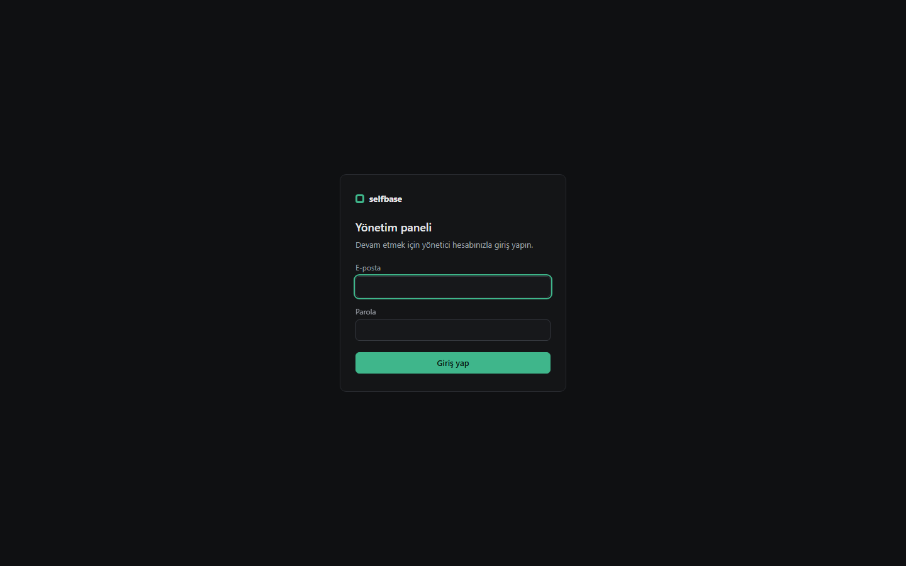
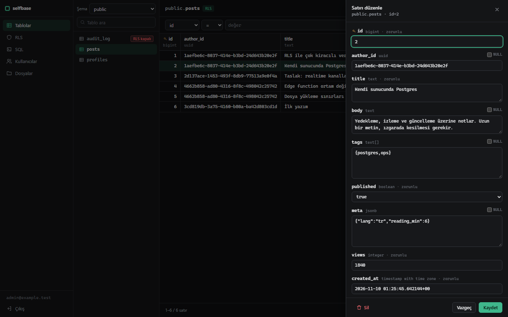
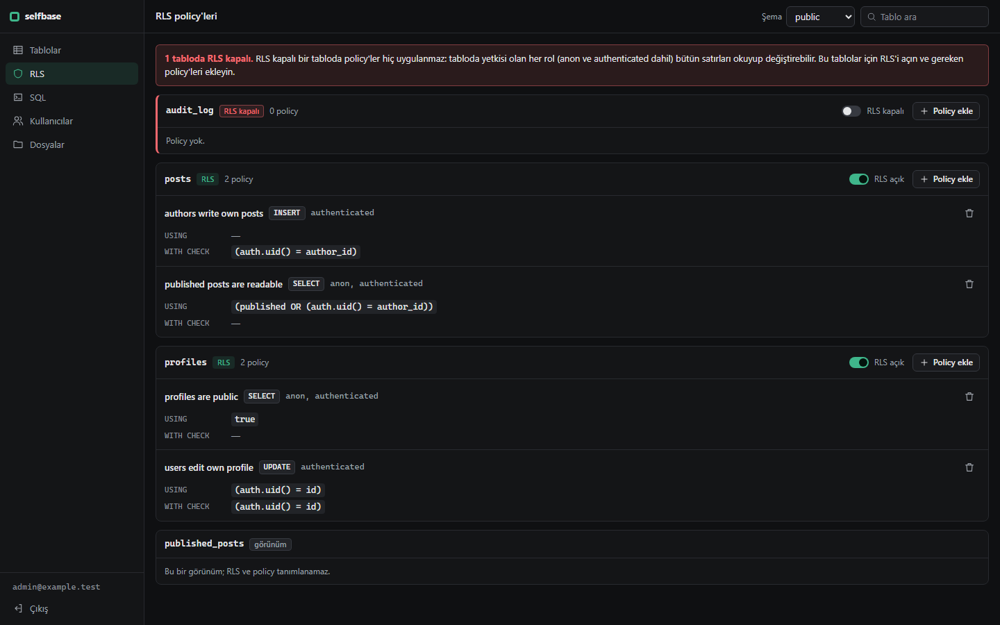
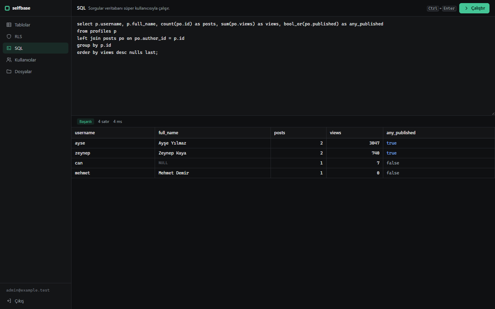
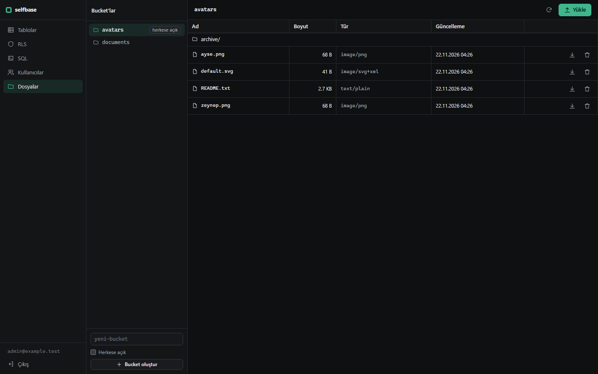

# selfbase rehberi

Bu rehber selfbase'i hiç görmemiş birinin onu anlaması, sıfırdan kurması, başka bir uygulama için
tekrar kurması ve ekibine anlatması için yazıldı. Her adımda üç şey var: **ne** yapıyorsun,
**neden** yapıyorsun ve **ne görmen gerekiyor**. Gördüğün şey farklıysa ne yapacağın da yazıyor.

Rehberde hiçbir gizli değer yok. Şifreleri ve anahtarları her zaman sen üretirsin ve `.env`
dosyasına (ya da Coolify'ın env ekranına) sen yazarsın. `.env` hiçbir zaman git'e girmez.

Komutların başında hangi kabukta çalıştığı yazıyor:
- **PowerShell**: kendi Windows bilgisayarın.
- **bash (sunucu)**: Linux sunucu.
- **Git Bash**: Windows'ta, Git ile gelen bash. Taşıma script'leri (`scripts/migrate/*.sh`) bash ister.

> **Bilmen gerekenler (kısa liste, ayrıntısı ilgili bölümde)**
>
> 1. **Canlıda tarayıcı core'a HTTPS ile ulaşmalı.** Panel çerezi `Secure` işaretli, yani düz
>    `http://` üzerinden giriş yapılamaz (yalnızca `http://localhost` istisna). İstemcinin birden fazla
>    sekmede token yenilemesini sıraya koyan Web Locks API'si de sadece güvenli bağlamda (HTTPS ya da
>    localhost) var.
> 2. **Realtime token'ı WebSocket adresinin query string'inde gider** (`/realtime/v1?token=...`).
>    Önündeki reverse proxy'nin erişim logu `/realtime/v1` için query string yazmamalı.
> 3. **Yedekler aynı sunucuda duruyor.** Sunucu giderse yedek de gider. Canlıya geçmeden önce sunucu
>    dışına bir kopya ekle (bölüm 11).
> 4. **Cron işleri taşımada kapalı (inactive) kaydedilir.** Sadece geçiş günü, eski sistemdeki işler
>    durdurulduktan sonra açılır (bölüm 7, adım 9).
> 5. **Bildirim fonksiyonlarının kullandığı iki vault sırrı** (`notification_dispatch_secret`,
>    `radar_news_cron_secret`) fonksiyon sunucusunun env'iyle aynı olmalı (bölüm 7).
> 6. **Google girişi ve SMTP kendi bilgilerini ister.** SMTP yoksa e-postalar gönderilmez,
>    `selfbase.mail_log` tablosuna yazılır. Telefon doğrulama kapalı.
> 7. **Uygulamanın kendi Content-Security-Policy'si selfbase adresine izin vermeli** (`https://` ve
>    `wss://`). CorteQS'te CSP sabit yazılı, ekibin değiştirmesi gerekiyor (bölüm 8).
> 8. **Supabase'den bilinçli olarak farklı olanlar** var (bölüm 8.5): tekrar kayıt davranışı, token'sız
>    yükleme, telefon değişikliği doğrulaması, e-posta OTP kodu yok, PKCE yok, resim dönüştürme yok,
>    realtime'da sadece `eq` filtresi.

## İçindekiler

1. [Büyük resim](#1-büyük-resim)
2. [Gereksinimler](#2-gereksinimler)
3. [Yerelde çalıştırma](#3-yerelde-çalıştırma)
4. [Anahtar üretimi ve `.env`'in her satırı](#4-anahtar-üretimi-ve-envin-her-satırı)
5. [Coolify'a kurulum](#5-coolifya-kurulum)
6. [Coolify'sız, düz Docker ile bir sunucuya kurulum](#6-coolifysız-düz-docker-ile-bir-sunucuya-kurulum)
7. [Supabase'den veri taşıma](#7-supabaseden-veri-taşıma)
8. [Uygulamayı bağlama](#8-uygulamayı-bağlama)
9. [Panel](#9-panel)
10. [Ekibin yeni migration'larını alma (sync)](#10-ekibin-yeni-migrationlarını-alma-sync)
11. [Yedekleme ve geri yükleme](#11-yedekleme-ve-geri-yükleme)
12. [Yeni bir uygulama için kurulum](#12-yeni-bir-uygulama-için-kurulum)
13. [Bilinen kısıtlar](#13-bilinen-kısıtlar)
14. [Sorun giderme](#14-sorun-giderme)

---

## 1. Büyük resim

### Ne bu?

selfbase, CorteQS'in kullandığı Supabase'in yerine geçen, kendi sunucumuzda çalışan küçük bir
backend. Uygulama kodu neredeyse hiç değişmiyor: uygulama yine `@supabase/supabase-js` import ediyor,
ama bu import derleme sırasında selfbase'in kendi istemcisine (`selfbase-js`) yönleniyor. Aynı adresler
(`/rest/v1`, `/auth/v1`, `/storage/v1`, `/realtime/v1`, `/functions/v1`) ve aynı cevap biçimleri
korunuyor.

### Neden?

- **Kontrol ve taşınabilirlik.** Her parçayı biliyoruz, istediğimiz sunucuya taşıyabiliyoruz.
- **Kaynak.** Self-host Supabase yaklaşık 10 container ister ve 4 GB+ RAM önerir. selfbase boşta
  yaklaşık **166 MiB** (boş veritabanıyla), CorteQS dev verisiyle yaklaşık **227 MiB** kullanıyor
  (db 129, core 58, rest 25, fn 15 MiB). Bu yüzden her uygulamaya ayrı bir kurulum vermek ucuz.
- **Şirket bağımlılığı yok.** Hiçbir `@supabase/*` paketi ya da `supabase/*` Docker imajı çalışmıyor.
  Sadece PostgREST'in istemci kodu (MIT lisanslı) repoya kopyalandı.

Kurulduğu sunucu: 31 GiB RAM, 8 CPU, başka projelerle paylaşımlı. selfbase'in payı bunun çok küçük
bir kısmı.

### Parçalar

```mermaid
flowchart LR
  B[Tarayıcı / uygulama<br/>selfbase-js] -->|HTTPS + WSS| P[Reverse proxy<br/>Coolify / Caddy]
  P --> C[core :8080<br/>Node]
  C -->|/rest/v1| R[rest<br/>PostgREST]
  C -->|/functions/v1| F[fn<br/>Deno]
  C --> D[(db<br/>Postgres 17)]
  R --> D
  F -->|SUPABASE_URL = core| C
  D -. net.http_post kuyruğu .-> C
```

Dışarıya sadece `core` açılır. Diğer üçü sadece compose'un iç ağında konuşur.

| Container | Ne | Supabase'de neyin yerine geçti | Neden böyle |
|---|---|---|---|
| `db` | Postgres 17 + PostGIS + pgvector + pg_cron (+ pg_trgm, unaccent, pgcrypto) | Supabase'in Postgres'i | Dev veritabanı PG 17, eklentiler aynı. `db/bootstrap/*.sql` ilk açılışta Supabase'e özgü şemaları (`auth`, `storage`, `vault`, `net`), rolleri (`anon`, `authenticated`, `service_role`) ve `auth.uid()` gibi fonksiyonları kurar, böylece migration'lar ve RLS policy'leri **hiç değişmeden** çalışır. |
| `rest` | PostgREST 14 | Supabase'in PostgREST'i | Aynı yazılım. Tablolar ve RPC'ler (`.from()`, `.rpc()`) buradan geçer. JWT'deki `role` ile RLS uygulanır. |
| `core` | Node servis (Hono) | GoTrue (auth), storage-api, realtime, Kong (gateway), Studio'nun yerine panel, pg_net'in gönderen tarafı | Dört Supabase servisini tek küçük süreçte topladık. Tek dış adres: `/auth/v1`, `/storage/v1`, `/realtime/v1`, `/admin`, `/panel/` doğrudan core'da; `/rest/v1` ve `/functions/v1` içeri yönlendiriliyor. |
| `fn` | Deno sunucusu | Supabase Edge Functions | Uygulamanın `supabase/functions/` klasörünü salt okunur bağlar. Fonksiyon dosyaları düzenlenmez: içlerindeki `esm.sh/@supabase/supabase-js` import'u bir import map ile `selfbase-js`'e gider. |

Bazı kavramlar (bir kez açıklıyorum, sonra İngilizce kullanıyorum):
- **container**: kendi dosya sistemi olan, izole çalışan süreç. **volume**: container silinse de
  duran veri klasörü (`pgdata` veritabanı, `storage` yüklenen dosyalar).
- **migration**: veritabanı şemasını değiştiren SQL dosyası. **RLS** (Row Level Security) ve
  **policy**: Postgres'in "bu kullanıcı bu satırı görebilir mi" kuralları.
- **token**: kim olduğunu kanıtlayan imzalı metin (JWT). **endpoint**: bir HTTP adresi, ör. `/auth/v1/token`.

### Önemli iç mekanizmalar

- **Kimlik.** core, Supabase'le aynı claim'lerle (`sub`, `role`, `email`, `aud`, `exp`) HS256 JWT
  imzalar. PostgREST aynı `JWT_SECRET` ile doğrular ve isteği JWT'deki role ile çalıştırır.
  `ANON_KEY` ve `SERVICE_ROLE_KEY` da bu secret ile imzalanmış uzun ömürlü JWT'lerdir.
- **Storage.** Dosyalar diskte (`storage` volume). Her yükleme ve okumada core, kullanıcının
  JWT'siyle `storage.objects` üzerinde sorgu yapar, yani yetkiyi yine Postgres policy'leri verir.
- **Realtime.** Realtime açılan tabloda bir trigger `pg_notify` gönderir. core değişen satırı abone
  olan her kullanıcının JWT'siyle tekrar okur, böylece kullanıcı sadece RLS'in izin verdiği satırı görür.
- **`net.http_post`.** Supabase'de pg_net eklentisi SQL'den HTTP isteği atar. selfbase'de bu fonksiyon
  isteği `selfbase.http_queue` tablosuna yazar, core gönderir. `*.supabase.co` adresine giden her istek
  iç adrese (fonksiyonlar için `fn`, diğerleri için core) çevrilir. **Kopyadan Supabase'e istek gitmez.**
- **Panel.** Ayrı container değil, core `/panel/` altında statik dosya olarak sunar.

### Repo haritası

| Yol | İçerik |
|---|---|
| `compose.yml` | Bütün yığın (stack). Değerleri `.env`'den alır. |
| `compose.local.yml` | Sadece yerelde: veritabanını `127.0.0.1` üzerinde açar (taşıma script'leri için). |
| `.env.example`, `fn.env.example` | Doldurulacak değişkenlerin listesi. |
| `db/` | Postgres imajı ve `bootstrap/*.sql` (ilk açılışta bir kez çalışır). |
| `core/` | Node servisi: `src/auth`, `src/storage`, `src/realtime`, `src/admin`, `src/netqueue`. |
| `fn/` | Deno fonksiyon sunucusu. |
| `panel/` | Yönetim paneli (React). core imajının içinde derlenir. |
| `client/` | `selfbase-js`. `client/dist/` derlenmiş hali, repoda duruyor. |
| `scripts/` | `gen-keys.mjs`, `set-panel-password.mjs`, `migrate/` (Supabase'den taşıma), `sync.mjs`, `backup.sh`, `restore.sh`. |
| `docs/` | Bu rehber, `auth-settings.md` (eski sistemin auth ayarları), `functions-status.md`, `screens/`. |

---

## 2. Gereksinimler

### Kendi bilgisayarında (Windows)

| Ne | Neden | Kontrol (PowerShell) | Beklenen |
|---|---|---|---|
| Docker Desktop | Bütün yığın container'da çalışır | `docker compose version` | `Docker Compose version v2.24.0` ya da daha yeni (v5 de olur). `compose.yml` içindeki `env_file: required: false` 2.24 ister. |
| Git | Repoyu almak için. Git Bash da onunla gelir. | `git --version` | herhangi bir sürüm |
| Node.js 22 ya da 24 | Anahtar üretme ve panel şifresi script'leri bilgisayarında çalışır | `node --version` | `v22...` ya da `v24...` |

Docker Desktop açık olmalı. `docker compose version` "cannot connect" diyorsa Docker Desktop'ı başlat
ve tekrar dene.

### Sunucuda (Linux)

- Ubuntu 22.04/24.04 ya da benzeri, Docker Engine ve Compose eklentisi (bölüm 6'da kurulum var).
- RAM: selfbase boşta 250 MiB'ın altında. İlk derleme (`--build`) sırasında geçici olarak 1-2 GB
  kullanılabilir. 2 GB RAM'li bir sunucu yeter.
- Disk: imajlar yaklaşık 2-3 GB, üstüne veri ve yedekler.
- Bir alan adı (ör. `selfbase.ornek.com`) ve sunucunun IP'sine giden bir DNS A kaydı. HTTPS için şart.
- Dışarıdan açık portlar: sadece 80 ve 443 (reverse proxy). core'un 8080'i dışarı açılmaz.

Node sunucuda sadece panel şifresini sunucuda ayarlamak istersen gerekir. Şifreyi kendi
bilgisayarında ayarlayıp iki satırı kopyalayabilirsin (bölüm 9).

---

## 3. Yerelde çalıştırma

Amaç: kendi bilgisayarında boş bir selfbase ayağa kaldırmak, `GET /health` cevabını ve panelin giriş
sayfasını görmek. Yaklaşık 10 dakika (ilk derleme internet hızına bağlı).

**1. Repoyu al.** (PowerShell)

```powershell
git clone <REPO_URL> selfbase
cd selfbase
```

`<REPO_URL>`: selfbase'in GitHub adresi (GitHub'da repo sayfası → yeşil **Code** düğmesi → HTTPS).
Repo özel olduğu için GitHub girişi istenebilir.

**2. `.env` dosyasını oluştur.** `.env.example` doldurulacak değişkenlerin listesi. Kopyası `.env`
olur ve git onu hiç görmez (`.gitignore`'da).

```powershell
Copy-Item .env.example .env
```

**3. Anahtarları ve veritabanı şifresini üret.**

```powershell
node scripts/gen-keys.mjs
node -e "console.log('POSTGRES_PASSWORD=' + require('crypto').randomBytes(24).toString('base64url'))"
```

Beklenen: dört satır, `JWT_SECRET=...`, `ANON_KEY=eyJ...`, `SERVICE_ROLE_KEY=eyJ...` ve
`POSTGRES_PASSWORD=...`. Neden: `JWT_SECRET` bütün token'ları imzalayan sır; diğer iki anahtar onunla
imzalanmış JWT'ler. Veritabanı şifresi base64url (sadece harf, rakam, `-`, `_`), çünkü bağlantı
adreslerinin içine girecek ve orada özel karakter sorun çıkarır. Her çalıştırmada yeni değerler çıkar.
Bu çıktıyı başka bir yere kaydetme, sadece bir sonraki adımda `.env`'e yapıştır.

**4. `.env`'i doldur.**

```powershell
notepad .env
```

Şu satırları bul ve değerleri yaz (eşittir işaretinin hemen arkasına, tırnak ve boşluk olmadan):

| Satır | Değer |
|---|---|
| `POSTGRES_PASSWORD=` | 3. adımdaki değer |
| `JWT_SECRET=` | 3. adımdaki değer |
| `ANON_KEY=` | 3. adımdaki değer |
| `SERVICE_ROLE_KEY=` | 3. adımdaki değer |
| `PUBLIC_URL=` | `http://localhost:8080` |
| `SITE_URL=` | `http://localhost:5173` (uygulamanın yerel adresi; bilmiyorsan böyle bırak) |

Dosyanın en altına şu satırı ekle:

```
COMPOSE_PROJECT_NAME=selfbase-deneme
```

Neden: Docker her kurulumu bir "proje adı" ile ayırır; container'lar, volume'ler ve ağ bu adla başlar.
Ad vermezsen klasörün adı kullanılır ve aynı adlı iki klasör aynı veriyi paylaşır. Bilgisayarında
var olan adlara bak, kullanılmayan bir ad seç:

```powershell
docker compose ls
```

Kaydet ve Notepad'i kapat. Diğer satırları şimdilik boş bırak; ne olduklarını bölüm 4 anlatıyor.

**5. Port 8080 boş mu?**

```powershell
netstat -ano | findstr ":8080 "
```

Çıktı yoksa port boş, 6. adıma geç. `LISTENING` içeren bir satır varsa 8080'i başka bir program
kullanıyor. O zaman aynı komutla `8081`'e bak; boşsa `.env`'in sonuna `CORE_PORT=8081` ekle ve
`PUBLIC_URL=http://localhost:8081` yap (bu bölümün geri kalanında `8080` yerine `8081` kullan).
O da doluysa 8082, 8083... ile aynısını yap.

**6. Yığını derle ve başlat.**

```powershell
docker compose up -d --build
```

Ne oluyor: `db`, `core` ve `fn` imajları derleniyor (core imajı paneli de derler), PostgREST imajı
indiriliyor, dört container başlıyor. İlk sefer 3-10 dakika sürer, sonrakiler saniyeler. Sonunda her
container için `Started` ya da `Healthy` görürsün. Veritabanı ilk açılışta `db/bootstrap/*.sql`'i
çalıştırır; bu sadece boş bir `pgdata` volume'ünde olur.

Beklenen son satırlar şuna benzer (terminale göre başlarında `✔` olabilir):

```
 Container selfbase-deneme-db-1 Healthy
 Container selfbase-deneme-rest-1 Healthy
 Container selfbase-deneme-core-1 Starting
 Container selfbase-deneme-core-1 Started
```

`set POSTGRES_PASSWORD` ya da `set JWT_SECRET` hatası: `.env`'de o satır boş kalmış, 4. adıma dön.
`port is already allocated`: 5. adımı yap.

**7. Durumu kontrol et.**

```powershell
docker compose ps
```

Beklenen: `db`, `rest`, `core`, `fn` satırlarının hepsinde `Up ... (healthy)`. core bir iki
dakika `(health: starting)` görünebilir; birkaç saniye bekleyip tekrar çalıştır.
<!-- verify against final sync/backup -->
Yedekleme servisi eklenmiş bir sürümdeysen `backup` satırı da görünür (bölüm 11), onda health yoktur.

**8. Sağlık kontrolü.**

```powershell
curl.exe -s http://localhost:8080/health
```

Beklenen: `{"ok":true}`. (PowerShell'de `curl` başka bir komutun takma adı; `curl.exe` yaz.)

**9. Panel.** Tarayıcıda `http://localhost:8080/panel/` aç. Beklenen: üstte **selfbase**, altında
**Yönetim paneli** yazan giriş sayfası (e-posta ve şifre alanları). Henüz giriş yapamazsın, çünkü panel şifresi ayarlanmadı; bölüm 9 bunu anlatıyor.



**10. Durdurmak ve silmek.**

```powershell
docker compose stop        # durdurur, her şey yerinde kalır; tekrar: docker compose start
docker compose down        # container'ları siler, veri (volume) kalır
docker compose down -v     # container'ları VE veriyi siler; geri dönüşü yok
```

---

## 4. Anahtar üretimi ve `.env`'in her satırı

### Anahtarlar

`node scripts/gen-keys.mjs` üç satır yazar:

- `JWT_SECRET`: 64 karakterlik rastgele sır. core token imzalar, PostgREST ve fn doğrular.
  **En az 32 karakter** olmalı, yoksa core açılmaz (`JWT_SECRET must be at least 32 characters`).
- `ANON_KEY`: `role: anon`, 10 yıl geçerli JWT. Tarayıcıya giden, gizli olmayan anahtar
  (Supabase'deki "anon / publishable key"). Tek başına sadece RLS'in `anon`'a izin verdiğini yapar.
- `SERVICE_ROLE_KEY`: `role: service_role`, 10 yıl geçerli. **RLS'i atlar.** Sadece sunucu tarafında
  (fonksiyonlar, script'ler) kullanılır, tarayıcıya asla gitmez.

Neden kendimiz üretiyoruz: anahtarlar `JWT_SECRET`'a bağlı. Supabase'in anahtarları başka bir sırla
imzalı, selfbase'de geçersiz.

**`JWT_SECRET`'ı değiştirirsen** bütün anahtarlar ve bütün oturumlar geçersiz olur: üç değeri birlikte
yeniden üret, uygulamaya yeni `ANON_KEY`'i ver, `docker compose up -d` ile yığını yeniden başlat.
Kullanıcıların tekrar giriş yapması gerekir. Panel oturumları da düşer.

### `.env` biçimi

Her satır `AD=değer`. **Tırnak koyma, satır sonuna `#` yorum yazma, `$` kullanma.** Neden: bu dosyayı
hem docker compose hem taşıma script'leri okuyor ve ikisi tırnak/yorum/`$` konusunda farklı davranıyor.
Tek istisna `PANEL_ADMIN_PASSWORD_HASH`: onu script yazar ve içindeki `$`'ları bilerek `$$` yapar
(compose `$$`'ı tek `$`'a çevirir).

### Satır satır `.env`

| Değişken | Ne | Nereden / örnek | Ne zaman değişir |
|---|---|---|---|
| `POSTGRES_PASSWORD` | Veritabanı süper kullanıcısı `postgres`'in ve PostgREST'in bağlandığı `authenticator` rolünün şifresi | Bölüm 3'teki `node -e ...` komutu. URL'de özel anlamı olan karakter (`/ # ? @ : %`) olmasın. | **Sadece ilk açılışta uygulanır.** Sonradan `.env`'de değiştirmek veritabanını değiştirmez; bkz. bölüm 14. |
| `JWT_SECRET` | Token imzalama sırrı, en az 32 karakter | `gen-keys.mjs` | Değişirse bkz. yukarı. |
| `ANON_KEY` | Herkese açık anahtar | `gen-keys.mjs` | `JWT_SECRET` ile birlikte |
| `SERVICE_ROLE_KEY` | RLS'i atlayan sunucu anahtarı | `gen-keys.mjs` | `JWT_SECRET` ile birlikte |
| `PUBLIC_URL` | core'un dışarıdan görünen adresi. Uygulama bunu `SUPABASE_URL` olarak kullanır. E-posta linkleri, dosya adresleri ve Google dönüş adresi bundan üretilir. | Yerelde `http://localhost:8080`, canlıda `https://selfbase.ornek.com` (sonunda `/` yok) | Alan adı değişince |
| `TRUST_PROXY` | `true`: istemcinin IP'si `X-Forwarded-For` başlığının **en sağdaki** değerinden alınır (önündeki proxy'nin eklediği). Panelin yanlış şifre kilidi bu IP'ye göre sayar. | Proxy arkasında `true`. core doğrudan internete açıksa `false` (yoksa herkes başlığı uydurabilir). Yerelde fark etmez. | Kurulum biçimine göre |
| `SITE_URL` | Uygulamanın adresi. Auth yönlendirmeleri `redirect_to` izinli değilse buraya döner. | `https://app.ornek.com` ya da yerelde `http://localhost:5173` | Uygulama adresi değişince |
| `AUTH_REDIRECT_ALLOWLIST` | E-posta linki ve Google girişinden sonra dönülebilecek adresler, virgülle. | Örnek: `http://localhost:8099/**,https://app.ornek.com/**`. Joker yoksa birebir eşleşir; sondaki `*` ya da `**` altındaki her yolu kabul eder; yol içindeki `*` tek bir parçayı. | Yeni bir uygulama adresi eklenince |
| `AUTH_CONFIRM_EMAIL` | `true`: kayıttan sonra e-posta doğrulanmadan giriş yok | `true` (eski sistemle aynı) | |
| `AUTH_PHONE_ENABLED` | Telefon doğrulama | `false`. Açmak için şu an yeterli değil, bkz. bölüm 13. | |
| `AUTH_MIN_PASSWORD` | Kullanıcı şifresinin en az uzunluğu | `6` (eski sistemle aynı) | |
| `SMTP_HOST`, `SMTP_PORT`, `SMTP_USER`, `SMTP_PASS`, `SMTP_FROM` | Auth e-postalarını (doğrulama, şifre sıfırlama, sihirli link) gönderen sunucu | Ekipten gelecek. Port boşsa 587. **`SMTP_HOST` boşsa e-posta gönderilmez,** `selfbase.mail_log` tablosuna yazılır (yerelde linke oradan bakarsın). | SMTP bilgisi gelince |
| `GOOGLE_CLIENT_ID`, `GOOGLE_CLIENT_SECRET` | Google girişi | Google Cloud Console → OAuth client. Yetkili dönüş adresi: `<PUBLIC_URL>/auth/v1/callback`. Boşsa Google girişi çalışmaz. | |
| `PANEL_ADMIN_EMAIL`, `PANEL_ADMIN_PASSWORD_HASH` | Panel girişi | **Elle yazma,** `node scripts/set-panel-password.mjs` yazar (bölüm 9). Hash boşsa panele kimse giremez; varsayılan şifre yoktur. | |
| `STORAGE_DIR` | core içinde dosyaların durduğu klasör | `/data/storage` (compose'daki `storage` volume'ü). Değiştirme. | |
| `SUPABASE_DIR` | Fonksiyon kaynağı: uygulama reposundaki `supabase/` klasörünün **bilgisayardaki/sunucudaki yolu** (içinde `functions/` ve `config.toml`). fn bunu salt okunur bağlar. | Windows'ta ör. `D:/Dev/corteqsemir/supabase` (ileri eğik çizgiyle), Linux'ta `/opt/apps/corteqsemir/supabase`. Boşsa fonksiyon yok, her ad 404 döner. | Uygulama reposunun yeri değişince |
| `PGRST_URL`, `FN_URL` | core'un PostgREST'e ve fn'e iç adresi | `http://rest:3000`, `http://fn:8000`. Değiştirme. | |

`.env.example`'da olmayan ama işine yarayacak satırlar:

| Değişken | Ne | Varsayılan |
|---|---|---|
| `COMPOSE_PROJECT_NAME` | Docker proje adı (bölüm 3, adım 4). Aynı makinede iki kurulum için şart. | klasör adı |
| `CORE_PORT` | core'un makinede açıldığı port. Sadece port numarası yaz (`8090`); adres `CORE_BIND` ile verilir. | `8080` |
| `CORE_BIND` | core'un hangi adreste açıldığı. Varsayılan `127.0.0.1`: sadece makinenin içinden erişilir (reverse proxy aynı makinedeyse doğrusu bu). `0.0.0.0` core'u ağdaki herkese açar; sadece aynı makinede proxy yoksa yaz. | `127.0.0.1` |
| `LOCAL_DB_PORT` | `compose.local.yml` ile veritabanının `127.0.0.1`'de açıldığı port | `55432` |
| `BACKUP_DIR`, `BACKUP_RETENTION_DAYS` | Yedeklerin yeri (volume adı ya da sunucudaki klasör) ve kaç gün saklanacağı (bölüm 11) | `backups` volume'ü, `7` |

<!-- verify against final sync/backup: BACKUP_DIR / BACKUP_RETENTION_DAYS row above -->

Taşıma (bölüm 7) ve sync (bölüm 10) için ayrıca `SUPABASE_DB_URL`, `SUPABASE_URL`,
`SUPABASE_SERVICE_KEY`, `TARGET_DB_URL`, `DOCKER_NETWORK` gibi değişkenleri de `.env`'e yazacaksın;
onlar orada anlatılıyor.

`.env.example`'da yorum satırı olarak duran `AUTH_OTP_EXPIRY`, `AUTH_EMAIL_INTERVAL`,
`AUTH_SMS_HOOK_SECRET` ve Google adres değişkenleri **şu an `.env`'den core'a ulaşmıyor** (compose
bunları core'a geçirmiyor), yani varsayılanlar geçerli: link ömrü 3600 saniye, aynı kullanıcıya iki
auth e-postası arasında 60 saniye. Bkz. bölüm 13.

### `fn.env` (fonksiyonların sırları)

Fonksiyonlar Stripe, WhatsApp, Gemini gibi servislerin anahtarlarını ister. Bunlar ayrı bir dosyada,
`fn.env`'de durur ve sadece `fn` container'ına gider (core ve veritabanı bunları görmez).

```powershell
Copy-Item fn.env.example fn.env
notepad fn.env
```

Sadece kullandığın satırları doldur. `SUPABASE_URL`, `SUPABASE_ANON_KEY`, `SUPABASE_SERVICE_ROLE_KEY`,
`SUPABASE_DB_URL` ve `JWT_SECRET`'ı **yazma**: compose bunları selfbase'in kendi değerleriyle verir.
`fn.env` yoksa fn yine açılır, anahtar isteyen fonksiyonlar 500 döner. Hangi fonksiyonun hangi anahtarı
beklediği `docs/functions-status.md`'de: 24 fonksiyondan 19'u yükleniyor, 5'i kendi API anahtarını
bekliyor. Değiştirdikten sonra: `docker compose up -d fn`.

---

## 5. Coolify'a kurulum

<!-- to be confirmed against the real deployment; screenshots to add -->

> Bu bölüm reponun desteklediği şeylerden yazıldı; gerçek Coolify kurulumu henüz yapılmadı. İlk
> kurulumda adımlar ve ekran görüntüleri bununla karşılaştırılıp düzeltilecek. Emin olunmayan yerler
> **(doğrulanacak)** diye işaretli.

Coolify, sunucuya kurulan bir yönetim paneli: git reposundan compose dosyasını alır, derler,
container'ları çalıştırır ve önlerine HTTPS'li bir reverse proxy (Traefik) koyar. Bizim tarafımızda
farklı olan tek şey: `.env` dosyası yerine değerleri Coolify'ın ekranına girmek.

**Paylaşımlı sunucu kuralı:** sunucudaki diğer projelere ve Coolify proxy'sine dokunma, proxy'yi
yeniden başlatma. selfbase kendi projesinde kalır.

**1. Uygulama reposunu sunucuya koy (fonksiyonlar için).** fn, uygulamanın `supabase/` klasörünü
sunucudaki bir yoldan bağlar. Coolify bunu kendisi getirmez. Sunucuya SSH ile bağlan (bash, sunucu):

```bash
sudo mkdir -p /opt/apps && sudo chown "$USER" /opt/apps
git clone <UYGULAMA_REPO_URL> /opt/apps/corteqsemir
ls /opt/apps/corteqsemir/supabase/functions | head
```

Beklenen: fonksiyon klasörlerinin adları (`admin-knowledge`, `delete-account`, ...). Bu yol
`SUPABASE_DIR=/opt/apps/corteqsemir/supabase` olacak. Fonksiyonlar değişince:
`git -C /opt/apps/corteqsemir pull` ve Coolify'da `fn` servisini yeniden başlat.

**2. Yeni kaynak.** Coolify → projen (ör. `selfbase-corteqs`, yoksa **+ Add** ile oluştur) →
**+ New** → **Private Repository** (GitHub App ile ya da Deploy Key ile; repo özel) → selfbase reposu,
branch → **Build Pack: Docker Compose** → **Docker Compose Location:** `/compose.yml`. Kaydet.
Coolify compose dosyasını okur ve servisleri (`db`, `rest`, `core`, `fn`) listeler.

**3. Alan adı sadece core'a.** Servis listesinde `core`'un **Domains** alanına
`https://selfbase.ornek.com:8080` yaz. `:8080` container içindeki port; dışarıdan adres yine
`https://selfbase.ornek.com` olur, Coolify'ın proxy'si 443'ü bu porta yönlendirir ve sertifikayı alır.
`db`, `rest`, `fn` için alan adı **girme**: dışarı açılmamalılar.

**4. Environment variables.** Coolify compose dosyasındaki `${...}` değişkenlerini **Environment
Variables** sekmesinde listeler. Bölüm 4'teki tabloya göre doldur:

- Kendi bilgisayarında `node scripts/gen-keys.mjs` ve bölüm 3'teki şifre komutunu çalıştır, çıkan
  değerleri `POSTGRES_PASSWORD`, `JWT_SECRET`, `ANON_KEY`, `SERVICE_ROLE_KEY` alanlarına yapıştır.
- `PUBLIC_URL=https://selfbase.ornek.com`, `SITE_URL=` uygulamanın adresi,
  `AUTH_REDIRECT_ALLOWLIST=` uygulamanın adresleri.
- `TRUST_PROXY=true` (Traefik `X-Forwarded-For` ekler).
- `CORE_PORT=18080`. Neden: `compose.yml` core'un portunu makinede de açar. Coolify'da buna gerek
  yok (trafik proxy'den gelir), ama sunucudaki başka bir 8080 ile çakışabilir. `CORE_BIND` varsayılan
  olarak `127.0.0.1` olduğu için core zaten sadece sunucunun içinden erişilir, HTTPS'siz internete
  açılmaz; `CORE_BIND`'e dokunma. Sunucuda 18080 kullanılıyorsa başka bir port seç. **(doğrulanacak: Coolify'ın `ports` satırını
  olduğu gibi kullandığı)**
- `SUPABASE_DIR=/opt/apps/corteqsemir/supabase` (1. adım).
- SMTP ve Google bilgileri geldiyse onlar.
- Panel için `PANEL_ADMIN_EMAIL` ve `PANEL_ADMIN_PASSWORD_HASH`: bölüm 9'daki "sunucu için" yolu.
  **(doğrulanacak: hash'in Coolify'a `.env`'deki gibi `$$`'lı mı, yoksa "literal" işaretli ham hâliyle
  mi girileceği. Girişi deneyerek kontrol et.)**

**5. Fonksiyon sırları (`fn.env`).** **(doğrulanacak)** `compose.yml` fonksiyon sırlarını
sunucudaki `fn.env` dosyasından okur (yoksa sessizce atlar). Coolify'ın env ekranına girilen değerler
sadece compose dosyasında adı geçen değişkenlere gider, `fn.env`'in içindekiler orada geçmez. İlk
kurulumda Coolify'ın repoyu açtığı klasöre `fn.env` koymanın yeniden deploy'da korunup korunmadığı
denenecek. Korunmuyorsa bu, compose'da küçük bir değişiklik ister; o zamana kadar fonksiyonlar
anahtarsız çalışır (19'u açılır, anahtar isteyen 5'i 500 döner).

**6. Volume'ler.** Compose'daki `pgdata` (veritabanı) ve `storage` (dosyalar) Coolify'da kalıcı volume
olur. Yeniden deploy onları silmez. **Kaynağı Coolify'dan silerken "delete volumes" seçeneğini
işaretleme**, yoksa veri gider.

**7. Health check.** Ayrı ayar gerekmez: compose dosyasında her servisin kendi health check'i var.
core'unki `http://localhost:8080/health`. Coolify servisleri "healthy" gösterene kadar bekle.

**8. Deploy.** **Deploy** düğmesi. Coolify'ın deploy logunda imajların derlendiğini ve dört
container'ın başladığını görürsün. İlk deploy birkaç dakika.

**9. Kontrol.** Kendi bilgisayarında (PowerShell):

```powershell
curl.exe -s https://selfbase.ornek.com/health
```

Beklenen: `{"ok":true}`. Tarayıcıda `https://selfbase.ornek.com/panel/` giriş sayfasını açmalı.
Sertifika hatası alırsan DNS kaydı henüz yayılmamıştır ya da Coolify sertifikayı alamamıştır;
Coolify'da proxy loguna bak.

**10. Erişim logu.** Realtime token'ı `/realtime/v1?token=...` adresinde gider. Coolify'ın Traefik'inde
erişim logu açıksa bu adresler token'la birlikte yazılır. **(doğrulanacak: sunucudaki Traefik'te
access log açık mı; açıksa `/realtime/v1` için query string'in loga yazılmaması.)** Proxy ayarı bütün
projeleri etkilediği için bunu tek başına değiştirme, önce ekiple konuş.

---

## 6. Coolify'sız, düz Docker ile bir sunucuya kurulum

Coolify olmayan herhangi bir Linux sunucuda: Docker + compose + önüne HTTPS'li bir reverse proxy
(burada Caddy; sertifikayı kendisi alır).

```
internet ──443──> Caddy ──> 127.0.0.1:8080 (core) ──> rest, fn, db (sadece iç ağ)
```

**1. Docker'ı kur.** (bash, sunucu) Docker'ın resmi kurulum script'i:

```bash
curl -fsSL https://get.docker.com | sudo sh
sudo usermod -aG docker "$USER"
```

Oturumu kapatıp tekrar SSH ile bağlan (grup değişikliği için), sonra:

```bash
docker compose version
```

Beklenen: `Docker Compose version v2.24.0` ya da daha yeni.

**2. Repoyu al.**

```bash
sudo mkdir -p /opt/selfbase && sudo chown "$USER" /opt/selfbase
git clone <REPO_URL> /opt/selfbase/corteqs
cd /opt/selfbase/corteqs
cp .env.example .env
chmod 600 .env
```

`chmod 600`: `.env`'i sadece sen okuyabil.

**3. Anahtarlar.** Sunucuda Node yoksa bu iki komutu kendi bilgisayarında çalıştır ve çıktıyı
sunucudaki `.env`'e yapıştır:

```powershell
node scripts/gen-keys.mjs
node -e "console.log('POSTGRES_PASSWORD=' + require('crypto').randomBytes(24).toString('base64url'))"
```

**4. `.env`'i doldur.** (bash, sunucu)

```bash
nano .env
```

Bölüm 3, adım 4'teki dört değer, ve:

```
PUBLIC_URL=https://selfbase.ornek.com
SITE_URL=https://app.ornek.com
TRUST_PROXY=true
COMPOSE_PROJECT_NAME=selfbase-corteqs
```

`CORE_BIND` ve `CORE_PORT` yazmana gerek yok: `CORE_BIND` varsayılan olarak `127.0.0.1` olduğu için core
sadece sunucunun içinden erişilir (`127.0.0.1:8080`). Dışarıdan tek yol Caddy (HTTPS).
`TRUST_PROXY=true` çünkü önünde Caddy var. Fonksiyonlar için uygulama reposunu da sunucuya al ve
`SUPABASE_DIR`'i yaz (bölüm 5, adım 1'deki gibi), sırlar için `fn.env` (bölüm 4). Nano'da kaydet:
`Ctrl+O`, `Enter`, çık: `Ctrl+X`.

**5. Başlat ve kontrol et.**

```bash
docker compose up -d --build
docker compose ps
curl -s http://127.0.0.1:8080/health
```

Beklenen: dört servis `Up ... (healthy)`, sonra `{"ok":true}`. Dışarıdan `http://<sunucu-ip>:8080`
**açılmamalı**; açılıyorsa `.env`'de `CORE_BIND=0.0.0.0` yazmışsındır, sil.

```bash
docker compose port core 8080
```

Beklenen: `127.0.0.1:8080`.

**6. Caddy (HTTPS).** DNS'te `selfbase.ornek.com` → sunucunun IP'si olmalı.

```bash
sudo apt-get update && sudo apt-get install -y caddy
sudo nano /etc/caddy/Caddyfile
```

Dosyanın içeriğini şununla değiştir:

```
selfbase.ornek.com {
	reverse_proxy 127.0.0.1:8080
}
```

```bash
sudo systemctl reload caddy
curl -s https://selfbase.ornek.com/health
```

Beklenen: `{"ok":true}`. Caddy sertifikayı Let's Encrypt'ten kendisi alır (80 ve 443 dışarıdan
açık olmalı), WebSocket'i kendiliğinden geçirir ve `X-Forwarded-For` ekler. Caddyfile'a `log`
yazmadıkça erişim logu tutmaz; bu yüzden realtime token'ı loga düşmez. `log` eklersen `/realtime/v1`
için query string'i yazdırma. Ubuntu'da `apt` caddy paketini bulamazsa Caddy'nin resmi kurulum
sayfasındaki Debian/Ubuntu adımlarını uygula.

nginx kullanıyorsan aynı iş (sertifikayı `certbot` ile ayrıca alırsın):

```nginx
server {
    listen 443 ssl;
    server_name selfbase.ornek.com;
    # ssl_certificate ... ; ssl_certificate_key ... ;  (certbot doldurur)
    client_max_body_size 50m;            # storage yükleme sınırı core'da 50 MB

    location /realtime/v1 {
        access_log off;                  # token query string'de
        proxy_pass http://127.0.0.1:8080;
        proxy_http_version 1.1;
        proxy_set_header Upgrade $http_upgrade;
        proxy_set_header Connection "upgrade";
        proxy_set_header Host $host;
        proxy_set_header X-Forwarded-For $proxy_add_x_forwarded_for;
        proxy_read_timeout 1h;
    }
    location / {
        proxy_pass http://127.0.0.1:8080;
        proxy_set_header Host $host;
        proxy_set_header X-Forwarded-For $proxy_add_x_forwarded_for;
        proxy_set_header X-Forwarded-Proto $scheme;
    }
}
```

**7. Güvenlik duvarı.**

```bash
sudo ufw allow OpenSSH
sudo ufw allow 80,443/tcp
sudo ufw enable
```

Not: Docker'ın açtığı portlar ufw kurallarını atlar. Bu yüzden `CORE_BIND`'in varsayılanı (`127.0.0.1`) önemli;
ufw'ye güvenme.

**8. Yeniden başlatma.** Ayrı bir servis dosyası gerekmez: compose'daki `restart: unless-stopped`
sayesinde sunucu yeniden açılınca container'lar kendiliğinden kalkar.

**9. Güncelleme.**

```bash
cd /opt/selfbase/corteqs
git pull
docker compose up -d --build
```

Veritabanı ve dosyalar volume'de, güncelleme onlara dokunmaz.

---

## 7. Supabase'den veri taşıma

Bu bölüm bir Supabase projesini (şema, veri, kullanıcılar, dosyalar, cron, realtime) **boş, yeni
kurulmuş** bir selfbase'e taşır. CorteQS dev veritabanı bu yolla taşındı: 370 tablonun satır sayıları
eşleşti, 357 public tablo, 647 policy, 9 kullanıcı, `auth.users`'a giden 157 foreign key doğrulandı.

Script'ler `scripts/migrate/` altında; ayrıntılı teknik açıklama `scripts/migrate/README.md`'de.
Şifreleri ekrana hiçbir zaman yazmazlar. `pg_dump`/`psql` 17'yi `postgres:17` imajından çalıştırırlar,
yani bilgisayarına Postgres kurman gerekmez.

**Neden bu kadar adım:** uygulama tablolarının `auth.users`'a foreign key'i var. Kullanıcılar 3.
adımda geliyor. O yüzden önce tablolar ve veri, sonra kullanıcılar, en son kısıtlar (foreign key'ler)
yükleniyor. Her adım tek transaction: hata olursa geri alınır, sebebi düzeltip aynı adımı tekrar
çalıştırırsın.

### Hazırlık

1. selfbase yerelde, **boş** ve veritabanı portu açık olarak çalışsın (Git Bash):

   ```bash
   docker compose -f compose.yml -f compose.local.yml up -d --build
   ```

   `compose.local.yml` veritabanını `127.0.0.1:55432`'de açar (`LOCAL_DB_PORT` ile değişir). Sunucuda
   kullanma.

2. `core/` içinde bağımlılıkları kur (05 ve 06 onların `pg` paketini kullanır):

   ```bash
   (cd core && npm ci)
   ```

3. `.env`'e taşıma değişkenlerini ekle. Değerleri Supabase dashboard'undan sen alırsın:

   | Değişken | Değer |
   |---|---|
   | `SUPABASE_DB_URL` | Kaynak, **session pooler** adresi: Supabase → Project Settings → Database → Connection string → Session pooler. Kullanıcı `postgres.<ref>` biçiminde. |
   | `SUPABASE_URL` | `https://<ref>.supabase.co` |
   | `SUPABASE_SERVICE_KEY` | Kaynağın service role anahtarı. Sadece dosyaları indirmek için. |
   | `DOCKER_NETWORK` | `<COMPOSE_PROJECT_NAME>_default`, ör. `selfbase-deneme_default`. Kontrol: `docker network ls`. |
   | `TARGET_DB_URL` | `postgres://postgres:<POSTGRES_PASSWORD>@db:5432/postgres` |
   | `PUBLIC_URL` | zaten var |
   | `NOTIFY_DISPATCH_SECRET`, `RADAR_NEWS_CRON_SECRET` | İsteğe bağlı: `fn.env`'deki aynı adlı değerler (aşağıda adım 8) |

   Neden `db:5432`: 01, 02 ve 03'ün `psql`'i bir container'da çalışır ve `DOCKER_NETWORK` ile selfbase'in
   ağına katılır, orada veritabanının adı `db`. 05 ve 06 ise bilgisayarında çalışır; onlar için adım 7'de
   `TARGET_DB_URL`'i değiştireceksin. Supabase adresi (`*.supabase.co/.com`) hedef olarak verilirse
   script'ler reddeder: yanlışlıkla canlıya yazamazsın.

4. **Kaynakta yazmaları durdur** (1. adım boyunca). Script tek bir anlık görüntüden (snapshot) okur,
   ama pooler buna izin vermezse ayrı okumalar yapar ve bunu söyler.

### Adımlar (Git Bash, repo kökünde)

```bash
. scripts/migrate/lib.sh                                             # psql_target yardımcısı
bash scripts/migrate/01-dump.sh                                      # 1
bash scripts/migrate/02-restore.sh pre                               # 2
node scripts/migrate/03-auth-storage.sql.mjs rows | psql_target      # 3
bash scripts/migrate/02-restore.sh post                              # 4
node scripts/migrate/03-auth-storage.sql.mjs policies | psql_target  # 5
node scripts/migrate/04-files.mjs                                    # 6
```

Burada `.env`'de `TARGET_DB_URL`'i `postgres://postgres:<POSTGRES_PASSWORD>@localhost:55432/postgres`
yap (05 ve 06 bilgisayarında çalışır, veritabanına açılan porttan ulaşır), sonra:

```bash
node scripts/migrate/05-rewrite-urls.mjs --dry-run                   # 7a
node scripts/migrate/05-rewrite-urls.mjs                             # 7b
node scripts/migrate/06-realtime-cron.mjs                            # 8
```

Bitince `TARGET_DB_URL`'i tekrar `@db:5432` hâline getir (sync onu container'dan kullanır, bölüm 10).

| Adım | Ne yapar | Neden | Ne görmelisin |
|---|---|---|---|
| 1. `01-dump.sh` | Kaynağın Supabase'e ait olmayan şemalarını `pg_dump` ile alır; `auth.users`, `auth.identities`, `storage.buckets`, `storage.objects`'i JSON satırları olarak; eklentiler, storage policy'leri, auth trigger'ları, realtime tabloları, `cron.job`, migration geçmişi ve tablo başına satır sayılarını `dump/catalog/` altına | Supabase'in kendi şemaları bizde kendi tablolarımızla var; onları kopyalamak çakışır | `dump/` klasörü (git'e girmez). Okuyamadığı bir katalog `NOT READ` diye yazılır, gerisi devam eder. |
| 2. `02-restore.sh pre` | Hedef boş değilse reddeder. Eklentileri kurar (`pg_graphql`, `supabase_vault`, `pg_net`, `pgsodium`, `pg_stat_statements` atlanır ve söylenir), tabloları, fonksiyonları ve veriyi yükler, migration geçmişini `supabase_migrations.schema_migrations`'a kopyalar | Hepsi tek transaction, hata olursa hiçbir şey kalmaz | CorteQS dev'de: 598 geçmiş satırı. Eksik bir Supabase nesnesi hatası: dump düzenlenmez, `db/bootstrap/`'a shim eklenir. |
| 3. `03 rows` | Kullanıcıları, kimlikleri, bucket ve dosya kayıtlarını selfbase'in tablolarına kopyalar; sadece ortak kolonlar | Şifre hash'leri bcrypt, aynen çalışır: kullanıcılar eski şifreleriyle girer | Kaynaktaki her id hedefte olmalı, yoksa durur. Tekrar çalıştırılabilir. |
| 4. `02-restore.sh post` | 3. adım çalışmadıysa reddeder. Index'leri, kısıtları (foreign key'ler dahil) yükler, her tablonun satır sayısını kaynakla karşılaştırır, PostgREST'e şemayı yenilemesini söyler | Foreign key'ler ancak kullanıcılar geldikten sonra eklenebilir | `row counts match the source for N tables`. Uyuşmazlık olursa geri alınır. |
| 5. `03 policies` | Storage policy'lerini ve `auth.users`/`storage.objects` üzerindeki uygulama trigger'larını kurar | Bunlar Supabase'in şemalarında yaşıyordu, 1. adımın dump'ında yoktular | Hata yok. |
| 6. `04-files.mjs` | Her dosyayı `SUPABASE_SERVICE_KEY` ile indirir, `STORAGE_DIR/<bucket>/<ad>` altına yazar; var olanları atlar; yönlendirme izlemez | Dosyalar Supabase'in diskinde | `downloaded/skipped/failed` sayıları; bir hata bile varsa çıkış kodu 1, tekrar çalıştır. |
| 7. `05-rewrite-urls.mjs` | Veritabanında kayıtlı `https://<ref>.supabase.co` adreslerini `PUBLIC_URL` ile değiştirir (bütün metin ve json kolonları, trigger'lar kapalı). `--dry-run` sadece sayar. | Yoksa avatarlar ve görseller hâlâ Supabase'den yüklenir: gizli bağımlılık | Kuru çalıştırmada kolon başına satır sayısı; uygulamadan sonra ikinci bir `--dry-run` 0 göstermeli. |
| 8. `06-realtime-cron.mjs` | Kaynakta realtime açık tablolarda `selfbase.enable_realtime`'ı çalıştırır; her `cron.job` satırını **kapalı** olarak kaydeder; iki vault sırrını yazar | İki sistem aynı işleri aynı anda çalıştırmasın diye cron kapalı gelir | Hangi değişkeni kullandığını yazar (değerini değil). |
| 9. `06 --activate` | **Sadece geçiş günü**, kaynaktaki işler durdurulduktan sonra: cron işlerini açar | | Kaynakta zaten kapalı olan işler kapalı kalır. |

**Vault sırları.** `notification_dispatch_secret` ve `radar_news_cron_secret`, cron'un ve
trigger'ların fonksiyonlara gönderdiği paylaşılan sırlar; fonksiyon bunu kendi env'indeki
`NOTIFY_DISPATCH_SECRET` / `RADAR_NEWS_CRON_SECRET` ile karşılaştırır. 06, `.env`'de bu değişkenler
varsa onları, yoksa `SERVICE_ROLE_KEY`'i kullanır ve uyarır. **İki taraf aynı olmalı:** `fn.env`'deki
değeri `.env`'e de yaz ve 06'yı tekrar çalıştır. Dikkat: geçişten sonra 06'yı **bayraksız** çalıştırmak
cron işlerini tekrar kapatır; o zaman `--activate` ile çalıştır.

**CorteQS dev'den öğrendiklerimiz.** Dev projede 0 cron işi ve realtime yayınında 0 tablo vardı, yani
06 orada hiçbir şey kaydetmedi. Uygulamanın realtime kullandığı tablolar selfbase'de elle açıldı
(panelin SQL ekranında ya da `docker compose exec db psql -U postgres` ile):

```sql
select selfbase.enable_realtime('public.cadde_posts');
```

Realtime açılacak tablonun `id` kolonu olmalı. Ayrıca 05, dev'de 0 değer değiştirdi (1949 kolon
tarandı) ve 0 dosya vardı.

**Taşımadan sonra:** `node scripts/sync.mjs --repo <uygulama reposu> --baseline` (bölüm 10).

---

## 8. Uygulamayı bağlama

### 8.1 Alias yöntemi (neden ve nasıl)

Uygulamada Supabase istemcisini kullanan 166 dosya var. Hiçbirine dokunmuyoruz. Bunun yerine derleme
aracına "`@supabase/supabase-js` istendiğinde selfbase-js'i ver" diyoruz (alias). `client.ts` aynen
`createClient(url, key)` çağırmaya devam eder.

CorteQS'te yapılan değişiklik (dal `selfbase/client-swap`, ekip onayı bekliyor):

1. `selfbase/client/dist/` içindeki `selfbase.mjs`, `selfbase.d.ts`, `LICENSE-postgrest-js`,
   `LICENSE-supabase-js` dosyaları değiştirilmeden uygulamada `src/integrations/selfbase/`'e kopyalanır.
2. `vite.config.ts` ve `vitest.config.ts`: `resolve.alias` dizi biçiminde, birebir eşleşme:
   `{ find: /^@supabase\/supabase-js$/, replacement: "<yol>/src/integrations/selfbase/selfbase.mjs" }`.
   Birebir olduğu için alt yollar (`@supabase/supabase-js/...`) etkilenmez.
3. `tsconfig.app.json`: `paths["@supabase/supabase-js"] = ["./src/integrations/selfbase/selfbase.d.ts"]`.
4. Araçların kopyalanan dosyaları kontrol etmemesi için: `eslint.config.js` ignore, `.prettierignore`,
   `knip.json` ignore, `scripts/check/check-dead-code.mjs` istisna listesi.

Sonuç: uygulamanın 690 test dosyası / 7183 testi önce ve sonra aynı geçti; derlenen pakette
`gotrue`, `realtime-js`, `postgrest-js` izine rastlanmadı.

selfbase-js güncellenince (`client/dist` değişir) bu dört dosyayı tekrar kopyala.

### 8.2 Uygulamanın env'i

| Uygulama değişkeni | Değer |
|---|---|
| `VITE_SUPABASE_URL` | selfbase `PUBLIC_URL` |
| `VITE_SUPABASE_PUBLISHABLE_KEY` | selfbase `ANON_KEY` |
| `VITE_SUPABASE_PROJECT_ID` | `selfbase` (kodda okunmuyor, sadece geçiriliyor) |

**Hem derleme zamanında hem çalışma zamanında ver.** Neden: `client.ts` önce çalışma zamanındaki
`window.__APP_CONFIG__`'e bakar, ama üç yer (`group-claims.ts`, `group-submit.ts`,
`radarNewsPipeline.ts`) `/functions/v1/...`'i istemciyi kullanmadan, derleme zamanındaki
`VITE_SUPABASE_URL` ile çağırıyor.

selfbase tarafında: `SITE_URL` uygulamanın adresi, `AUTH_REDIRECT_ALLOWLIST` uygulamanın adresleri
(ör. `https://app.ornek.com/**`). Yoksa e-posta linkleri ve Google girişi `SITE_URL`'e döner.

### 8.3 Content-Security-Policy (CorteQS'te ekibin işi)

CorteQS'in CSP'si iki yerde **sabit yazılı**: `nginx.conf.template` (canlı) ve `server.mjs`
(`npm start`). İkisi de sadece `*.supabase.co` adreslerine izin veriyor. selfbase başka bir adreste
olunca tarayıcı REST, auth, storage, fonksiyon isteklerini ve realtime WebSocket'ini engeller; avatar ve
görselleri de (`img-src`). Eklenmesi gerekenler:
- `connect-src`: `https://selfbase.ornek.com wss://selfbase.ornek.com`
- `img-src` ve `media-src`: `https://selfbase.ornek.com`

Alternatif: selfbase'i uygulamanın kendi alan adı altında (`/auth/v1`, `/rest/v1`, `/storage/v1`,
`/functions/v1`, `/realtime/v1` yollarını reverse proxy ile core'a vererek) sunmak; o zaman `'self'`
yeter.

Diğer bulgular: dört ticari HTML sayfası maskot görselini canlı Supabase projesinden yüklüyor;
`storage-image.ts` resim küçültmeyi sadece `*.supabase.co` için yapıyor (selfbase'de görsel
küçültülmeden, olduğu gibi gelir; çalışır).

### 8.4 Fonksiyonlar

`SUPABASE_DIR` uygulamanın `supabase/` klasörünü gösterir (bölüm 4). fn her fonksiyonu
`/functions/v1/<ad>` altında sunar, `config.toml`'daki `verify_jwt` ayarına uyar (varsayılan `true`).
Stripe ve WhatsApp webhook adresleri `https://selfbase.ornek.com/functions/v1/<ad>` olur; sağlayıcı
panellerinde güncellemek ekibin işi.

### 8.5 Supabase'den bilinçli olarak farklı olanlar

| Davranış | selfbase | Neden |
|---|---|---|
| Doğrulanmamış bir e-postayla **farklı şifreyle tekrar kayıt** | Hesabın şifresi silinir, yeni şifre de saklanmaz. Doğrulama linki, posta kutusunun sahibini şifre belirleme ekranına (`type=recovery`) götürür. | Başkası senin adınla önceden hesap açıp şifreyi kendi belirleyemesin. Tekrar kayıt olan gerçek kullanıcı, doğruladıktan sonra şifre belirler. |
| Token'sız dosya yükleme | Reddedilir (401). `apikey` gerekir. | supabase-js zaten her zaman gönderir. |
| Telefon değişikliği doğrulaması (`verifyOtp` `phone_change`) | Giriş yapmış kullanıcının oturumunu ister. | Giriş yapmamış biri tahminle kurbanın kodunu kilitleyemesin. |
| E-posta OTP kodu | Yok; sadece link. | Uygulama kod kullanmıyor. |
| PKCE akışı | Yok; implicit akış. | Uygulama PKCE ayarlamıyor. |
| Resim dönüştürme (`/storage/v1/render/image`) | Yok. | Uygulama sadece `*.supabase.co`'da kullanıyor. |
| Realtime | Sadece `postgres_changes`, sadece `eq` filtresi. Broadcast ve presence yok. | Uygulamanın 5 kullanımı bu kadarını istiyor. |
| Telefon girişi | Kapalı (`AUTH_PHONE_ENABLED=false`). | Dev'de de kapalı. |

---

## 9. Panel

Panel `PUBLIC_URL/panel/` adresinde. Supabase Studio'nun bize gereken kısmı: **Tablolar** (gör,
ekle, düzenle, sil, filtre), **RLS** (policy'leri gör, yaz, RLS'i aç/kapat), **SQL** editörü,
**Kullanıcılar** (liste, ban, sil, e-posta doğrula), **Dosyalar** (bucket, gözat, yükle, sil).

Panel `service_role` yetkisiyle çalışır ama ayrı bir hesapla girilir: e-posta + şifre `.env`'de
(`PANEL_ADMIN_EMAIL`, `PANEL_ADMIN_PASSWORD_HASH`). Giriş 12 saat geçerli bir çerez verir.
Aynı IP'den 5 yanlış denemede 15 dakika kilit. Her yazma işlemi ve her SQL çalıştırması
`selfbase.admin_audit` tablosuna kaydedilir; bu yüzden SQL ekranına sır yazma.

### Şifreyi ayarla (yerelde)

Script şifreyi ekranda göstermeden okur, bcrypt ile hash'ler ve `.env`'e iki satır yazar. Şifreyi
asla komut satırından ya da dosyadan almaz. **Bu yüzden gerçek bir terminalde çalıştırılmalı**
(Windows Terminal / PowerShell penceresi, sunucuda SSH oturumu). Bir IDE'nin çıktı paneli, pipe ya da
otomasyon aracı içinde `stdin is not a terminal` deyip durur.

PowerShell, repo kökünde:

```powershell
cd core
npm ci
cd ..
node scripts/set-panel-password.mjs
```

`npm ci` bir kez gerekir: script bcrypt kütüphanesini `core/node_modules`'tan alır. npm'in yeni
sürümleri `npm warn allow-scripts` uyarısı yazabilir; zararsız, onay verme. Script sorar:

```
Admin email: sen@ornek.com
New password:
Repeat password:
updated D:\...\selfbase\.env
restart core to apply: docker compose up -d core
```

Şifre en az 12 karakter (en fazla 72 bayt). Sonra:

```powershell
docker compose up -d core
```

`.env`'de artık `PANEL_ADMIN_EMAIL=sen@ornek.com` ve `PANEL_ADMIN_PASSWORD_HASH=$$2b$$12$$...` var.
`$$` bilerek öyle: docker compose `.env`'deki `$`'ı değişken sanar, `$$` onu tek `$` olarak geçirir.
Bu satırı elle düzenleme. Script dosyadaki diğer satırlara dokunmaz.

`http://localhost:8080/panel/` → e-posta ve şifreyle giriş. Yanlışsa "invalid login".

### Sunucu için

Sunucuda Node varsa aynı komutları SSH oturumunda çalıştır. Yoksa kendi bilgisayarında ayrı bir
dosyaya yazdır ve iki satırı kopyala:

```powershell
node scripts/set-panel-password.mjs --env panel.env
Get-Content panel.env
Remove-Item panel.env
```

`Get-Content` hash'i gösterir (şifreyi değil). İki satırı sunucudaki `.env`'e (ya da Coolify'a, bölüm 5)
yapıştır, `panel.env`'i sil, core'u yeniden başlat.

### Ekranlar

| Ekran | |
|---|---|
| Tablolar: tablo listesi, ızgara, filtre; satıra tıklayınca sağdan düzenleme çekmecesi |   |
| RLS: tablo başına policy'ler, RLS aç/kapat, yeni policy |  |
| SQL: yaz, `Ctrl+Enter` ile çalıştır, en fazla 1000 satır sonuç |  |
| Kullanıcılar: ara, ban, sil, e-postayı doğrulanmış yap |  |
| Dosyalar: bucket'lar, klasörler, yükle, indir, sil |  |

Panel telefonda da çalışır (`screens/07-tables-mobile.png`) ve açık tema var (`screens/09-tables-light.png`).

Ban: kullanıcı yeni token alamaz, ama elindeki access token en fazla 1 saat daha geçerli kalır.

---

## 10. Ekibin yeni migration'larını alma (sync)

<!-- verify against final sync/backup -->

selfbase tek seferlik bir kopya değil: geçiş gününe kadar ekip yeni migration yazdıkça onları da alır.
`scripts/sync.mjs` uygulama reposundaki `supabase/migrations/applied/*.sql` dosyalarından henüz
uygulanmamış olanları dosya adı sırasıyla selfbase veritabanına uygular. Migration dosyaları
düzenlenmez.

Gereken: `.env`'de `TARGET_DB_URL` (container'dan erişilebilir: `@db:5432` + `DOCKER_NETWORK`, bölüm 7
hazırlık 3). Git Bash, repo kökünde.

**Taşımadan hemen sonra, bir kez:**

```bash
node scripts/sync.mjs --repo D:/Dev/corteqsemir --baseline --dry-run
node scripts/sync.mjs --repo D:/Dev/corteqsemir --baseline
```

Ne yapar: kaynağın migration geçmişinde (02'nin kopyaladığı `supabase_migrations.schema_migrations`)
kayıtlı her dosyayı "uygulandı" diye işaretler, çalıştırmaz. Neden: o migration'lar zaten dump'ın
içinde. Çıktı: `marked N migrations as applied (baseline)`. Repoda olup kaynakta uygulanmamış dosyalar
listelenir; bir sonraki normal çalıştırma onları uygular. Aynı sürüm numarasını paylaşan ve geçmişten
hangisinin çalıştığı anlaşılamayan dosyalar için tek tek `--mark-applied <dosya>` komutu yazdırır.
Geçmiş boşsa `--baseline` tahmin etmez, durur; o zaman bütün dosyaları işaretleyen `--baseline-all` var
(bunu sadece veritabanının repodaki bütün migration'ları zaten içerdiğinden eminsen kullan).

**Ekip yeni migration ekledikçe:**

```bash
git -C D:/Dev/corteqsemir pull
node scripts/sync.mjs --repo D:/Dev/corteqsemir --dry-run
node scripts/sync.mjs --repo D:/Dev/corteqsemir
```

`--dry-run` uygulanacakları listeler, reddedilecekleri `(REFUSED: sebep)` ile gösterir. Normal
çalıştırma her dosyayı **tek transaction** içinde, kaydıyla birlikte uygular (`selfbase.applied_migrations`
ve `supabase_migrations.schema_migrations`). İlk hatada durur, o dosya geri alınır, çıkış kodu 1.
Sonunda PostgREST'e şemayı yenilemesini söyler ve yeni tablolar için realtime hatırlatması yazar.

Reddedilen dosyalar (çalıştırılmadan önce): `\if`, `\gset`, `\i` gibi psql komutları, psql değişkenleri,
birden fazla `BEGIN`/`COMMIT`, `COMMIT`'ten sonra komut, transaction içinde çalışamayan komutlar
(`CREATE INDEX CONCURRENTLY`, `VACUUM`...). Böyle bir dosyayı elle uygula ve sonra
`--mark-applied <dosya>` ile kaydet. Uygulanmış bir dosya sonradan değişirse uyarır, tekrar uygulamaz.

Aynı anda iki sync çalışmaz (kilit). Sync, ekibin canlıya özel script'lerini (`scripts/ops/*`,
`check-migrations.mjs`) hiçbir zaman çalıştırmaz.

---

## 11. Yedekleme ve geri yükleme

<!-- verify against final sync/backup -->

### Yedekleme

compose'daki `backup` servisi her gün **03:15 UTC**'de yedek alır, `BACKUP_RETENTION_DAYS` günden
(varsayılan 7) eskileri siler. Her yedek `/backups/<YYYYMMDD-HHMMSS>/` klasörü:

- `db.dump`: bütün veritabanı (`pg_dump -Fc`)
- `globals.sql`: roller, şifresiz (sadece sıfırdan felaket kurtarma için)
- `storage.tar.gz`: yüklenen dosyalar
- `MANIFEST`: her dosyanın boyutu ve sha256'sı

Yedek önce geçici bir klasörde hazırlanır, bitince adı verilir: zaman damgalı bir klasör her zaman
tam bir yedektir. Hata olursa `backup: FAILED` yazar.

Hemen bir yedek al:

```bash
docker compose run --rm backup bash /scripts/backup.sh
```

Beklenen: `backup: wrote /backups/20261122-101500 (12M)` gibi bir satır.

Yedekler varsayılan olarak `backups` adlı Docker volume'ünde. Sunucuda bir klasörde olsun istersen
`.env`'e `BACKUP_DIR=/opt/selfbase/backups` yaz.

> **Yedekler aynı sunucuda.** Sunucu bozulursa yedek de gider. Canlıya geçmeden önce bu klasörü
> sunucu dışına (başka bir sunucu, nesne depolama) kopyalayan bir iş ekle. Henüz yok.

### Geri yükleme

```bash
bash scripts/restore.sh 20261122-101500
bash scripts/restore.sh 20261122-101500 --yes-overwrite
```

İlk komut sadece kontrol eder: ne yapacağını anlatır, yedeğin `MANIFEST`'ini (boyut ve sha256) doğrular,
yedekten sonra eklenen kaç dosyanın silineceğini söyler. Hiçbir şeyi değiştirmez. İkinci komut:

1. `core`, `rest`, `fn`'i durdurur (geri yükleme sırasında kimse yazmasın),
2. açık cron işlerini geçici olarak kapatır,
3. veritabanını tek transaction'da geri yükler (hata olursa hiçbir şey değişmez),
4. storage volume'ünü yedekteki hâline getirir,
5. servisleri başlatma komutunu yazar: `docker compose start rest core fn`.

Bilmen gerekenler:
- Yedekten **sonra** oluşturulmuş nesneler (tablolar vb.) silinmez.
- Migration kaydı yedekteki hâline döner, yani sync sonraki migration'ları tekrar uygulamaya çalışır ve
  "already exists" ile durur. O nesneleri sil ya da dosyaları `--mark-applied` ile işaretle.
- Yedekten sonra eklenen dosyalar silinir.

Hiçbir şeyin üzerine yazmayan, daha güvenli yol (yeni bir veritabanına geri yükleyip kontrol ettikten
sonra geçmek) `scripts/restore.sh`'nin başındaki açıklamada komut komut yazılı.

Başka bir kurulum için (farklı proje adı) `.env`'de `COMPOSE_PROJECT_NAME` varsa script onu kullanır,
çünkü repo kökünde düz `docker compose` çalıştırır.

---

## 12. Yeni bir uygulama için kurulum

Her uygulama **kendi** selfbase kurulumunu alır: kendi veritabanı, anahtarları, adresi. Bir kurulumu
iki uygulama arasında paylaştırma. Neden: RLS, kullanıcılar ve anahtarlar uygulamaya özel; biri
diğerinin verisine erişmesin, biri bozulunca diğeri etkilenmesin. Kurulum hafif olduğu için bu ucuz.

### Aynı makinede ikinci kurulum (deneme)

Bu, aynı bilgisayarda (ya da sunucuda) var olan bir kurulumun yanına ikincisini, onunla hiçbir şeyi
paylaşmadan kurar. PowerShell:

```powershell
git clone <REPO_URL> selfbase-app2
cd selfbase-app2
Copy-Item .env.example .env
node scripts/gen-keys.mjs
node -e "console.log('POSTGRES_PASSWORD=' + require('crypto').randomBytes(24).toString('base64url'))"
notepad .env
```

`.env`'de bölüm 3, adım 4'teki dört değeri yapıştır (**yeni üretilenleri**; başka kurulumun
anahtarlarını kullanma), ve:

```
PUBLIC_URL=http://localhost:8090
SITE_URL=http://localhost:5174
COMPOSE_PROJECT_NAME=selfbase-app2
CORE_PORT=8090
```

`SITE_URL` yeni uygulamanın adresi. Yeni uygulamanın fonksiyonları varsa `SUPABASE_DIR`'e onun
`supabase/` klasörünü yaz, yoksa boş bırak. Taşıma için `compose.local.yml` kullanacaksan
`LOCAL_DB_PORT=55433` da ekle (ilk kurulum 55432'yi kullanıyor). Kaydet, kapat.

```powershell
netstat -ano | findstr ":8090 "
docker compose up -d --build
docker compose ps
curl.exe -s http://localhost:8090/health
docker compose ls
```

Beklenen: `netstat` boş (doluysa başka bir port seç, `CORE_PORT` ve `PUBLIC_URL`'i ona göre yaz);
dört servis `Up ... (healthy)`; `{"ok":true}`; `docker compose ls` iki projeyi ayrı satırlarda
gösterir. Tarayıcıda `http://localhost:8090/panel/` giriş sayfasını açar. Panel şifresi için bölüm 9
(bu klasörde çalıştır).

İki kurulum arasındaki tek ortak şey Docker'ın kendisi. Volume'ler `selfbase-app2_pgdata`,
`selfbase-app2_storage` adını alır, ağ `selfbase-app2_default`.

Kaldırmak (bu kurulumun verisi dahil):

```powershell
docker compose down -v
cd ..
Remove-Item -Recurse -Force selfbase-app2
```

### Canlı kurulum kontrol listesi

Yeni bir uygulamayı canlıya koyarken sırayla:

- [ ] **Kopyala:** selfbase reposunu yeni bir klasöre klonla (Coolify'da: yeni kaynak, bölüm 5).
- [ ] **Ad:** `COMPOSE_PROJECT_NAME=selfbase-<uygulama>` (Coolify'da proje adı yeter).
- [ ] **Anahtar üret:** `gen-keys.mjs` + veritabanı şifresi. Her kurulumda yeni; asla kopyalama.
- [ ] **Adresler:** `PUBLIC_URL` (selfbase'in kendi alan adı), `SITE_URL`, `AUTH_REDIRECT_ALLOWLIST`.
- [ ] **Port:** `CORE_PORT=<boş port>`, proxy bu porta gider. `CORE_BIND` varsayılanı `127.0.0.1`, core dışarıdan açılmaz.
- [ ] **`TRUST_PROXY=true`** (proxy arkasında).
- [ ] **Fonksiyonlar:** uygulama reposunu sunucuya al, `SUPABASE_DIR`; sırlar için `fn.env`.
- [ ] **SMTP:** `SMTP_*`. Yoksa e-postalar gitmez (`selfbase.mail_log`).
- [ ] **Google:** `GOOGLE_CLIENT_ID/SECRET`, Google'da dönüş adresi `<PUBLIC_URL>/auth/v1/callback`.
- [ ] **Panel:** `set-panel-password.mjs` (gerçek terminalde), iki satır `.env`'e.
- [ ] **Deploy:** `docker compose up -d --build` ya da Coolify'da Deploy.
- [ ] **Kontrol:** `https://<alan>/health` → `{"ok":true}`, `https://<alan>/panel/` → giriş.
- [ ] **Veri:** Supabase'den geliyorsa bölüm 7 (kendi bilgisayarında, boş bir kopyaya ya da doğrudan
      sunucuya), sonra `sync --baseline`. Sıfırdan başlıyorsa uygulamanın migration'larını sync ile uygula.
- [ ] **Realtime:** uygulamanın dinlediği tablolar için `select selfbase.enable_realtime('public.<tablo>');`
- [ ] **Uygulama:** alias (bölüm 8.1), `VITE_SUPABASE_URL` / `VITE_SUPABASE_PUBLISHABLE_KEY` derleme ve
      çalışma zamanında, CSP'ye selfbase adresi (`https://` ve `wss://`).
- [ ] **Erişim logu:** proxy `/realtime/v1` için query string yazmıyor.
- [ ] **Yedek:** `docker compose run --rm backup bash /scripts/backup.sh` bir kez dene; sunucu dışı kopya planı.
- [ ] **Geçiş günü:** eski sistemin cron'larını durdur, `06-realtime-cron.mjs --activate`.

---

## 13. Bilinen kısıtlar

Bunlar bilerek seçilmiş kısayollar. Her biri kodda `shortcut:` yorumuyla işaretli. Şu anki kullanım
için sorun değiller; sağdaki sütun ne zaman ele alınması gerektiğini söylüyor.

| Nerede | Kısıt | Ne zaman yükseltilmeli |
|---|---|---|
| `scripts/backup.sh` | Yedekler aynı sunucuda. | **Canlıdan önce:** sunucu dışı kopya ekle. |
| `db/bootstrap/04-shims.sql` (vault) | Vault sırları veritabanında düz metin. | Canlıdan önce: env'den gelen bir anahtarla pgcrypto şifrelemesi. |
| `db/bootstrap/04-shims.sql` (net) | `net.http_get/post`'un `params`'ı URL'ye kodlanmadan eklenir. | Bir çağıran `params` verirse. Bugünkü çağıranlar vermiyor. |
| `core/src/netqueue/worker.ts` | HTTP kuyruğunun tekrar denemeleri sırayla çalışır: yavaş bir hedef kuyruğu satır başına ~19 saniye durdurur. Tek core çalışabilir. | Trafik artarsa ya da core birden fazla kopya çalışacaksa. |
| `core/src/admin/session.ts` | Panelin yanlış şifre sayacı bellekte, tek core için doğru. | core birden fazla kopya çalışınca: veritabanına taşı. |
| `core/src/admin/session.ts` | Panel çerezi durumsuz: çıkış sadece o tarayıcıdan siler, kopyalanan çerez 12 saat geçerli. | Yetmezse sunucu tarafı oturum tablosu. Acil durumda `JWT_SECRET`'ı değiştirmek bütün oturumları düşürür. |
| `core/src/admin/sql.ts` | SQL ekranı sonucu 1000 satırla kesmeden önce tamamını belleğe okur. | Çok büyük `select`'ler sorun olursa: cursor. |
| `core/src/admin/tables.ts` | Tablo ekranı her sayfada tam `count(*)` yapar. | Çok büyük tablolarda: tahmini sayı. |
| `core/src/admin/files.ts`, `core/src/storage/index.ts` | Yüklenen dosya (en fazla 50 MB) bellekte tutulur. | Büyük dosyalar gerekirse: diske akıt. |
| `core/src/storage/objects.ts` | Dosya adı değişikliği commit'ten önce: başarısız commit, kaydı olmayan bir dosya bırakabilir. | Görülürse: tutarlılık kontrolü yapan bir iş. |
| `core/src/storage/objects.ts` | Dosya listesi her zaman ada göre sıralı, `search` filtresi yok. | Bir çağıran sıralama/arama isterse. |
| `core/src/storage/paths.ts` | Büyük/küçük harf duyarlı dosya sistemi varsayar (Linux). | core Windows/macOS üzerinde doğrudan (container'sız) çalışacaksa. |
| `core/src/auth/mail.ts` | E-posta değişikliğinde sadece yeni adrese onay gider, eskisine gitmez. | Eski adresin de onaylaması istenirse. |
| `core/src/auth/sessions.ts` | Refresh token'da bekleme payı yok: iki sekme aynı token'ı aynı anda yenilerse oturum biter. İstemci Web Locks ile bunu önler (HTTPS ister). | Kullanıcılar beklenmedik çıkışlardan şikâyet ederse: 10 saniyelik tekrar kullanma payı. |
| `core/src/auth/routes-phone.ts` | Aynı numaraya iki hesap milisaniyeler içinde yarışırsa ikisi de bir SMS gönderebilir. | Telefon açılır ve bu önemli olursa. |
| `core/src/realtime/hub.ts` | Her değişiklikte her abone için bir sorgu. | Bir tabloda ~100'den fazla abone olursa: aynı yetkili aboneleri grupla. |
| `fn/main.ts` | İçe aktarması zaman aşımına uğrayan fonksiyon, fn yeniden başlayana kadar bozuk kalır. | İndirmeler yavaşsa `FN_IMPORT_TIMEOUT_MS`'i artır ya da fn'i yeniden başlat. |
| `fn/main.ts` | Bir fonksiyonun kendi `deno.json`/`import_map.json`'ı birleştirilmez. | Böyle bir dosyası olan fonksiyon gelince (CorteQS'te yok). |
| `panel/src/App.tsx` | Panel adresleri tek parçalı hash (`#/tables`), router kütüphanesi yok. | İç içe sayfalar gerekirse. |
| `panel/src/pages/Sql.tsx` | SQL editörü düz metin kutusu, otomatik tamamlama yok. | Otomatik tamamlama istenirse: CodeMirror. |
| `scripts/migrate/02-restore.sh` | Dump'ın kendisinin oluşturduğu bir şemadaki eklenti kurulmaz. | Böyle bir eklenti çıkarsa: geri yüklemeden sonra elle kur. |
| `scripts/set-panel-password.mjs` | İki parçaya bölünmüş bir tuş dizisinin sonu şifreye karışabilir. | Gerçek terminallerde görülmüyor; görülürse. |

Kodda `shortcut:` olarak işaretli olmayan ama bilinen eksikler:

- **`.env`'den core'a ulaşmayan değişkenler:** `AUTH_OTP_EXPIRY`, `AUTH_EMAIL_INTERVAL`,
  `AUTH_SMS_HOOK_SECRET`, `GOOGLE_AUTH_URL/TOKEN_URL/USERINFO_URL`, `STORAGE_MAX_UPLOAD_BYTES`
  (compose bunları core'un `environment` listesine koymuyor). Varsayılanlar geçerli: 3600 sn, 60 sn,
  50 MB. Sonuç: **telefon doğrulama compose ile açılamıyor** (`AUTH_SMS_HOOK_SECRET` gerekiyor).
  Ne zaman: bunlardan biri değiştirilmek istendiğinde compose'a bir satır eklenmeli.
- Ban, kullanıcının elindeki access token'ı hemen geçersiz kılmaz (en fazla 1 saat).
- Realtime filtresi ve RLS birlikte uçtan uca test edilmedi; telefon, Google ve SMTP gerçek bir
  sağlayıcıyla denenmedi.

---

## 14. Sorun giderme

Önce bak: `docker compose ps` (hangi servis sağlıksız) ve `docker compose logs --tail 50 <servis>`.

| Belirti | Sebep | Ne yap |
|---|---|---|
| `up` sırasında `required variable POSTGRES_PASSWORD is missing a value: set POSTGRES_PASSWORD` (ya da `JWT_SECRET`) | `.env`'de değer boş ya da `.env` yanlış klasörde | Komutu repo kökünde çalıştır, `.env`'de satırı doldur. |
| `port is already allocated` / `Only one usage of each socket address` | Port dolu | `.env`'de `CORE_PORT`'u değiştir (ve `PUBLIC_URL`'i). Veritabanı portuysa `LOCAL_DB_PORT`. |
| core sürekli yeniden başlıyor, logda `JWT_SECRET must be at least 32 characters` | Secret kısa ya da boş | `gen-keys.mjs` ile yeniden üret (üç değer birlikte). |
| core ya da rest logunda `password authentication failed for user` | `.env`'deki `POSTGRES_PASSWORD` veritabanı ilk kurulurken kullanılandan farklı. Şifre **sadece ilk açılışta** uygulanır. | Veri önemli değilse: `docker compose down -v` ve tekrar `up`. Önemliyse eski şifreyi geri koy. Şifreyi gerçekten değiştirmek için veritabanında hem `postgres` hem `authenticator` rolünün şifresini `alter role ... password` ile değiştir, sonra `.env`'i. |
| `/rest/v1/...` 502 `upstream_unavailable` | rest çalışmıyor | `docker compose logs rest`. Genelde şifre ya da `JWT_SECRET` uyuşmazlığı. |
| Yeni tablo REST'te 404 / "Could not find the table" | PostgREST şema önbelleği eski | `docker compose exec db psql -U postgres -c "notify pgrst, 'reload schema'"` ya da `docker compose restart rest`. |
| `/functions/v1/<ad>` 404 | `SUPABASE_DIR` boş ya da yanlış yol | `.env`'de yolu düzelt, `docker compose up -d fn`. Kontrol: `docker compose exec fn ls /supabase/functions`. |
| `/functions/v1/<ad>` 500 | Fonksiyon anahtar bekliyor | `docs/functions-status.md`'deki anahtarı `fn.env`'e yaz, `docker compose up -d fn`. |
| Panelde giriş "invalid login" | E-posta/şifre yanlış, ya da hash `.env`'e elle (`$$` olmadan) yazılmış | `set-panel-password.mjs`'i tekrar çalıştır, `docker compose up -d core`. |
| Panelde giriş 429 | 5 yanlış deneme, 15 dakika kilit | Bekle ya da `docker compose restart core` (sayaç bellekte). |
| Panelde giriş başarılı görünüyor ama hemen tekrar giriş istiyor | Panel `https://` olmadan, `localhost` dışından açılmış; çerez `Secure` | HTTPS üzerinden aç (bölüm 5/6). |
| `set-panel-password: stdin is not a terminal` | Script gerçek terminalde değil | Windows Terminal ya da SSH oturumunda çalıştır. |
| `Cannot find module ... bcryptjs` | `core/node_modules` yok | `cd core; npm ci; cd ..` |
| Kayıt sonrası e-posta gelmiyor | `SMTP_HOST` boş | Yerelde linke bak: `docker compose exec db psql -U postgres -c "select to_email, subject, created_at from selfbase.mail_log order by id desc limit 5"`. Canlıda SMTP bilgisini gir. |
| Google girişi `redirect_uri_mismatch` | Google'daki dönüş adresi farklı | Google Console'da `<PUBLIC_URL>/auth/v1/callback`. |
| Giriş sonrası uygulamaya değil `SITE_URL`'e dönüyor | `redirect_to` izinli listede değil | `AUTH_REDIRECT_ALLOWLIST`'e uygulamanın adresini `/**` ile ekle, `docker compose up -d core`. |
| Tarayıcı konsolunda `Refused to connect ... Content Security Policy` | Uygulamanın CSP'si selfbase'e izin vermiyor | Bölüm 8.3. |
| Realtime mesajı gelmiyor | Tabloda realtime açık değil | `select selfbase.enable_realtime('public.<tablo>');` (tabloda `id` kolonu olmalı). Filtrede sadece `eq` çalışır. |
| Bildirim fonksiyonu 401/403 dönüyor, `selfbase.http_queue`'da `failed` | Vault sırrı fonksiyonun env'iyle aynı değil | Bölüm 7, "Vault sırları". Kuyruğa bak: `select status, url, last_error from selfbase.http_queue order by id desc limit 10;` |
| `selfbase.http_queue`'da `blocked` | `*.supabase.co`'ya gidip iç karşılığı olmayan bir istek | Bilerek engellendi; isteği yapan cron/trigger'ı incele. |
| Taşıma script'i `points at a Supabase host` | `TARGET_DB_URL` Supabase'i gösteriyor | Hedef selfbase olmalı (bölüm 7). |
| 01-03 `could not translate host name "db"` | `DOCKER_NETWORK` yok ya da yanlış | `docker network ls`, `<proje adı>_default`. |
| 05/06 `getaddrinfo ENOTFOUND db` | 05 ve 06 bilgisayarda çalışır | `TARGET_DB_URL`'i `localhost:<LOCAL_DB_PORT>` yap, `compose.local.yml` ile başlat. |
| `02 pre: the target is not empty` | Hedefte zaten veri var | Boş bir kurulum: `docker compose down -v`, tekrar `up`. |

Hâlâ çözülmediyse: `docker compose logs --tail 200 core` çıktısını (içinde sır olmadığını kontrol
ederek) ekiple paylaş.
